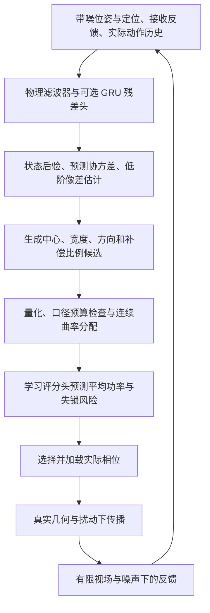

# RIS_ML：有限相位梯度预算下的预测驱动光斑整形与反馈残差补偿

设计日期：2026-11-07。适用工程：`RIS_phase`、`sea_wave`、`W_RIS`。实现与新增数据统一放在 `RIS_ML`。

## 1. 建议采用的整体方案

让机器学习选择“瞄准哪里、光斑多大、沿哪个方向展开、补偿多少实际误差”，再由现有相位梯度模型把这些策略编译为各受照单元的线性梯度、二次曲率和参考相位。

**核心研究问题：海浪与接收机运动造成状态不确定性时，如何在有限梯度和离散指令约束下，联合选择接收功率较高、失锁风险可控、能够实际执行的空间相位策略？**

建议统一为三项相互关联的内容：

| 研究内容 | 机器学习负责 | 相位梯度算法负责 | 可验证的改进 |
| --- | --- | --- | --- |
| 偏转—汇聚联合优化 | 选择目标中心、目标光斑形状，预测候选策略的功率和风险 | 量化线性指令，在单元口径内分配剩余曲率能力 | 优于先偏转、再整形及曲率超限直接清零 |
| 反馈式波前补偿 | 根据带动作记录的反馈序列，估计少数低阶残差及置信度 | 把残差转成线性项、曲率项和参考相位修正，并重新检查预算 | 优于开环，或以较少探测次数达到传统反馈优化效果 |
| 不确定性感知光斑调节 | 预测未来位置的均值、协方差，选择窄／宽／椭圆策略 | 合成对应二次相位，并检验实际传播结果 | 在相同功率和反馈开销下改善功率—失锁折中 |

机器学习的输出维度保持在个位数或十余维；40×40 个单元的实际加载量由物理层计算。其优势来自状态历史、实际反馈和复杂可行域中的策略选择。

### 1.1 推荐主次

主创新：**有量化约束的偏转—曲率联合分配**。

第二创新：**预测误差驱动的椭圆光斑控制，并把反馈残差补偿纳入同一梯度预算**。

附加研究：梯度余量感知的反馈探测、策略更新触发。多用户、多 RIS 和复杂多智能体控制暂列扩展，优先完成一个闭环系统。

## 2. 现有工程可以复用什么

### 2.1 已有能力

| 现有文件 | 当前功能 | 在 RIS_ML 中的用途 |
| --- | --- | --- |
| `RIS_phase/rp_command.m` | 每轴梯度限幅和 0.021° 参考指令量化 | 所有方法共用的实际指令转换 |
| `RIS_phase/rp_phase.m` | 目标分配、线性偏转、二维二次相位、全口径预算检查 | 新相位编译器的公式与数据结构基础 |
| `RIS_phase/rp_paraxial.m`、`rp_layer_path.m` | 精确分层中心光线与光程二阶矩阵 | 从接收位置／光斑形状映射到局部相位 |
| `RIS_phase/rp_trace.m` | 逐样本加载梯度、透射、全反射及落点 | 廉价可行性筛选和散射功率传播 |
| `RIS_phase/rp_wave.m`、`rp_pixel_intensity.m` | 有限孔径 Fresnel 传播、相干交叉项、像素平均 | 离线标签和高保真性能评价 |
| `RIS_phase/rp_reachability.m` | 固定入射下的传播、饱和和量化可达性 | 方向级预筛选；仍需后续孔径和曲率验证 |
| `sea_wave`、`wris_tx_motion.m`、`rp_rx_motion.m` | RIS、TX、RX 的动态轨迹 | 真值环境；另行生成带噪观测 |

现有算法已经把偏转与曲率放在同一相位模型中。新工作是在其上改变优化目标、曲率分配规则、状态输入和反馈闭环。

### 2.2 必须先处理的三个实际问题

**问题一：原优化目标是圆形覆盖，接收功率只是附带输出。**

`rp_design` 搜索覆盖中心和半径，`rp_snapshot` 按验证覆盖半径选优；`rp_footprint` 才计算固定 RX 孔径中的功率。RIS_ML 的主排序必须改为真实接收孔径积分，覆盖面积保留为辅助指标。固定强度阈值 `0.005 W/m²` 与接收功率门限 `P_min` 单位不同，后者需根据接收器要求单独设置。

**问题二：默认工况包含严重可达性限制。**

当前 `rp_config` 的每轴连续归一化梯度上限为

\[
B=n_a\sin 7.643^\circ\approx0.1330003.
\]

参考指令最大离散格点为 7.623°，对应 \(B_q\approx0.1326543\)。在固定水中入射 60°、方位角 `atan2(-sqrt(2),1)` 的例子中，

\[
\mathbf q_{in}\approx(0.665,-0.940452).
\]

局部法向出射要求 \(\mathbf b=-\mathbf q_{in}\)，远超器件边界；同时，用双轴极限指令可以把出射横向量模长降到约 0.9674，说明“有空气传播方向”和“能打到指定 RX”是两件事。该计算针对局部坐标，世界坐标目标必须经 `rp_geometry` 和分层路径转换。

已有 `results/summary.csv` 六帧记录的 RX 孔径功率均为 0，而覆盖圆心距 RX 可达数十米。这里的 0 是原有限绘图窗口上的积分值：接收孔径在窗口外时，现有积分也会给出 0，因此不能把它当作无限接收平面上的严格零功率证明。

实施时保留原工况作为饱和／失锁压力测试；另设经逐帧可达性验证的标称部署工况。RX 标称位置只在部署阶段确定，各算法共用相同位置和轨迹，不逐帧搬动 RX 迁就光斑。

**问题三：反馈补偿尚缺真实扰动接口。**

当前波动模型重建弹道复场，散射光作为非相干功率累加；它没有独立未知波前残差的时变模型。`phaseAtReferenceRad` 虽已保存，`rp_wave` 没有显式读取这个字段，其相位构造使用名义光程抵消后的表达。因此，仅改该字段不能证明波前补偿生效。后续需显式加入真实残差、已执行修正及跨单元参考相位差。

## 3. 统一的物理相位模型

### 3.1 保留现有线性＋二次相位

第 \(i\) 个受照单元以参考点 \(\mathbf r_i\) 展开，令 \(\boldsymbol\xi=\mathbf r-\mathbf r_i\)：

\[
\phi_i(\boldsymbol\xi)
=\phi_{0i}+k_0\left[\mathbf b_i^T\boldsymbol\xi
+\tfrac12\boldsymbol\xi^T\mathbf H_i\boldsymbol\xi\right],
\quad k_0=2\pi/\lambda.
\]

其中 \(\mathbf b_i\) 无量纲，\(\mathbf H_i\) 为对称矩阵、单位 m⁻¹。实际归一化梯度为

\[
\nabla\phi_i/k_0=\mathbf b_i+\mathbf H_i\boldsymbol\xi.
\]

它与现有 `gradientOverK0`、`phaseCurvature` 和 `referenceXY` 一一对应。设备命令角是梯度的空气标定参数，不能直接加到真实出射角上。

### 3.2 梯度预算的正确写法

整个透光口径上需要满足

\[
\left|b_{i,d}+\mathbf H_{i,d:}\boldsymbol\xi\right|\le B,
\quad d\in\{x,y\}.
\]

对矩形单元，线性函数的最大／最小值出现在四个角点。因此对四角逐轴检查可精确验证该二次相位的梯度边界。当前代码使用

\[
|b_{i,d}|+\sum_e|H_{i,de}|e_{i,e}\le B
\]

这一充分条件，\(e_{i,e}\) 含参考点偏离单元中心的裕量。新方案可以继续使用该快速保守检查，并以实际四角约束减少保守性。

**“分配有限相位梯度”具体指改变相位中的线性项和曲率项，使其总梯度满足同一个口径约束。** 两轴分别受限；不把器件能力解释为三个可随意相加的角度额度。

参考倾角继续调用 `rp_command` 量化。7.643° 的连续局部上限与 7.623° 的参考离散格点按现模型分别使用；未来若器件要求微电极级离散相位，需额外进行电极映射验证。

### 3.3 传播与能量约束

在现有理想模型中，出射横向量为

\[
\mathbf q_{out}=\mathbf q_{in}+\mathbf b_i+\mathbf H_i\boldsymbol\xi.
\]

若存在等效入射光程扰动 \(\Psi\)，再加入 \(\nabla\Psi\)。空气传播要求 \(\|\mathbf q_{out}\|<n_a\)，同时检查玻璃路径、顶面越界和世界坐标向上传播。实际传输使用 Fresnel 功率系数，保留散射、孔径裁剪和无效路径损失。

合法相位允许部分入射光损失；“全口径均不全反射”可作为保守策略选项，不能默认删除所有含局部全反射的候选。所有方法都按实际透射功率和 RX 捕获功率评分。

### 3.4 器件能力分层

本方案沿用当前代码的双轴独立梯度和单元内二次相位模型。参考器件论文已核实口径、波长和最大偏转角，尚不足以证明双轴独立调制、任意二维曲率及跨单元参考相位能够同时实现。仿真报告将“已标定线性相位模式”与“可编程二次相位模式”分开；后者需要电极级空间相位能力支撑。若只能加载线性相位，可研究多单元目标分配与波束重叠，但应按实际相干性和参考相位能力重新验证汇聚效果。

## 4. 创新方向一：偏转与汇聚联合优化

### 4.1 从“偏转优先”变为“目标中心—曲率—实际功率联合选择”

现有流程先确定线性指令，再尝试给每个单元加载完整曲率；曲率超限就保留合法线性相位。结果在边界附近容易从“能整形”直接变成“完全不整形”。

建议引入两个改动：

1. **目标中心允许小幅偏离预测 RX 均值。** 略微改变中心可能释放梯度余量，得到更好的聚光／扩束能力；以最终孔径功率评价这一交换。
2. **对各受照单元连续缩放曲率。** 通过部分曲率保留整形能力，避免全部清零。优先级由该单元的受照功率、RX 耦合贡献和反馈置信度共同决定。

这两点都是在现有相位族内改进，适合先做出清晰、可解释的结果。

### 4.2 与现有二阶光程公式的联系

现有 `rp_phase` 中，设入射光程 Hessian 为 \(\mathbf C_{in,i}\)，出射传播的二阶矩阵为 \(\mathbf A_i,\mathbf B_i\)，则总积分二次项为

\[
\mathbf M_i=\mathbf A_i+\mathbf C_{in,i}+\mathbf H_i.
\]

接收平面近似映射为

\[
\delta\mathbf y\approx\mathbf B_i^{-1}
\left[(\mathbf q_{in,i}+\mathbf b_i-\mathbf q_{out,i}^{des})
+\mathbf M_i\boldsymbol\xi\right].
\]

因此，目标中心改变偏转需求；\(\mathbf H_i\) 改变接收光斑的二阶形状。根据目标协方差求 \(\mathbf M_i\)，再令

\[
\mathbf H_i^{shape}=\mathbf M_i^{des}-\mathbf A_i-\mathbf C_{in,i}.
\]

第一版沿用 `rp_phase` 的矩阵构造，把标量圆盘半径换成正定目标协方差。该映射提供候选初值；衍射、干涉、量化偏移和裁剪后的实际宽度仍由波动传播检验。

**实现提醒：** 当前 `rp_wave` 要求 \(\mathbf M_i\) 正定；理想精确焦点可能对应零或近零二次项。第一版选择有限正宽度并检查该条件。后续扩展精确焦点或负曲率时，传播器应支持零／负特征值、按绝对曲率确定采样，并在奇异附近关闭不适用的逆矩阵去啁啾。不能只把目标半径设为零就宣称实现了衍射极限聚焦。

### 4.3 连续曲率分配

在无反馈版本中加载

\[
\mathbf H_i=\beta_i\mathbf H_i^{shape},\quad0\le\beta_i\le1.
\]

给定量化后的 \(\mathbf b_i\)，单个单元最大合法缩放 \(\beta_i\) 可通过角点不等式求出。带反馈时改为

\[
\mathbf H_i=\beta_i\mathbf H_i^{shape}-\gamma\widehat{\mathbf H}_{ab,i}.
\]

其中 \(\gamma\) 为反馈置信度控制的补偿比例，\(\widehat{\mathbf H}_{ab,i}\) 是估计的未知入射光程 Hessian。固定候选 \(\gamma\) 和最终量化线性项后，角点约束对 \(\beta_i\) 仍为线性不等式。第一版逐单元求合法区间；需要跨单元协调时，使用带平滑项的有界二次规划求暖启动，然后按实际功率重新排序。

这个预算子问题只保证加载合法。它的目标函数可取保留曲率的加权误差，但**最终系统目标仍是波动传播后的孔径功率与风险**，因为部分曲率和单元间干涉并非总是单调有利。

例如某轴 \(b=0.12\)、单元半宽 7.2 mm、参考点居中且无交叉曲率，则连续上限下剩余同轴曲率约为

\[
|H|\le(0.1330003-0.12)/0.0072\approx1.806\ \mathrm{m}^{-1}.
\]

超过该值的理想曲率仍可能以部分比例执行。这是对现有“超限即清零”规则的直接改进。

### 4.4 机器学习输出的策略

建议每个候选策略写成

\[
\mathbf a=[\delta_x,\delta_y,\log w_1,\log w_2,\psi,\gamma].
\]

前两项表示相对预测位置均值的瞄准偏置；\(w_1,w_2\) 为目标 1/e² 主轴半径；\(\psi\) 为长轴方向；\(\gamma\in[0,1]\) 为反馈补偿比例。无反馈阶段固定 \(\gamma=0\)。圆光斑令 \(w_1=w_2\)，此时方向角不再作为有效自由度。

\(\beta_i\) 由物理编译器结合各单元预算计算，机器学习不直接输出全部单元的缩放量。记录执行后的实际光斑二阶矩，防止把请求宽度误当成可实现宽度。

## 5. 创新方向二：反馈式低阶波前残差补偿

### 5.1 第一版学习什么

首先识别低阶等效光程扰动：慢变离焦、两种像散，以及几何／入射标定残差。它们可以代表液晶标定误差、窗口形变或慢变低阶折射扰动。

全局倾斜残差由指向／状态估计模块统一管理。第一版波前头只估计离焦与两种像散，避免把同一个倾斜误差同时交给瞄准策略和补偿网络。

令 \(u=(x-x_c)/R_0,v=(y-y_c)/R_0\)，采用矩形受照区域上的低阶基函数

\[
\Psi(\mathbf r,t)=c_d(t)(u^2+v^2)
+c_a(t)(u^2-v^2)+c_b(t)2uv.
\]

\(c_d,c_a,c_b\) 为光程长度，单位 m；相位误差为 \(k_0\Psi\)。这些多项式与 Zernike 低阶模式相近，实际正交化采用受照功率权重，避免直接假定当前离散矩形孔径满足圆形 Zernike 正交条件。

通过随机过程生成缓慢变化的真实系数，并保留独立测试种子。系数幅度以相位 RMS 和最大梯度同时表征，先做灵敏度扫描，再确定工况；未经数据标定时称为“低阶等效扰动场景”。

### 5.2 修正如何进入现有相位

在每个单元参考点进行展开：

\[
\Psi(\mathbf r_i+\boldsymbol\xi)=\Psi_i
+(\nabla\Psi_i)^T\boldsymbol\xi
+\tfrac12\boldsymbol\xi^T\mathbf H_{ab,i}\boldsymbol\xi.
\]

机器学习输出 \(\hat{\mathbf c}\) 及其不确定性，相位编译器计算

\[
\mathbf b_i=\operatorname{rp\_command}
\left(\mathbf q_{out,i}^{des}-\mathbf q_{in,i}^{nom}
-\gamma\nabla\widehat\Psi_i\right),
\]

\[
\mathbf H_i=\beta_i\mathbf H_i^{shape}-\gamma\widehat{\mathbf H}_{ab,i},
\quad
\phi_{0i}=\phi_{0i}^{nom}-k_0\gamma\widehat\Psi_i.
\]

先组合线性补偿再量化，然后计算合法曲率；补偿也占用器件梯度。三类修正来自同一个光程函数，以保持单元间物理一致性。全局共同 piston 不改变强度，作为固定规范去除。

反馈离焦与策略光斑宽度具有耦合。用“已知加载动作＋多次探测＋时间先验”估计扰动系数，再由策略层选择目标宽度；不把同一个自由离焦同时交给两个独立控制器。

### 5.3 图像反馈与功率反馈分开实现

| 反馈条件 | 可用观测 | 推荐实现 |
| --- | --- | --- |
| 成像或小阵列探测 | 有限视场光斑、质心、二阶矩、分支功率、图像有效标记 | 小型序列网络估计低阶残差；必要时用正负离焦探测区分符号 |
| 只有总功率 | 已执行策略、功率序列、少量正负扰动反馈 | 学习暖启动＋SPGD／SPSA 类低维修正，以功率改进为评价 |

单幅强度图通常不唯一确定相位；单次总功率也不足以识别多维像差。采用“带已知探测动作的反馈序列”缓解可辨识性问题。若相机只看到截断光斑，应保留视场截断、低信号和无检测标记，不能默认获得全平面质心和宽度。

功率反馈版本，令低维补偿参数为 \(\mathbf c\)，随机方向 \(\mathbf d\) 的每维取 ±1，执行两个合法探测动作：

\[
P_+=P(\mathbf c+\epsilon\mathbf d),\quad
P_-=P(\mathbf c-\epsilon\mathbf d),
\]

\[
\widehat{\nabla P}=\frac{P_+-P_-}{2\epsilon}\mathbf d,
\quad\mathbf c\leftarrow\mathbf c+\eta\widehat{\nabla P}.
\]

网络提供初始补偿或更新步长。若投影／量化使正负实际动作不对称，应使用实际扰动重新估计方向导数或放弃该次更新；两次实际加载相同也不能形成有效梯度。探测间海浪状态变化和衰减波动需要用交替探测顺序、局部时间模型或可用的入射功率监测抑制，且计入探测时间和数据光损失。

### 5.4 真值与控制器严格分离

真值端保存 \(g_t^{true},\Psi_t^{true}\)，根据已经加载的相位传播；控制端只看到带噪位姿／定位、历史动作及测量反馈。仿真中的真实像差系数可以作为离线监督标签，部署时不能作为输入。

对于估计几何设计的相位，真值传播时应固定其实际加载的局部相位多项式，再按真实几何重建入射与传播光程。不能让预测几何中的 `p.outgoing` 和名义相位抵消关系直接替代真实传播，否则预测误差会在仿真中被意外抵消。

真实 \(\Psi\) 的局部常数项、梯度和 Hessian 应同时进入弹道复场及相应的光线映射；补偿加载量单独记录。像差样本必须在比较不同控制方法时共用。

**适用边界：** 当前散射光没有光程相位，只能按非相干功率传播。低阶波前补偿首先作用于相干弹道成分，不能据此宣称恢复了水下全部多重散射光。

## 6. 创新方向三：根据预测误差选择光斑尺寸与形状

### 6.1 预测一个位置分布

学习器预测控制生效时刻的位置分布

\[
\mathbf r_{RX,t+\tau}\mid\mathcal H_t
\sim\mathcal N(\boldsymbol\mu_t,\mathbf\Sigma_{RX,t}).
\]

同时估计 RIS 姿态和入射几何误差。局部近似下，将它们通过落点 Jacobian 转为接收平面的联合误差协方差

\[
\mathbf\Sigma_e\approx\mathbf J\mathbf\Sigma_s\mathbf J^T
+\mathbf\Sigma_{res}.
\]

状态向量包含 RX、RIS 和相关几何量，协方差保留交叉相关；接近掠射／可达性边界时改用共同场景采样，避免 Jacobian 线性化失准。

候选椭圆光斑协方差为

\[
\mathbf S_b=\mathbf R(\psi)
\operatorname{diag}(w_1^2/4,w_2^2/4)\mathbf R(\psi)^T.
\]

沿误差较大的主轴适度展开，较小误差方向保持窄束，有机会比同面积圆光斑捕获更多功率。该方向同时受单元余量、斜入射几何和出射约束影响，最终角度由实际功率优化确定。

### 6.2 “误差大就扩束”需要正确目标支撑

对于总功率固定、圆对称高斯光斑、无偏各向同性位置误差，设单轴误差标准差为 \(\sigma_e\)、RX 孔径半径为 \(a\)、光斑 1/e² 半径为 \(w\)，平均捕获功率存在解析检验式：

\[
\frac{\mathbb E[P_{RX}]}{P_T}
=1-\exp\left[-\frac{a^2}{2\sigma_e^2+w^2/2}\right].
\]

在这一简化模型中，增大 \(w\) 反而降低平均捕获功率。因此应把用户关心的接收功率最大化写成**可靠性约束下的平均功率最大化**：

\[
\max_{\mathbf a}\ \mathbb E[P_{RX}(\mathbf a)]
-\lambda_\Delta C_{update}(\mathbf a)
-\lambda_f C_{probe}(\mathbf a),
\]

\[
\text{s.t.}\quad
\Pr\{P_{RX}(\mathbf a)<P_{min}\}\le\varepsilon,
\quad \phi(\mathbf a)\in\mathcal F_{device}.
\]

没有可靠性要求的实验令风险约束关闭，接受窄束仍然最优的结果。若可靠性约束不可行，先选择估计中断概率最低的合法策略，并明确记录风险约束违约。

窄光斑提高对准时功率，适度加宽可能降低远偏移时的中断风险，过宽又会使整个光斑功率密度不足。小孔径近似

\[
P(d,w)\approx P_T\frac{2a^2}{w^2}e^{-2d^2/w^2}
\]

给出固定大偏移 \(d\) 下约 \(w^2=2d^2\) 的最优宽度，仅用于候选初值；当 \(a\) 与 \(w\) 相当时直接积分，不能继续套用小孔径近似。

### 6.3 最小可实现的自适应策略

先采用三类候选：窄圆光斑、宽圆光斑、沿误差主轴的椭圆光斑。宽度下限由衍射、采样和指令量化共同确定，上限由功率门限、可行曲率和接收视场确定。

置信椭圆主轴用于初始化候选；机器学习预测每个候选的平均功率和失锁风险，在约束内选优。先完成离散候选版本，再增加连续半径和方向回归。

当前 0.021° 指令步长，在正入射、5 m 传播距离下对应约 1.83 mm／步的落点尺度；掠射时灵敏度会显著增加。该值是量级说明，实际候选间距通过精确 Jacobian 和量化后传播决定。

## 7. 学习结构与训练方法

### 7.1 推荐第一版：概率预测＋候选策略评分

采用轻量混合结构：



机器学习通过对低维候选排序预测最佳策略；确定性编译器负责将策略变为实际相位。候选先经廉价可行性筛选，避免浪费网络容量学习明显无效动作。

状态头从过去数据预测，评分头可以使用当前候选的量化误差、余量分位数、受照功率分布摘要等可计算特征。没有实际传感器提供的入射功率／照明分布，只能使用模型估计及其误差，不能读取 MC 真值充当观测。

### 7.2 公平的预测基线

现有 RX 为 OU 过程。参数已知、观测为线性高斯时，Kalman／OU 条件预测是强基线，GRU 不应被预设为一定优于它。

第一版先用 OU/Kalman 预测建立完整闭环。机器学习主要学习候选策略价值及低阶反馈残差；预测残差头在存在参数漂移、非平稳机动或非线性观测的场景中评估增益。这些扩展场景需要明确写入数据生成器并单独报告。

预测生效时刻采用系统实际时序；延迟只是工况变量。当前运动时间步长为 50 ms，不能靠插值生成更细的随机扰动来证明毫秒级预测优势。

### 7.3 离线标签如何得到

每个训练时刻只根据 \(\mathcal H_t\) 建立后验，再抽取可能状态场景。对每个候选动作：

1. 用估计状态生成并量化实际加载相位；
2. 在每个真实场景中固定该加载相位进行传播；
3. 对真实 RX 孔径积分，得到功率样本；
4. 计算条件平均功率、门限以下比例、低尾功率和反馈开销；
5. 用相同约束选择候选最优策略。

标签为候选集中的最佳策略和各候选性能，记为 `candidate_best`。使用未来真实轨迹直接优化得到的结果单列为 `oracle`，只用于性能参照，不充当部署控制器的输入。

每个工况保留原始相位、实际指令、可行性证书和功率账本，便于检查“高分动作是否真的能执行”。

### 7.4 学习损失与约束

位置分布头采用二维高斯负对数似然，协方差由 Cholesky 参数化保证正定，并在独立验证集校准覆盖率。仅当近似合理时使用单高斯；多峰失锁场景由场景／混合模型表达。

评分头采用平均功率回归＋门限风险学习＋候选排序损失。可写为

\[
\mathcal L=\lambda_p\mathcal L_{power}
+\lambda_o\mathcal L_{outage}
+\lambda_r\mathcal L_{ranking}
+\lambda_s\mathcal L_{state}.
\]

不直接平均多组等价相位标签。角度采用周期表示；椭圆半径按长短轴排序，并在近圆时弱化方向角监督。

策略选择时对失锁概率使用经校准的保守估计；有限场景中“零次失锁”不能视为真实风险为零。样本量不足时输出不确定／证据不足，而非颁发可靠性保证。

例如在固定策略、独立同分布测试中，零失锁的单侧 95% 二项上置信界为 \(1-0.05^{1/N}\)；验证其低于 1% 至少需 299 个独立样本。相邻相关帧、反复测试同一场景和参与候选选择的样本不直接满足这个条件，应另外使用独立 episode 做最终可靠性评估。

### 7.5 是否使用强化学习

推荐先用监督候选评分完成第一阶段。只有在反馈探测会影响未来观测、补偿需要跨时刻积累时，再增加一个低维循环 PPO 或其他连续控制版本，与监督版本公平比较。

奖励使用实际孔径功率、失锁代价和探测开销。反馈不可辨识部分由历史状态处理。网络大小、算法名称和注意力模块属于实现选择，论文创新归于约束耦合与闭环机制。

## 8. 接收功率评价器的最小改造

### 8.1 固定物理 RX 孔径

每个场景在实际接收位置 \(\mathbf r_{RX}^{(s)}\) 上积分

\[
P_{RX}^{(s)}=\int_{\mathcal A(\mathbf r_{RX}^{(s)})}
I(\mathbf y;\phi,\text{true state})\,d\mathbf y.
\]

计算窗口覆盖 RX 孔径及所需误差场景；必要时单独对 RX 局部区域细化。候选光斑中心可以改变，物理 RX 位置不可随候选移动。窗口外功率与真实零功率分别记账。

像素与圆孔径相交采用面积权重或局部过采样，检验积分收敛。分辨率标准围绕最小 RX 孔径和衍射／干涉尺度确定，原有“覆盖圆至少四像素”规则不能替代孔径积分收敛检查。

纯 RX 位置变化、传播平面不变且无接收角变化时，可以复用同一已加载相位的光强图，对不同孔径位置积分。RIS 姿态、入射场或像差改变时，需重新传播或使用经独立验证的代理。

### 8.2 相位真实执行与数值一致性

所有动作先量化、预算检查，再求功率；训练标签、测试和反馈使用同一执行规则。梯度检查针对未包裹相位；加载相位可模 2π，不能对包裹后的跳变直接求差分作为物理梯度。

`rml_wave` 需要显式接受真实扰动和已执行参考相位。若采用现有 `rp_wave` 派生实现，保留来源、记录源文件指纹；仅在新目录中修改。名义零扰动时先复现原结果，再检查已知低阶像差与其反向补偿能否恢复基准。

### 8.3 分集接收扩展

当前 `RIS_phase` 为单孔径，第一版用它闭合问题。若接入毕业设计中的空间／角度分集，各分支必须共享同一光场和运动场景，使用固定总接收面积、明确的光学分光和电子合并规则。

重叠光瞳先划定实际捕获／分光归属，避免重复计算光子功率；共享海浪和姿态误差保留分支相关性。SNR 与合并性能在确定探测噪声模型后计算，不能把各分支功率简单重复累加当作分集增益。

## 9. 其他值得研究的方向

### 9.1 可达性边界感知的椭圆光斑与偏置瞄准（优先）

误差椭圆与梯度可行域可能方向不同。选择稍微偏移的瞄准中心，并把长轴朝向高误差、低梯度成本的方向，可以同时保留偏转余量和可靠性。

对比“固定圆”“仅按协方差展开的椭圆”“联合优化中心与椭圆方向”三组。报告收益随入射角、量化步长和每轴余量变化的规律。这一扩展与前述三方向共用全部核心模块，实施成本最低。

### 9.2 梯度余量感知的主动反馈探测（第二阶段）

探测模式也占用梯度。根据可执行扰动幅度、测量噪声和像差后验，选择信息量较高、短时功率损失较小的模式。可用局部观测敏感度形成初值：

\[
\mathbf F\approx\mathbf J_{obs}^T\mathbf R_{noise}^{-1}\mathbf J_{obs}.
\]

在预计可获得的协方差缩减与通信功率损失之间选择是否探测。功率反馈下区分“学习控制动作”与“学习产生有效观测的探测动作”。先实现基于置信度的规则，再与可学习探测策略比较。

对照实验按相同探测次数、探测占空比和接收数据功率比较，防止收益来自更多测量。

### 9.3 收益触发的策略更新（可选）

以预计功率／风险改进超过更新成本且置信度足够为更新条件。目的在于减少无效重配置与反馈开销。延迟敏感性单独扫参，不把毫秒级延迟预设为主要创新。

### 9.4 空间子阵与高阶像差（后续扩展）

若低阶全局补偿不足，可对少量受照子阵建立共享残差系数。只有测量可辨识性和数据量支持时增加维度。三阶及以上相位需要修改孔径场和采样／梯度认证，不能直接塞入现有 2×2 Hessian。

## 10. RIS_ML 的拟实现接口

以下为后续模块规划，本次未创建这些 MATLAB 文件。

| 新增文件 | 输入与输出 | 与现代码关系 |
| --- | --- | --- |
| `rml_config.m` | 继承 `rp_config`，设置风险门限、传感器、策略候选和数据划分 | 所有输出、缓存重定向到 RIS_ML |
| `rml_build_episode.m` | 轨迹种子 → 真值状态、传感器观测、扰动序列 | 复用 sea_wave／W_RIS／RX 运动模型 |
| `rml_observe.m` | 真值传播与传感器模型 → 允许的反馈 | 屏蔽真值字段；保存实际执行动作 |
| `rml_predict.m` | 历史观测 → 状态均值、协方差、残差后验 | OU/Kalman 基线＋可选 GRU 残差 |
| `rml_candidates.m` | 后验与预算 → 低维候选 | 中心、圆／椭圆宽度、方向、补偿比例 |
| `rml_phase.m` | 估计几何、照明估计、候选、残差估计 → 已加载相位与证书 | 继承 `rp_phase` 的分层路径与二阶相位公式，调用 `rp_command` |
| `rml_budget.m` | 最终量化线性项、候选曲率 → 合法缩放和余量 | 替换曲率全有／全无判定；四角约束 |
| `rml_wave.m` | 真值几何、固定加载相位、真实扰动 → RX 区域光场／功率 | 基于 `rp_wave` 扩展，处理参考相位和真实光程 |
| `rml_rx_power.m` | 光场、固定实际孔径／分支 → 捕获功率和积分误差 | 替代覆盖半径主排序 |
| `rml_teacher.m` | 后验与候选 → 功率／风险标签、候选最优动作 | 粗筛＋高保真复核，记录求解预算 |
| `rml_train.m`、`rml_policy.m` | 训练集 → 模型；历史与候选 → 策略评分 | 第一版监督候选排序 |
| `rml_feedback.m` | 动作—反馈序列 → 残差估计／探测动作 | 图像与功率模式分别实现 |
| `run_ris_ml.m`、`rml_report.m` | 固定配置 → 闭环评估与统一报告 | 独立运行，不覆盖旧结果 |

建议相位输出继续保留 `unitIds/referenceXY/gradientOverK0/commandDeg/phaseCurvature/phaseAtReferenceRad`。另加 `beta`、`feedbackScale`、`cornerMargin`、`requestedShape`、`realisedShape` 和 `status`。

建议数据结构明确分成 `truth`、`observation`、`belief`、`requestedAction`、`executedPhase`、`measurement`。策略函数只接受后三者中获准的历史与当前后验，防止把 `truth` 整个结构传入网络。

## 11. 每一控制周期的执行逻辑

```text
1. 读取截至当前时刻已到达的传感器观测和反馈。
2. 估计 RX/RIS 状态、预测误差协方差及低阶像差后验。
3. 生成保持动作、窄圆、宽圆和少量椭圆／偏置中心候选。
4. 对每个候选运行分层路径、组合补偿、参考指令量化、曲率分配。
5. 丢弃加载非法的动作，保留传播失效的诊断和功率损失记录。
6. 用学习器估计候选平均接收功率与风险，必要时保守复核前几名。
7. 在满足风险门限的候选中选平均功率最高者；若全不满足，选风险最低者并记违约。
8. 加载相位，按真实几何和真实残差传播，产生有噪反馈。
9. 按探测预算更新残差估计；下一周期继续。
```

保持前一加载相位也是候选。保持动作应在当前真实／预测状态下重新评价，不能沿用上一次功率分数。新动作在实际生效时刻进入真值环境，历史反馈按原执行动作解释。

全保真 FFT 主要用于离线标签和验证。部署推理只执行小型网络、候选编译与快速约束检查；任何在线高保真复核次数均计入运行时间。目标是否达到实时要求由实际测试决定。

## 12. 对照、消融与评价指标

### 12.1 必须保留的对照组

| 方法 | 用途 |
| --- | --- |
| B0：现有最大圆形覆盖算法 | 展示覆盖目标与孔径功率目标的区别；作为历史参照 |
| B1：当前状态＋固定窄束／固定宽束 | 基础性能范围 |
| B2：先偏转再整形，曲率超限清零 | 直接比较预算分配创新 |
| B3：OU/Kalman＋同候选集物理优化，无学习 | 判断学习是否带来速度、模型失配适应或反馈收益 |
| B4：OU/Kalman＋固定规则自适应宽度 | 判断学习策略优于简单规则的条件 |
| B5：低阶 SPGD/SPSA 反馈，无学习暖启动 | 判断补偿学习收益是否来自更少反馈／更快恢复 |
| O：真值状态／像差已知的离线候选优化 | 参照性能；部署方法不使用其额外信息 |
| Proposed：概率策略评分＋连续预算分配＋反馈补偿 | 完整方案 |

B0 的原始目标不同，因此主要算法优势应相对 B2—B5 证明。学习方法可能接近离线教师而加速，不能预设其功率一定超过同候选集充分搜索的教师。

### 12.2 关键消融

分别关闭预测、关闭协方差输入、圆形替代椭圆、固定中心替代偏置中心、曲率连续缩放替代清零、关闭残差补偿、关闭主动探测。先比较 A=联合预算，A+B=不确定性整形，A+B+C=反馈闭环，再按需要细分。

反馈增益同时在零像差和非零像差场景下报告；零像差场景应检验是否出现无效探测或错误修正。协方差失配单独验证过度自信对窄束失锁的影响。

### 12.3 指标

主指标：平均接收功率、功率第 5 百分位／低尾均值、中断概率、最长连续失锁时间。

辅指标：每轴梯度余量、饱和单元功率占比、实际保留曲率比例、实际光斑二阶矩、预测误差与置信覆盖率、反馈次数／占空比、恢复时间、推理与编译时间。

保留 TX→RIS 入射功率→有效透光功率→界面损失→RX 捕获功率账本。相干有限窗口积分和全局能量守恒分别验证；统计置信区间按独立 episode／海浪种子计算，不能把高度相关的相邻帧当作独立样本。

### 12.4 工况矩阵

| 因素 | 起步设置 | 扩展验证 |
| --- | --- | --- |
| 可达性 | 内域、边界、不可达各一组 | 入射角／方位角扫描；原 60° 工况保留 |
| 海况 | 继承当前 3、5 m/s 工况 | 未见风速与风向；固定物理参数对照 |
| RX 不确定性 | OU 原模型，多个误差尺度 | 参数漂移、机动、偏置与反馈丢失 |
| 像差 | 零扰动及低阶慢变扰动 | 未见系数、相关时间和组合模式 |
| 设备 | 7.643°、0.021° 当前模型 | 梯度范围、量化步长、可用相位族敏感性 |
| 反馈 | 功率；小阵列／图像分别评估 | 读出噪声、有限视场、探测开销 |
| 风险目标 | 先设可行的 P_min、ε | 功率—中断 Pareto 曲线，含关闭风险约束 |

设置多个门限，避免只选对本方法有利的可靠性点。不可达组如实展示残余失锁，不用大范围光斑中心搜索的覆盖结果替代实际 RX 功率。

## 13. 数据规模、算力和防泄漏设计

六个静态快照适合做核查，不能支撑时间序列学习。新增数据按完整 episode 生成，并按海浪种子、轨迹种子和扰动种子整段划分训练／验证／测试。所有归一化、协方差校准和超参数选择只使用训练／验证集。

建议先做 10—20 个短 episode 的工程闭环，每帧约 10—30 个候选做廉价筛选，仅前 2—4 个进行全波动复核。这些是开发起点，数据量是否足够根据学习曲线决定。高精度教师在小型独立子集上扩大候选和场景数，检查粗筛漏掉优质策略的程度。

降低标签成本优先采用：复用同一入射 MC、复用同一已加载相位下的多位置孔径积分、对可达性边界和候选分数接近处补充标签。改变真实 RIS 位姿或入射场时，不直接平移旧 MC 结果冒充新物理样本。

所有方法在测试时共享真值轨迹、噪声序列和扰动序列；反馈探测由于动作不同形成不同测量，仍使用同分布且可复现的噪声流。分别报告离线训练／标签成本和在线延迟。

**当前依赖缺口：** `rp_mc` 需要 `risa_water_mc`，`rp_setup` 预期邻目录 `RIS_A`；当前 code 工作区未找到这一源文件。已有 MAT／结果可做旧模型核查，新工况 MC 与训练数据生成应先恢复依赖，或实现并独立验证替代 MC。只改路径不能补齐缺失的物理模型。

## 14. 分阶段实施与完成标准

| 阶段 | 工作 | 完成标准 |
| --- | --- | --- |
| S0：基准整理 | 固定部署、核查可达性、恢复 MC、建立真实 RX 孔径积分 | 能区分不可达、窗口截断与真实弱功率；基准结果可复现 |
| S1：物理联合策略 | 椭圆相位初值、四角检查、连续曲率、中心偏置搜索 | 所有加载合法；对 B2 的功率／失锁曲线可解释 |
| S2：概率策略学习 | OU/Kalman、监督候选评分、独立数据划分 | 相对物理教师的差距与运行时间明确；风险预测经校准 |
| S3：反馈补偿 | 真实低阶扰动、相位执行接口、SPGD、学习暖启动 | 已知反向补偿恢复基准；同反馈预算下比较闭环收益 |
| S4：完整验证 | 因素扫描、消融、未见工况、统计区间 | 能说明每个模块的贡献、失效条件与额外成本 |

建议论文两章：第一章“有限梯度下的偏转—整形联合优化”，包含预算模型、连续曲率和有限孔径评价；第二章“动态环境下的概率策略学习与反馈残差补偿”，包含概率状态、椭圆策略、反馈学习和闭环实验。

首轮原型优先完成 S0—S2，已能回答“学习策略、梯度生成相位”的核心问题；S3 在此基础上形成第二部分的闭环深度。

## 15. 创新表述与证据范围

拟验证贡献可写成：

> 针对动态海面透射 RIS 的有限相位梯度与参考指令量化约束，构建预测后验驱动的低维光斑策略空间，通过连续曲率分配联合调整偏转与整形能力，并利用接收反馈估计低阶等效波前残差，实现可靠性约束下的接收功率优化。

贡献能否成立，由三条证据决定：连续分配相对清零／串行设计的收益；概率椭圆策略相对固定束宽和物理规则的收益；同反馈预算下学习残差补偿的恢复能力。文献已分别研究光学 IRS 聚焦、学习调节指向与发散角以及无波前传感反馈控制，具体差异与来源见 [文献与代码依据](文献与代码依据.md)。

本方案完成了研究设计与接口规划。性能提升幅度、运行时间和可发表的新颖性需要后续实验及更全面的同题文献比对确定；本次数值仅包括已有结果读取与解析公式核算。
