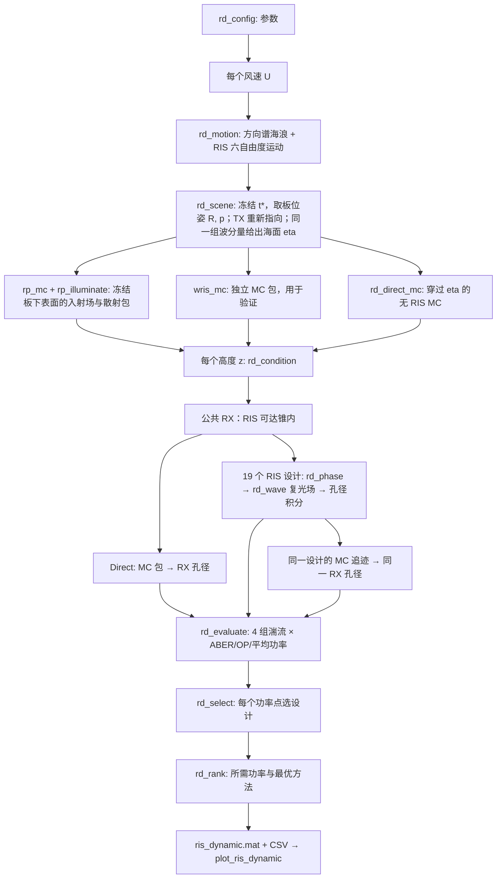

# RIS_dynamic v4：冻结粗糙海面下 RIS 调制与无 RIS 直达链路的对比

本文说明三件事：这一版改了什么、算法每一步怎么算（含公式），以及每张图的仿真条件和含义。代码入口为 `main_ris_dynamic.m`，运行方法见 `README.md`。

---

## 1. 本版改了什么

### 1.1 与上一版（v3，逐帧时间平均）的区别

| 项目 | v3 | v4（本版） |
|---|---|---|
| 时间处理 | 30 s 运动记录，每 0.5 s 一帧，帧间平均 | **只冻结一个时刻** $t^\*$（默认 15 s），所有方案在同一冻结海面上计算 |
| RIS 相位 | 静水中设计，冻结后不再改变 | **按冻结时刻的板位姿重新设计**，所有方案都瞄准同一个接收机 |
| RIS 链路的计算 | 光子包几何追迹（MC） | **复光场公式**（弹道光的 Fresnel/CZT 衍射 + 散射光），MC 只用来验证 |
| 无 RIS 直达链路 | MC（粗糙海面） | MC（粗糙海面），不变 |
| 接收机 | 每条链路各自对准自己的光斑质心 | **五条链路共用一个 RX**：同一位置、同一视轴、同一组抖动/角误差样本 |
| RX 高度 | 7.5、10 m | **10、20、30、50 m**（主条件 30 m），从静水时的 RIS 中心起算 |
| 风速 | 3–6 m/s 和静水 | **3、9、12 m/s**（主条件 9 m/s） |
| 方案 | 另有“海况感知宽度选择”和入射角扫描 | 只保留 Direct、Steering-only、Flat top、Robust ABER/OP、Max mean power 五个方案 |
| 新增输出 | — | 复光场与 MC 的逐设计对比（Fig6），以及达到目标所需功率与最优方法的判定（Fig7、`ranking.csv`） |

### 1.2 删除的旧代码

以下文件已删除，功能已不再需要或已被新文件替代：

- **计算**：`rd_design`、`rd_train`、`rd_pilot`、`rd_links`、`rd_flat_surface`、`rd_static_motion`、`rd_poses`、`rd_frame_keys`、`rd_schemes`、`rd_slim_phase`、`rd_spot`、`rd_entry_table`、`rd_metrics`。
- **画图**：`rd_fig_at`、`rd_fig_cdf`、`rd_fig_curves`、`rd_fig_incidence`、`rd_fig_timeseries`、`rd_fig_width`、`rd_fig_wind`、`rd_fig_wind_label`。

`RIS_phase`、`W_RIS`、`sea_wave` 中的文件一个都没有改。

---

## 2. 总流程

**参数网格**：

- 风速 $U\in\{3,9,12\}$ m/s，每个风速冻结一个时刻。
- RX 高度 $z\in\{10,20,30,50\}$ m，共 12 个条件。
- 每个条件有 1 个 Steering-only 设计，以及 Flat top 和 Robust 两族各 9 个宽度（4–30 cm），共 19 个 RIS 设计。

---

## 3. 算法详解

### 3.1 海况与冻结时刻（`rd_motion`、`rd_scene`）

每个风速 $U$ 生成一个方向海浪谱（`sea_wave/RIS_wave_components`：Neumann 谱 + $\cos^2$ 扩展），风向 50°。随机波相位种子为 600。海面高度场是有限个波分量之和：

$$
\eta(x,y,t)=\Re\sum_{n}a_n\,e^{\,i\left[\omega_n(t_0+t)-k_{x,n}x-k_{y,n}y\right]} .
$$

**同一组** $\{a_n,\omega_n,\mathbf k_n\}$ 同时用于两件事：

1. 驱动 1 m×1 m 浮板的六自由度运动（`RIS_float`）；
2. 给出无 RIS 链路所穿过的海面 $\eta(x,y,t^\*)$。

因此两条链路看到的是**同一个海况、同一个时刻**。

取运动记录中最接近 $t^\*=15$ s 的时刻 $k$，冻结以下量：

- 板的旋转矩阵 $R=R(t^\*)$；
- 下表面中心 $\mathbf p_b=\mathbf p_b(t^\*)$；
- 海面 $\eta(\cdot,\cdot,t^\*)$。

板的倾角、升沉、水平偏移、海面坡度、有效波高都保存在 `R.cond(iz,iw).pose` 中，并在运行时打印出来。

**发射机（TX）**：位置固定，位于静水板下表面中心的斜下方 10 m 处，水中入射角 40°（RIS_phase 主协议）。`c.tx.trackBoard = true` 时，TX 把光轴转向冻结时刻的下表面中心：

$$
\hat{\mathbf d}_T=\frac{\mathbf p_b(t^\*)-\mathbf p_T}{\|\mathbf p_b(t^\*)-\mathbf p_T\|},\qquad
R_T=\mathcal R(\hat{\mathbf d}_{T,0}\!\to\!\hat{\mathbf d}_T)\,R_{T,0},
$$

其中 $\mathcal R$ 是把 $\hat{\mathbf d}_{T,0}$ 转到 $\hat{\mathbf d}_T$ 的最小旋转（Rodrigues 公式）。

这样处理的原因：9–12 m/s 时有效波高为 1.5–3 m，若 TX 不跟踪，10 m 斜程上的光束会离开 1 m 的板。无 RIS 链路用的是**同一个** TX 位姿。

### 3.2 公共接收机的位置（`rd_rx_direction`、`rd_condition`）

**RX 平面高度**：从静水时 LC 屏中心起算，

$$
Z_R=p_{b,Z}^{\mathrm{calm}}+h_i+z .
$$

即题目中的“初始 RX 平面距 RIS 中心 $z$”。冻结时刻板的升沉不改变 $Z_R$，RX 是固定的。

**RX 水平位置**：每个 LC 单元的出射横向波矢为 $\mathbf q=\mathbf q_{\mathrm{in},m}+\mathbf b$，其中每轴 $|b_d|\le B=\sin 15.414^\circ=0.2658$。所有单元（去掉 $10^{-5}$ 的功率尾）都能到达的方向，构成每轴一个区间（RIS_phase 式 47）：

$$
l_d=Q_{1-\epsilon}\left(q_{\mathrm{in},d}-B\right),\qquad
h_d=Q_{\epsilon}\left(q_{\mathrm{in},d}+B\right),\qquad \epsilon=\frac{10^{-5}}{4}.
$$

这里 $Q$ 表示按单元弹道功率加权的分位数。取该区间中最接近板法向的点，再向区间内移动 $\eta_{\mathrm{rx}}=0.03$：

$$
q_{0,d}=\operatorname{clip}(0,l_d,h_d)\pm\min\!\left(\eta_{\mathrm{rx}},\tfrac{h_d-l_d}{2}\right).
$$

从 LC 中心沿 $\mathbf q_0$ 出射的光线与 $Z=Z_R$ 的交点，就是 RX 中心 $\mathbf x_{\mathrm{RX}}$。

**为什么这样放**：

- RIS 的最大偏转角有限，RX 必须放在 RIS 能照到的范围内，题目要求的正是这一点。
- 0.03 的余量让 Flat top / Robust 在展宽光斑时，边缘单元不会被限幅。

默认 `c.rx.placement='frozen'`，即按冻结时刻的板计算可达锥。若改为 `'calm'`，则按静水板计算，此时 RX 与风速无关，但大风下部分单元可能限幅。

**数值量级**：静水时水中 $q_{\mathrm{in}}=1.33\sin40^\circ=0.855$，方位角 −54.7°，可达锥最靠近法向的一侧约偏离法向 30°。无 RIS 时折射光偏离竖直方向 $\arcsin0.855=58.8^\circ$。所以在 $z=30$ m 处，RX 与无 RIS 直射光斑相距约 30 m，直达链路在 RX 处只能收到粗糙海面折射和水中散射带来的少量光。这是“收多少算多少”的正常结果。

**RX 视轴**：从 $(\mathbf p_{b,xy},\,p_{b,Z}+t_g)$ 指向 $\mathbf x_{\mathrm{RX}}$（与 `rp_aperture_channel` 相同）。五条链路共用同一个 RX、同一视轴、同一组 8192 个 Sobol 抖动和角误差样本（`rp_link_samples`），统计上是**成对比较**。

### 3.3 五个方案

| 编号 | 方案 | 计算方法 | 设计自由度 | 优势 |
|---|---|---|---|---|
| 1 | Direct (no RIS) | MC | 无，光照到哪就收到哪 | 基准 |
| 2 | Steering-only | 复光场（MC 验证） | 一个全局方向 | 只负责把光束对准 RX |
| 3 | Flat top | 复光场（MC 验证） | 每个单元的方向 + 平顶目标宽度（汇聚程度） | 光斑内功率均匀，抖动不超出平顶区时功率稳定 |
| 4 | Robust ABER/OP | 复光场（MC 验证） | 每个单元的方向 + 鲁棒（Weibull 径向）目标宽度 | 光斑有平滑的肩部和尾部，大抖动时深衰落少 |
| 5 | Max mean power | 复光场（MC 验证） | 在可行设计中取平均功率最大者 | 低信噪比区平均功率最高 |

所有相位都是可实现的分块仿射相位，即 RIS_phase 式 (30) 取 $H_m=0$：

$$
\phi_m(\boldsymbol\xi)=\phi_{0m}+k_0\,\mathbf b_m^{\mathsf T}(\boldsymbol\xi-\mathbf r_m),\qquad
\mathbf b_m=\mathcal Q\!\left(\mathbf q_m^\star-\mathbf q_{\mathrm{in},m}\right).
$$

其中 $\mathcal Q$ 是每轴限幅到 ±15.414° 并按 0.021° 量化的操作（`rp_command`，RIS_phase 式 33）。每个设计都检查命令合法性（`rd_candidate` 中的断言）。

**Steering-only**（`rd_phase`，与 `rp_fixed_receiver_phase` 一致）：

- 用功率加权的单元参考点质心 $\bar{\mathbf r}$，求出一个把它送到 RX 的全局梯度 $\mathbf b$，所有单元共用 $\mathbf b$；
- 常相位 $\phi_{0m}=k_0\mathbf b\cdot\mathbf r_m$，整个面板是一条连续的相位斜坡；
- 不补偿入射光的发散，所以光斑大小基本保持原光束的发散。

**Flat top / Robust**（有限宽度输运，即 RIS_phase `rp_finite_phase`，唯一改动是光斑中心固定为公共 RX）：

1. 对单元参考点按弹道功率白化，得到每个单元的能量分位数 $u_m$ 和方位角 $\vartheta_m$（RIS_phase 式 41–42）。
2. 单元 $m$ 的目标落点为
   $$
   \mathbf x_m^\star=\mathbf x_{\mathrm{RX}}+r(u_m)\,(\cos\vartheta_m,\sin\vartheta_m),
   $$
   其中
   $$
   r_{\mathrm{flat}}(u)=w\sqrt u,\qquad
   r_{\mathrm{robust}}(u)=\frac{w\,[-\ln(1-u)]^{1/p}}{\sqrt{2\Gamma(1+2/p)}},\quad p=1.6 .
   $$
3. 由分层 Fermat 路径求每个单元所需的出射方向，量化后得到实际落点，再用实际落点重算常相位，使每个单元到**自己的**落点等光程（RIS_phase 式 50）：
   $$
   \phi_{0m}=\operatorname{mod}\!\left[-\Phi_{h_i}(\mathbf r_m)-k_0L_m,\;2\pi\right].
   $$

目标宽度 $w$ 控制汇聚程度：$w$ 小时所有单元汇聚到 RX（聚焦）；$w$ 大时光斑展宽（抗抖动）。

**可行性约束**（RIS_phase 式 102，Steering-only 豁免）：

$$
w_{\min}\ge4\text{ cm},\quad w_{\mathrm{eq}}\ge4\text{ cm},\quad \chi\le1.35,\quad R_{0.5}\ge2\text{ cm}.
$$

这一约束防止把功率压成一个点。若某一族在某个条件下没有任何可行设计，则改用该族全部设计。

### 3.4 复光场公式（`rd_wave`）

#### 3.4.1 计算链

复光场的计算链与 RIS_phase 完全相同（MODEL_AND_FORMULAS 第 5、7、9 节），这里给出要点。

**(1) LC 前的入射复场**（`rp_incident_field`，RIS_phase 式 24）：

$$
U_{h_i}(\boldsymbol\xi)=\sqrt{I_{h_i}(\boldsymbol\xi)}\;e^{i\Phi_{h_i}(\boldsymbol\xi)} .
$$

- 振幅 $I_{h_i}$ 来自有限束腰 3×3 求积的弹道 BSF 强度，经水—玻璃 Snell 折射、面积 Jacobian 和 Fresnel 透射得到（式 15–17）。弹道生存概率 $e^{-c_w\ell_w}$ 已经包含在内。
- 相位 $\Phi_{h_i}$ 是高斯光束的波前相位加上玻璃中的光程：
  $$
  \Phi_{h_i}=k_0\left[n_w\left(z_b+\frac{\rho_b^2z_b}{2(z_b^2+z_R^2)}\right)+n_g\ell_g\right]-\arctan\frac{z_b}{z_R}.
  $$
- 冻结时刻的板是倾斜的，所有量都在板的局部坐标中计算：$\mathbf r'=R^{\mathsf T}(\mathbf r-\mathbf p_b)$。

**(2) LC 后的出射复场**（式 31）：

$$
U^+_{\mathrm{LC}}(\boldsymbol\xi)=\sum_m\mathbf 1_{D_m}(\boldsymbol\xi)\,U_{h_i}(\boldsymbol\xi)\,e^{i\phi_m(\boldsymbol\xi)} .
$$

$D_m$ 是 14.4 mm 的通光方块，单元间的 10.6 mm 间隙不透光。

**(3) 接收面上单元 $m$ 的弹道复场**（式 54）：

$$
U_m(\mathbf x)\simeq\frac{\sqrt{|\det B_m(\mathbf x)|}}{i\lambda_0}\int_{D_m}
\sqrt{I_{h_i}T_{ga}}\;
\exp\!\Big\{i\big[\Phi_{h_i}+\phi_m+k_0\big(L_m(\mathbf x)-\mathbf q_m(\mathbf x)^{\mathsf T}\boldsymbol\delta+\tfrac12\boldsymbol\delta^{\mathsf T}A_m^\star\boldsymbol\delta\big)\big]\Big\}\,d^2\boldsymbol\xi .
$$

- $L_m(\mathbf x)$、$\mathbf q_m(\mathbf x)$、$B_m(\mathbf x)$ 由玻璃—空气分层路径对**每个接收点**精确求解（`rp_paraxial`）。这一步同时包含了传播距离、倾斜传播和相位差。
- $T_{ga}$ 是玻璃—空气 Fresnel 透射率。
- 数值实现与 RIS_phase 相同：
  - 先去掉载波，写成 Fourier 积分（式 56–58）；
  - 用 CZT 计算频谱（式 60）；
  - 用 Parseval 守恒的方式把频谱功率映射到像素（式 61–63，`rp_deposit_power`）；
  - 相位由复数插值给出。

**(4) 像素平均强度**（式 64）：

$$
\overline I_{b,p}=\sum_m|\widehat U_{m,p}|^2+2\sum_{m<n}\Re\{\widehat U_{m,p}\widehat U_{n,p}^\*\}\,
\operatorname{sinc}\!\frac{\Delta k_{mn,x}\Delta x}{2\pi}\,\operatorname{sinc}\!\frac{\Delta k_{mn,y}\Delta y}{2\pi}.
$$

**(5) 加上散射光**（式 66）：

$$
I_p=\overline I_{b,p}+\frac{1}{\Delta A_p}\sum_{j\in\mathcal S}P_j\,T_{ga}(\mathbf q_j)\,\mathbf 1\{\text{落点}_j\in p\}.
$$

$\mathcal S$ 是 `rp_mc` 中通过 LC 通光区的**非弹道**光子包（$3\times10^5$ 个光子）。它们按所在单元的加载梯度偏折（`rp_trace`），与弹道光非相干叠加。

这就是题目说的“弹道光 + 散射光的复光场公式”。

#### 3.4.2 为适应 30–50 m 距离做的两处数值改动

两处改动都不改变上面的公式，只改变求值方式。

**① 单元光束的频谱窗口**

单元 $m$ 的频谱集中在其驻相光线所在的位置 $\mathbf f=M_m\boldsymbol\ell/\lambda_0$，其中 $\boldsymbol\ell$ 取遍 14.4 mm 孔径。CZT 只在这个矩形框上计算，框的每侧再加宽 64 个衍射瓣（每瓣 $1/d$）。

- 窗口外只剩方孔边缘衍射的 $\operatorname{sinc}^2$ 尾巴，每轴功率不超过约 $2/(\pi^2\cdot64)\approx0.3\%$。
- 被截掉的功率逐设计记在 `beamletTruncatedPowerW`，并在 `designs.csv` 的 `beamletTruncatedFraction` 一列给出。
- RIS_phase 的窗口覆盖整幅接收图。在 50 m 处这会使每个单元的 CZT 点数增加约 50 倍，而增加的点上几乎没有能量。

**② 相干交叉项只算到相邻 2 圈单元**

相距 $r$ 个间距 $p=25$ mm 的两个单元，在接收面上的相位斜率差约为 $\Delta k\approx k_0rp/L$。像素平均因子为 $\operatorname{sinc}(\Delta k\,\Delta x/2\pi)$，其中

$$
\frac{\Delta k\,\Delta x}{2\pi}=\frac{rp\,\Delta x}{\lambda_0L}.
$$

在 $L\approx35$ m、$\Delta x=1.25$ cm 时，$r=1$ 对应约 17，即交叉项已被压到 $1/(\pi\cdot17)\approx2\%$ 以下，且随 $r$ 按 $1/r$ 继续衰减、正负相消。

- 代码精确计算 Chebyshev 距离 $\le2$ 的全部单元对（`rd_pixel_intensity`）。
- 每一圈交叉项的总功率分别记录（`coherenceRingPowerW`；`designs.csv` 中的 `ring1CrossPowerFraction` 是第一圈占图功率的比例）。
- 5 cm 孔径还会对这些条纹再做一次积分平均。
- RIS_phase 的全对计算有约 128 万个单元对，在 30–50 m、128²–256² 像素下每张图要数十分钟。

### 3.5 RIS 链路的 MC 校验（`rd_trace`、`rd_capture`）

对同一冻结的下表面独立运行一次 `wris_mc`（$10^6$ 个光子，种子与复光场使用的散射包不同），得到的包使用**原始 MC 功率**，未按确定性弹道功率重新归一。处理步骤：

1. 水—玻璃折射（Snell + Fresnel）后落到 LC 屏上，只保留落在 14.4 mm 通光区内的包（`rd_ris_packets`）。
2. 用同一个设计的加载梯度偏折，玻璃—空气折射后直线传播到 $Z_R$（`rp_trace`）。弹道包和散射包都追迹。
3. 用同一个 RX 的同一组样本，计算倾斜圆盘的精确截获（`rd_capture`）：
   $$
   G_s^{\mathrm{MC}}=\frac1{P_0}\sum_j w_j\,\mathbf 1\{|\mathbf Y_{js}-\mathbf P_s|\le a\}\,\mathbf 1\{\hat{\mathbf d}_j\cdot\hat{\mathbf n}_s\ge\cos\Theta\}.
   $$
   $\mathbf Y_{js}$ 是包 $j$ 的直线与样本 $s$ 的孔径平面的交点。FOV 逐条光线判断。
4. 把包按复光场的同一组像素做直方图，得到 MC 光强图。

MC 用的是几何光学，不含衍射和单元间干涉；复光场两者都含。两者在孔径积分功率上的差异，正是对复光场公式（含其数值近似）的检验。比较内容：

- 每个设计在 FOV 内的平均增益 $\langle G\mid\psi\le\Theta\rangle$（`designs.csv`、Fig6a）；
- 过 RX 的光强剖面（Fig6b）；
- 主条件下 ABER/OP 曲线上的 MC 标记点（Fig2）。

### 3.6 无 RIS 直达链路的 MC（`rd_direct_mc`）

从同一 TX 位姿发射 $2\times10^6$ 个光子包，源分布与 `wris_mc` 相同：

$$
\mathbf u_0\sim\mathcal N(0,w_0^2/4),\qquad \boldsymbol\tau\sim\mathcal N(0,\theta_d^2/4).
$$

**水中传输**：

- 自由程 $\ell=-\ln U/c_w$；
- 每次碰撞吸收 $w\,a_w/c_w$，存活权重乘 $b_w/c_w$；
- HG 散射，$g=0.924$；
- 俄罗斯轮盘；
- 包退回到源平面、路径超过上限或散射次数超过上限时终止。

**第一次向上穿过** $z=\eta(x,y,t^\*)$ 时（`rd_crossing`：先用包络界确定搜索范围，再步进并二分，容差 2 μm），按当地法向做矢量 Snell 折射：

$$
\hat{\mathbf n}=\frac{(-\partial_x\eta,-\partial_y\eta,1)}{\|\cdot\|},\quad
\mathbf q=n_w\left[\hat{\mathbf d}-(\hat{\mathbf d}\cdot\hat{\mathbf n})\hat{\mathbf n}\right],\quad
\hat{\mathbf d}_a=\frac{\mathbf q+\sqrt{n_a^2-|\mathbf q|^2}\,\hat{\mathbf n}}{n_a},\quad
P\leftarrow P\,T_{wa}(|\mathbf q|).
$$

- $|\mathbf q|\ge n_a$ 时为全反射，包终止。
- 透射光线若在离开波浪层之前再次进入水中（被波峰遮挡），包终止。
- 反射、全反射、遮挡、吸收、退回、截断的功率分别记账，能量账本残差会被检查。

**到达接收面**：出射包直线传播到 $Z_R$，用与 RIS 链路**相同**的 RX 和样本计算 $G_s^{\mathrm{dir}}$，同样逐光线判断 FOV。

海面用 $\pm3$ m、步长 1.25 cm 的精确 Fourier 网格做三次插值，网格外直接用 Fourier 求和。

### 3.7 接收孔径、抖动与 FOV

参数与 RIS_phase 相同：

- 孔径半径 $a=5$ cm；
- 位置抖动每轴 $\sigma_p=80$ mm；
- 角误差 $\boldsymbol\epsilon=\boldsymbol\mu_\theta+\sigma_\theta\mathbf z$，其中 $\boldsymbol\mu_\theta=(25,0)$ mrad，$\sigma_\theta=25$ mrad；
- FOV 半角 $\Theta=130$ mrad。

复光场链路的孔径积分用 `rp_aperture_channel`（RIS_phase 式 75–78）：

$$
G_s=\frac{\max(0,\cos\psi_s)}{s_Z P_0}\int_0^{a}\!\!\int_0^{2\pi}I\big(\mathbf x_h(\rho,\alpha)\big)\rho\,d\alpha\,d\rho .
$$

接收图覆盖 RX 周围至少 ±0.55 m，即 $5\sigma_p+a$。`designs.csv` 中的 `outsideMapFraction` 记录了孔径点落到图外的比例。

FOV 失收概率用精确的 Rice 尾质量（式 79）：

$$
p_F=\Pr(\psi>\Theta)=Q_1\!\left(\frac{\|\boldsymbol\mu_\theta\|}{\sigma_\theta},\frac{\Theta}{\sigma_\theta}\right)\approx3.6\times10^{-5}.
$$

它就是图中 OP 的点线地板；ABER 的地板为 $p_F/2$。

### 3.8 湍流、ABER 与 OP（`rd_link_metrics`）

衰落为 $H=H_oH_a$，两者独立、均值为 1：

- 海洋 EGG：弱 $(\omega,\lambda,a,b,c)=(0.2130,0.3291,1.4299,1.1817,17.1984)$，强 $(0.4539,0.2744,0.3008,1.7053,54.1422)$；
- 大气 Gamma-Gamma：弱 $(\alpha,\beta)=(17,16)$，强 $(4.2,1.4)$。

调制方式为热噪声 OOK，$\mathcal R=0.5$ A/W，$\sigma_n=50$ μA，$\gamma_{\mathrm{th}}=10$。对 FOV 内的样本求条件期望，再加回精确的尾质量（RIS_phase 式 99–100）：

$$
\mathrm{ABER}=\frac{p_F}{2}+(1-p_F)\,\mathbb E\!\left[\mathbb E_H\,Q\!\left(\frac{\mathcal RP_tG H}{2\sigma_n}\right)\Big|\,\psi\le\Theta\right],
$$

$$
\mathrm{OP}=p_F+(1-p_F)\,\mathbb E\!\left[F_H\!\left(\frac{P_{\mathrm{th}}}{P_tG}\right)\Big|\,\psi\le\Theta\right],
\qquad P_{\mathrm{th}}=\frac{\sigma_n\sqrt{\gamma_{\mathrm{th}}}}{\mathcal R},
$$

$$
\overline P_r=(1-p_F)\,P_t\,\mathbb E[G\mid\psi\le\Theta].
$$

内层对 $H$ 的期望由 `rp_link_metrics` 计算（对数域概率卷积，order 64）。五条链路都用这一套公式，区别只在各自的 $G_s$。

湍流组合为 `c.metrics.turbulence` 的四行：

| 行 | 海洋 EGG | 大气 GG |
|---|---|---|
| 1（主） | 弱 | 弱 |
| 2 | 强 | 弱 |
| 3 | 弱 | 强 |
| 4 | 强 | 强 |

### 3.9 每个功率点的方案选择（`rd_select`）

沿用 RIS_phase Fig2/3 的规则，**在每个发射功率点分别选择**（`c.metrics.policy='per_power'`），可在各方案的设计池中随功率切换相位：

| 方案 | 设计池 | 目标 |
|---|---|---|
| Steering-only | 唯一的全局斜坡 | — |
| Flat top | 可行的 flat_top 设计 | ABER 图取最小 ABER；OP 图取最小 OP |
| Robust ABER / Robust OP | 可行的 robust 设计 | 最小 ABER / 最小 OP |
| Max mean power | 可行的 flat_top 与 robust 设计 | 最大 $\overline P_r$（与功率无关） |

- 平局（例如全部 OP=1）时，依次比较另一个风险指标和平均功率。
- 与 RIS_phase 固定接收版的区别：那里 Robust 的设计池包含全部族，Robust 曲线自然是包络。这里 Robust 只能用 robust 族，所以 Flat top 和 Robust 是两个真正独立的算法，它们之间的比较是有意义的。
- `c.metrics.policy='design_power'` 时，所有功率都使用 $P_t=30$ dBm 时选出的那个设计，即“同一个器件程序”的曲线。
- 选择只用复光场的结果；MC 曲线沿用同一组选择（Fig2 的标记点）。

### 3.10 最优方法的判定（`rd_rank`）

对每个条件、每组湍流、每个指标，计算达到目标（ABER $=10^{-3}$，OP $=10^{-3}$）所需的发射功率 $P_{\mathrm{req}}$（对数线性插值；在功率范围内达不到则记为 $\infty$）。

- 在 Flat top、Robust、Max mean power 三者中，$P_{\mathrm{req}}$ 不超过最优者 0.5 dB 的为**最优方法**，可以是 1 个或 2 个。
- 若每个最优方法都比**其余所有链路**（剩下的优化方法、Steering-only、Direct）至少领先 1 dB，则记为“明显最优”（`clear = true`）。
- 只有明显最优的方案，才在 Fig2–5 中画成粗线，并在 Fig2 的图例中标注“(best)”。
- `ranking.csv` 给出每个方案的 $P_{\mathrm{req}}$、最优方法，以及相对 Steering-only 和 Direct 的增益（dB）。运行结束时也会在命令行打印汇总。

**预期**：

- Robust ABER/OP（以及与之接近的 Flat top）在中高功率段明显优于 Max mean power。原因是 Max mean power 的光斑最窄，8 cm 抖动下深衰落多，OP 很早就进入平台。
- 两者也明显优于 Steering-only，因为后者的光斑由原光束发散决定，在 30 m 处远大于孔径。
- Direct 在 RX 处只有散射光和海面偶然折射过来的光，ABER 接近 0.5。

这只是判断，实际结论以运行结果为准；判定规则完全由数据决定，不预设赢家。

### 3.11 随机数与独立性

| 用途 | 种子 |
|---|---|
| 海浪相位 | `c.ris.seed` = 600（各风速相同，海况由风速区分） |
| 复光场的散射晕（`rp_mc`） | `c.mc.seed` |
| RIS 的 MC 校验（`wris_mc`） | `c.mc.seed + 7919` |
| 无 RIS 直达 MC | `c.mc.seed + 31337` |
| 接收样本（Sobol + Matoušek 扰乱） | `c.study.seed`，五条链路共用 |

复光场与 MC 校验使用互不相关的光子流，因此 Fig6 是一次独立检验。

### 3.12 计算量与缓存

主要耗时在 228 次复光场计算（12 个条件 × 19 个设计），每次约 1–3 min，与距离和光斑大小有关。合计约 4–11 h；`c.run.parallel=true` 可以按核数缩短。

checkpoint 的组织：

- 每个设计一个文件：`results/cache/designs/design_U*_z*_*.mat`；
- 每个条件一个文件：`condition_U*_z*.mat`。

指纹包含：物理参数（不含画图、统计、网格列表）、风速、高度、设计参数，以及相关源码的 SHA-256（分成“复光场”和“直达 MC”两组）。只改后处理参数（湍流、功率网格、选择规则、排名阈值）时，`rd_evaluate` 在几分钟内重算。

---

## 4. 每张图的仿真条件与含义

**所有图的共同条件**：

| 类别 | 参数 |
|---|---|
| 光源与水体 | 波长 532 nm，参考功率 1 W，发散角 $\theta_d=0.01$；水体 c0.151（$a_w=0.114$，$b_w=0.037$ m⁻¹），HG $g=0.924$；水下斜程 10 m，静水入射角 40°，TX 跟踪板 |
| RIS 器件 | 1 m×1 m×1 cm 玻璃板，40×40 个单元，单元间距 25 mm，通光 14.4 mm；每轴 ±15.414°，步长 0.021° |
| 海况 | 方向谱，风向 50°，冻结时刻 $t^\*=15$ s |
| 接收机 | $a=5$ cm，$\sigma_p=80$ mm，$\sigma_\theta=25$ mrad，偏差 $(25,0)$ mrad，FOV 130 mrad；8192 个成对样本 |
| 噪声 | $\mathcal R=0.5$ A/W，$\sigma_n=50$ μA，$\gamma_{\mathrm{th}}=10$ |
| 光子数 | 复光场散射晕 $3\times10^5$；RIS 的 MC 校验 $10^6$；直达 MC $2\times10^6$ |
| 功率网格 | −10:0.5:90 dBm（横轴范围按曲线变化区间自动截取） |
| 方案选择 | 逐功率点选择 |
| 纵轴 | $10^{-5}$–$10^{0}$；点线为 FOV 地板（ABER：$p_F/2$，OP：$p_F$） |

### Fig1 `fig1_irradiance_rx`：RX 平面光强图

- **条件**：$z=30$ m，$U=9$ m/s，冻结 $t^\*=15$ s，$P_t=1$ W 参考功率。RIS 面板使用主湍流（弱/弱）下、设计功率 30 dBm 时各方案选中的设计。
- **布局**：2×3 共六幅：Direct (no RIS)、Steering-only、Flat top、Robust ABER、Robust OP、Max mean power。
  - Robust ABER 和 Robust OP 可能选中同一个设计，此时两幅相同。
- **坐标**：以公共 RX 为中心，±60 cm。颜色为 $\log_{10}$ 光强，六幅共用一个色标，跨 5 个数量级。
- **标注**：
  - 白实线圆：RX 孔径；
  - 白虚线椭圆：二阶矩光斑“束腰”（RIS_phase 式 70）；
  - 左上角：FOV 内平均增益 $\langle G\rangle$，即 1 W 时的平均接收功率（W）。
- **怎么看**：
  - Direct 在 RX 附近几乎是空的，只有稀疏的散射/折射光点；
  - Steering-only 的光斑大而淡；
  - Flat top 和 Robust 在 RX 周围形成与抖动范围相当的光斑；
  - Max mean power 的光斑最小、最亮。

### Fig2 `fig2_aber_op_main`：主条件 ABER、OP 曲线

- **条件**：$z=30$ m，$U=9$ m/s，海洋 EGG 弱 + 大气 GG 弱。
- **布局**：(a) ABER，(b) OP，横轴为 $P_t$（dBm）。
- **线型**：
  - 线：RIS 链路为复光场，Direct 为 MC（点线）；
  - 空心标记：同一组选中设计用 MC 增益算出的曲线，约每 4 dB 一个点，用于验证复光场；
  - 粗线并在图例中标“(best)”：明显最优的方法。
- **怎么看**：
  - RIS 曲线相对 Direct 的左移量，就是 RIS 调制带来的功率增益；
  - 最优方法相对 Steering-only 和 Max mean power 的差距，见 `ranking.csv`；
  - 标记点落在线上，说明复光场与 MC 一致。

### Fig3 `fig3_turbulence`：强/弱海洋 EGG × 强/弱大气 GG

- **条件**：$z=30$ m，$U=9$ m/s。
- **布局**：
  - 行：ABER、OP；
  - 列：海洋 EGG 弱、强；
  - 每格内：实线为大气 GG 弱，虚线为 GG 强。Direct 用点线（GG 弱）和点划线（GG 强）。
- **选择**：每组湍流都重新执行 `rd_select`；粗线为该组湍流下的明显最优方法。
- **怎么看**：
  - 强湍流使所有曲线变缓，高功率段下降变慢（深衰落增多）；
  - 鲁棒光斑相对窄光斑的优势在强湍流下仍然保持。

### Fig4 `fig4_aber_distance_wind` / Fig5 `fig5_op_distance_wind`：高度 × 风速网格

- **条件**：$z\in\{10,20,30,50\}$ m（列）× $U\in\{3,9,12\}$ m/s（行），共 12 格；主湍流（弱/弱）。
- **每格内容**：五条曲线，粗线为该格的明显最优方法。每格有自己的冻结位姿和自己的公共 RX，RX 都在该格的 RIS 可达锥内。横轴在每格内按曲线自动截取。
- **怎么看**：
  - **高度增大**：Steering-only 的光斑按发散角线性变大，所需功率随距离上升最快；有限宽度设计的光斑受单元子光束尺寸限制（50 m 处约 6 cm），增长较慢。
  - **风速增大**：板倾角和入射角变化更大，部分单元接近限幅（见 `designs.csv` 的 `saturatedPowerFraction`）；Direct 的散射/折射背景随海面变粗糙而略有变化。

### Fig6 `fig6_field_vs_mc`：复光场与 MC 的验证

- **(a)**：
  - 横轴：复光场 $\langle G\mid\psi\le\Theta\rangle$；纵轴：MC 的同一量；双对数坐标。
  - 灰点为全部 12 个条件的全部 228 个设计；彩色标记为各条件在设计功率下选中的方案。
  - 实线为 $y=x$，虚线为 ±10%。
- **(b)**：
  - 主条件下，对 $|y-y_{\mathrm{RX}}|\le a$ 的条带取平均后的光强剖面。
  - 线为复光场，标记为 MC；默认展示 Steering-only、Robust ABER、Max mean power。
- **怎么看**：
  - 点沿对角线分布，说明复光场（含频谱窗口和相干截断两处近似）的孔径功率与独立 MC 一致；
  - 剖面在中心区一致，MC 在边缘处的起伏是光子统计噪声；
  - 衍射尾在复光场中更平滑。

### Fig7 `fig7_required_power`：达到目标所需的发射功率

- **条件**：主湍流。
- **布局**：
  - 行：ABER $=10^{-3}$、OP $=10^{-3}$；
  - 列：$U=3,9,12$ m/s；
  - 横轴：RX 高度 $z$；纵轴：所需 $P_t$（dBm）。
- **说明**：在 −10–90 dBm 范围内达不到目标的链路不画，Direct 通常属于这种情况。
- **怎么看**：
  - 同一高度上，线与线之间的竖直距离就是各方案之间的 dB 差距；
  - 最优方法应始终位于最下方，且与 Steering-only 和 Max mean power 拉开明显距离。

---

## 5. 输出表格

| 文件 | 每行 | 主要列 |
|---|---|---|
| `designs.csv` | 一个条件的一个 RIS 设计 | 风速、高度、族、目标宽度、是否可行、$w_{\mathrm{eq}}$/$w_{\min}$/轴比/$R_{50}$/$R_{90}$、限幅功率比例、最大命令角；复光场与 MC 的 $\langle G\rangle$ 及相对差；孔径越界比例、频谱截断比例、第一圈相干功率比例；设计功率下的 ABER/OP（复光场与 MC）；耗时 |
| `validation.csv` | 一个条件的一个方案（设计功率下的选择） | 设计编号、复光场与 MC 的 $\langle G\rangle$、相对差、风险指标（复光场与 MC） |
| `ranking.csv` | 条件 × 湍流 × 指标 × 方案 | $P_{\mathrm{req}}$、是否最优、是否明显最优、最优方法相对 Steering-only 和 Direct 的增益 |
| `curves.csv` | 条件 × 方案 × 功率点（主湍流） | ABER、OP、$\overline P_r$、MC 的 ABER/OP、ABER 图与 OP 图各自用到的设计编号 |

---

## 6. 需要你确认或留意的地方

1. **TX 跟踪**：大风下板的升沉和水平漂移可达米级。不跟踪时，10 m 斜程上的光束会离开 1 m 的板，RIS 链路直接失效，比较就失去意义。若论文需要“TX 不跟踪”的情形，把 `c.tx.trackBoard` 设为 `false` 即可，但应预期 9–12 m/s 时 RIS 链路可能完全失去光。
2. **RX 位置**：RX 按冻结时刻的 RIS 可达锥放置（`'frozen'`），因此不同风速的 RX 位置略有不同。若希望 RX 在所有风速下完全相同，改用 `c.rx.placement='calm'`，代价是大风时部分单元会限幅。
3. **逐功率点选择 vs 固定设计**：默认沿用 RIS_phase Fig2/3 的逐功率点选择，它代表“可调相位库”的性能包络。若审稿人更关心“一个固定程序”的性能，把 `c.metrics.policy` 改为 `'design_power'` 只需重算统计，几分钟即可完成。
4. **冻结单一时刻**：结论针对 $t^\*=15$ s 这一时刻。若想说明结论不依赖于所选时刻，可以改 `c.sea.freezeTimeS` 再跑几个时刻，在正文中作为稳健性检验。checkpoint 文件名不含时刻，换时刻会覆盖旧结果，所以每个时刻请把 `c.output`（及 `c.cache.folder`）指向不同的文件夹。
5. **两处数值近似**：频谱窗口截断比例和第一圈相干功率比例都写在 `designs.csv` 中。若其中任何一个超过 1%，可以把 `c.wave.beamletGuardLobes` 加大到 128，或把 `c.wave.coherentNeighbours` 改为 3 后重算对应条件；Fig6 的对角线一致性是最终判据。
