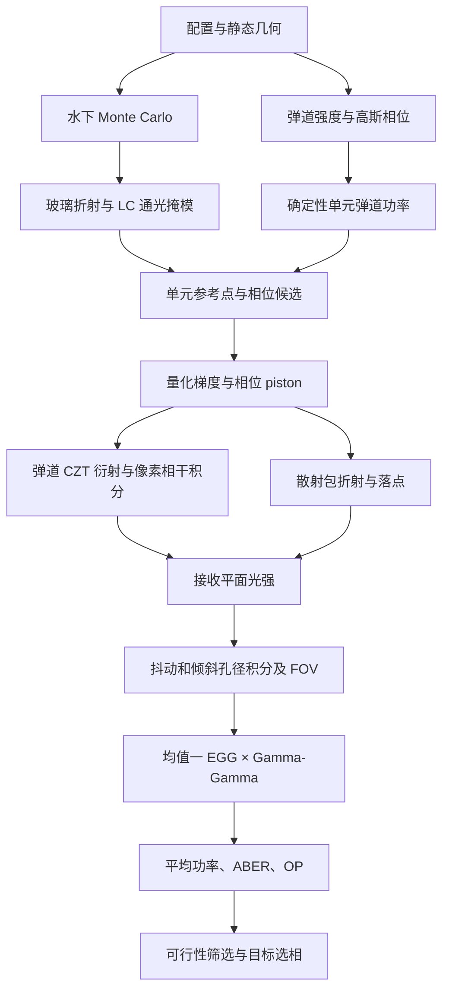

# RIS_phase 算法说明、完整公式与推导

## 1. 算法解决什么问题

系统包含水下高斯光源、水—玻璃界面、位于玻璃内部的液晶 RIS 相位屏、玻璃—空气界面和空气侧有限孔径接收机。RIS 用有限宽度、受限幅和角度量化约束的相位，将水下斜入射光输送到空气侧目标区域，在随机位置抖动、角度误差和乘性湍流下改善平均接收功率、平均误码率 ABER 或中断概率 OP。

代码的核心方法是**有限候选光斑族的输运设计与离散搜索**。先为单元分配目标落点，再反解折射光线，加载可实现的仿射相位，经波动传播得到实际光强，最后用通信指标选择宽度和方向余量。候选库最优的范围是已生成且通过约束的方案。

程序同时使用两条传播路径：

1. 弹道光：确定性强度模型 + 指定高斯相位 + 各单元标量 Fresnel/CZT 衍射 + 像素内相干平均。
2. 散射光：水下 HG 蒙特卡洛输运 + 界面折射 + RIS 局部梯度偏转 + 光子包功率累积。



### 1.1 入口与当前实验协议

主入口是 `run_ris_phase.m → rp_stage2_run.m`。它构建三个距离的候选场，执行宽度扩展、接收端扫描、入射角扫描、数值检查和绘图。`rp_run`、`rp_study_config`、`rp_validate` 等是兼容入口。

| 实验 | 距离与孔径半径 | 接收机位置/方向 | 相位选择方式 |
|---|---|---|---|
| 主候选库、Fig4/5/8 等 | 5、7.5、10 m；通常 5 cm | 各方案对准自身实际光斑质心 | 在 1 W 或相应抖动参数下选择 |
| 当前 Fig2/3 | **仅 10 m**；5 cm | 所有方案共用固定位置和方向 | **逐功率点**重选；ABER、OP 图的 Flat top 可不同 |
| Fig9 湍流扫描 | 7.5 m；5 cm | 各方案自身质心 | 每组湍流在 1 W 重选，然后固定相位扫功率 |
| Fig10 入射角 | 7.5、10 m；5 cm | 各方案自身质心 | 随入射角重算载波；沿用名义选定的宽度 |
| Fig12 | 7.5 m；**3 cm** | 各方案自身质心 | 每个位置抖动标准差重新选宽 |
| Fig13/14 | 7.5 m；3 cm | 各方案自身质心 | 固定已选相位，再扫抖动或功率 |
| Fig1 直接通信列 | 三距离 | 展示光强，坐标相对各自质心 | 裸水—空气界面 MC 基准 |

当前主研究采用 `wris_reference` 的水平固定板，即 $R_{\mathrm{RIS}}=I_3$。配置保留风速和运动参数，但上述静态研究没有调用风浪时序；不能据此解释为某风速下的动态性能。`rp_geometry` 则保留了处理任意冻结姿态的能力。

## 2. 符号、坐标与默认参数

### 2.1 坐标定义

世界坐标的 $+Z$ 向上，接收面为 $Z=Z_R$。板局部坐标原点是玻璃下表面中心 $\mathbf p_b$，局部 $+z$ 指向玻璃上表面。$R$ 将板局部列向量转到世界坐标，$R_T$ 是发射光轴坐标到世界坐标的旋转矩阵。

$$
\mathbf r=\mathbf p_b+R\mathbf r',\qquad
\mathbf r'=R^T(\mathbf r-\mathbf p_b),\qquad
\mathbf s'=R^T(\mathbf p_T-\mathbf p_b),\qquad
\mathbf d'=R^T\mathbf d_T. \tag{1}
$$

源码使用行向量时，等价写法是 `(world-pRis.')*RRis`。所有横向层路径计算都在同一个板局部坐标系内。

玻璃厚度 $t_g$，LC 高度 $h_i=f_s t_g$，LC 到上表面的厚度 $h_o=(1-f_s)t_g$。下表面、LC、上表面的局部高度分别是 $0,h_i,t_g$。研究中的距离 $z$ 是世界竖直高度：

$$
Z_R=p_{b,Z}+t_g+z. \tag{2}
$$

对于倾斜板，式 (2) 是代码定义的水平接收面高度；它不等于从任意倾斜上表面点沿局部法向测量的距离。

### 2.2 主要符号

| 符号 | 含义与单位 |
|---|---|
| $\lambda_0,k_0=2\pi/\lambda_0$ | 真空波长 m、真空波数 m$^{-1}$ |
| $n_w,n_g,n_a$ | 水、等效玻璃、空气折射率 |
| $\mathbf q=(q_x,q_y)$ | 切向波矢除以 $k_0$，无量纲 |
| $\kappa_j=\sqrt{n_j^2-\|\mathbf q\|^2}$ | 法向波矢除以 $k_0$，无量纲 |
| $U,\mathcal E$ | 通量振幅 $\sqrt{\mathrm W/\mathrm m^2}$、电场振幅 V/m |
| $I,P_0,P_t$ | 平面法向光强 W/m$^2$、参考发射功率 W、扫描 ON 符号功率 W |
| $\mathbf b_m,H_m,\phi_{0m}$ | 单元相位梯度除以 $k_0$、相位曲率除以 $k_0$、参考点常相位 |
| $a_R,\sigma_p,\sigma_\theta,\boldsymbol\mu_\theta,\Theta$ | 接收半径 m、每轴位置标准差 m、每轴角标准差 rad、角偏差 rad、FOV 半角 rad |
| $G,H_o,H_a,H$ | 几何/FOV 功率增益、海洋衰落、大气衰落、联合衰落 |
| $\mathcal R,\sigma_n,\gamma_{\mathrm{th}}$ | 响应度 A/W、热噪声标准差 A、中断 SNR 门限 |

### 2.3 当前数值

| 参数 | 数值 |
|---|---|
| 波长、参考功率、发散参数 | 532 nm、1 W、$\theta_d=0.01$ |
| 折射率 | $n_w=1.33,n_g=1.50,n_a=1$ |
| 水下斜程、主入射角 | 10 m、40° |
| 水体 | `c0.151`：吸收 $a_w=0.114$ m$^{-1}$，散射 $b_w=0.037$ m$^{-1}$，消光 $c_w=0.151$ m$^{-1}$。`c0.398`：吸收 $a_w=0.179$ m$^{-1}$，散射 $b_w=0.219$ m$^{-1}$，消光 $c_w=0.398$ m$^{-1}$|
| HG 各向异性参数 | $g_{\mathrm{HG}}=0.924$ |
| 面板、厚度、LC 位置 | 1 m × 1 m、0.01 m、玻璃正中 |
| 单元数量、中心间距 | $40\times40=1600$、25 mm |
| 器件边长、通光边长 | 15 mm、14.4 mm |
| 电极中心间距 | 1 μm = 0.7 μm 宽 + 0.3 μm 间隙 |
| 控制角度网格 | 每轴 0.021°；最大实际网格角 15.414° |
| 名义抖动、角误差、偏差 | $\sigma_p=80$ mm、$\sigma_\theta=25$ mrad、$(25,0)$ mrad |
| FOV 半角 | 主配置 240 mrad；Fig2/3 为 130 mrad；敏感性独立基准为 90 mrad |
| 光电响应、噪声、SNR 门限 | 0.5 A/W、50 μA、10（线性值） |
| 默认 MC、Sobol 数量 | 300000 光子、8192 接收样本；独立验证 32768 |
| 主传播网格 | 128 × 128；光学复核 192 × 192，并加密孔径采样 |

## 3. 分层折射：从 Fermat 原理到二分求解

对应 `rp_layer_path`、`rp_paraxial`、`rp_fresnel`、`rp_carrier_landing`。

### 3.1 切向波矢守恒：求每层光线的折射角

对一组平行界面，设第 $j$ 层法向厚度为 $h_j$，横向位移为 $\boldsymbol\rho_j$。几何光程为

$$
L=\sum_j n_j\sqrt{h_j^2+\|\boldsymbol\rho_j\|^2},\qquad
\sum_j\boldsymbol\rho_j=\boldsymbol\Delta. \tag{3}
$$

对约束问题作变分，各层有相同的切向量 $\mathbf q=n_j\boldsymbol\rho_j/\sqrt{h_j^2+\|\boldsymbol\rho_j\|^2}$。所以

$$
\boldsymbol\rho_j=h_j\frac{\mathbf q}{\kappa_j},\quad
\ell_j=\frac{h_jn_j}{\kappa_j},\quad
L=\sum_j\frac{h_jn_j^2}{\kappa_j},\quad
\boldsymbol\Delta=\sum_j\frac{h_j\mathbf q}{\kappa_j}. \tag{4}
$$

设 $\rho=\|\boldsymbol\Delta\|$，$q=\|\mathbf q\|$，则只需解一个标量方程：

$$
F(q)=\sum_j\frac{h_jq}{\sqrt{n_j^2-q^2}}-\rho=0,\qquad
0\le q<\min_{h_j>0}n_j. \tag{5}
$$

因为

$$
F'(q)=\sum_j\frac{h_jn_j^2}{(n_j^2-q^2)^{3/2}}>0, \tag{6}
$$

根唯一，可二分求解；代码默认迭代 48 次。最后 $\mathbf q=q\boldsymbol\Delta/\rho$，零位移取 $\mathbf q=0$。零厚度层不限制二分上界。

### 3.2 光线 Jacobian 与面积映射：计算光强

对式 (4) 关于 $\mathbf q$ 求导：

$$
J=\frac{\partial\boldsymbol\Delta}{\partial\mathbf q}
=\left(\sum_j\frac{h_j}{\kappa_j}\right)I_2
+\left(\sum_j\frac{h_j}{\kappa_j^3}\right)\mathbf q\mathbf q^T
=a_JI_2+b_J\mathbf q\mathbf q^T. \tag{7}
$$

沿 $\mathbf q$ 与垂直 $\mathbf q$ 的特征值分别为 $a_J+b_Jq^2$、$a_J$，因此

$$
\det J=a_J(a_J+b_Jq^2),\qquad
A=J^{-1}=\frac{\partial\mathbf q}{\partial\boldsymbol\Delta}. \tag{8}
$$

同一束光由一个平面映射到另一个平面时，光强乘以对应面积 Jacobian 的比值，而不再额外乘一个重复的入射余弦。

### 3.3 Fresnel 功率透射率

设入射、透射介质折射率为 $n_1,n_2$，$\kappa_1=\sqrt{n_1^2-q^2}$、$\kappa_2=\sqrt{n_2^2-q^2}$。源码用无偏振平均：

$$
R_s=\left(\frac{\kappa_1-\kappa_2}{\kappa_1+\kappa_2}\right)^2,\qquad
R_p=\left(\frac{n_2^2\kappa_1-n_1^2\kappa_2}{n_2^2\kappa_1+n_1^2\kappa_2}\right)^2,
\qquad T_{12}=1-\frac{R_s+R_p}{2}. \tag{9}
$$

若 $q^2\ge\min(n_1^2,n_2^2)$，代码令 $T_{12}=0$。空气中的可传播条件是 $q<n_a$。裸水—空气的轴向临界角是

$$
\theta_c=\arcsin(n_a/n_w)\approx48.7535^\circ. \tag{10}
$$

有限发散光束包含多个方向，轴向角跨过临界角后仍可能存在亚临界尾部；直接传播模型逐方向判断传播条件。

## 4. 水下光源、弹道强度与蒙特卡洛散射

### 4.1 源面概率与发散约定

`wris_mc` 在光轴坐标系独立采样源面位置和横向斜率：

$$
\mathbf u_0\sim\mathcal N(\mathbf0,w_0^2I_2/4),\qquad
\boldsymbol\tau\sim\mathcal N(\mathbf0,\theta_d^2I_2/4),\qquad
\widehat{\mathbf d}=\frac{(\tau_x,\tau_y,1)}{\sqrt{1+\|\boldsymbol\tau\|^2}}. \tag{11}
$$

$$
w_0\theta_d=\frac{\lambda_0}{\pi n_w},\qquad
p_\tau(\boldsymbol\tau)=\frac{2}{\pi\theta_d^2}
\exp\left(-\frac{2\|\boldsymbol\tau\|^2}{\theta_d^2}\right). \tag{12}
$$

发射点与方向为 $\mathbf p_T+R_T(u_{0x},u_{0y},0)^T$ 和 $R_T\widehat{\mathbf d}$。源码物理传播直接用 $\theta_d$ 作斜率分布尺度；部分轮廓显示使用 $\tan\theta_d$。两者在小角度下接近，复现源码时应保留该区别。

### 4.2 下表面弹道强度推导

先考虑一个源节点 $\mathbf s'$。令 $S=R^TR_T$，下表面点 $\mathbf r'_b=(x_b,y_b,0)^T$，光轴坐标位移为

$$
\mathbf v=S^T(\mathbf r'_b-\mathbf s')=(v_x,v_y,\zeta)^T,\qquad
\ell_w=\|\mathbf v\|,\qquad
\mathbf n_T=S^T\mathbf e_z. \tag{13}
$$

从斜率 $\boldsymbol\tau=(v_x/\zeta,v_y/\zeta)$ 到下表面面积的变换满足

$$
\left|\frac{\partial(\tau_x,\tau_y)}{\partial(x_b,y_b)}\right|
=\frac{\max(\mathbf v\cdot\mathbf n_T,0)}{\zeta^3}. \tag{14}
$$

因此源码的单节点弹道光强是

$$
I_b^{(s)}(x_b,y_b)=
\frac{2P_0}{\pi\theta_d^2}
\exp\left[-\frac{2(v_x^2+v_y^2)}{\theta_d^2\zeta^2}-c_w\ell_w\right]
\frac{\max(\mathbf v\cdot\mathbf n_T,0)}{\zeta^3},\qquad \zeta>0. \tag{15}
$$

指数中的 $e^{-c_w\ell_w}$ 是未经历任何碰撞的弹道生存概率；散射光另外统计。源码在 $\ell_w>\texttt{mc.maxPath}$ 时置零。

有限束腰用每轴 3 点矩匹配求积：节点 $0,\pm\sqrt3w_0/2$，权重 $2/3,1/6,1/6$，两轴作张量积。该规则匹配位置方差 $w_0^2/4$ 和四阶矩，实际弹道光强为九个源节点光强的加权和。

### 4.3 从下表面到玻璃内部

对 LC 高度 $h$ 的点 $\boldsymbol\xi$，先用水/玻璃路径求 $\mathbf q$。下表面交点和水深是

$$
\mathbf x_b=\boldsymbol\xi-h\frac{\mathbf q}{\kappa_g},\qquad
d=-s'_z. \tag{16}
$$

令 $J_w$ 是仅水层的位移 Jacobian，$J_{wg}$ 是水加玻璃的 Jacobian，则

$$
I_h^{(s)}(\boldsymbol\xi)
=I_b^{(s)}(\mathbf x_b)\,T_{wg}(\mathbf q)
\frac{\det J_w}{\det J_{wg}},\qquad
\det J_w=\left(\frac d{\kappa_w}\right)^2
\left(1+\frac{q^2}{\kappa_w^2}\right). \tag{17}
$$

其中 $J_{wg}$ 在式 (7) 中取 $a_J=d/\kappa_w+h/\kappa_g$、$b_J=d/\kappa_w^3+h/\kappa_g^3$。九节点求和得到 `rp_bsf_ballistic` 的输出。$h>0$ 时源码还检查折射前下表面交点位于 1 m 面板内。

### 4.4 散射 Monte Carlo 完整步骤

消光系数 $c_w=a_w+b_w$。每次自由程和碰撞权重更新为

$$
\ell=-\frac{\ln U_1}{c_w},\qquad
\Delta w_{\mathrm{abs}}=w\frac{a_w}{c_w},\qquad
w^+=w\frac{b_w}{c_w}. \tag{18}
$$

若光子先到达下表面，则先记分并终止；该末段不再执行一次虚构碰撞吸收。散射方向的 HG 概率密度和逆采样为

$$
p(\mu)=\frac{1-g_{\mathrm{HG}}^2}
{2(1+g_{\mathrm{HG}}^2-2g_{\mathrm{HG}}\mu)^{3/2}},\qquad -1\le\mu\le1,
\tag{19}
$$

$$
\mu=\frac{1+g_{\mathrm{HG}}^2-
\left[\frac{1-g_{\mathrm{HG}}^2}{1-g_{\mathrm{HG}}+2g_{\mathrm{HG}}U_2}\right]^2}
{2g_{\mathrm{HG}}},\quad
\varphi=2\pi U_3,\quad
\widehat{\mathbf d}^{+}=\mu\widehat{\mathbf d}+
\sqrt{1-\mu^2}(\cos\varphi\,\mathbf e_1+\sin\varphi\,\mathbf e_2). \tag{20}
$$

$g_{\mathrm{HG}}=0$ 的极限是 $\mu=2U_2-1$。低权重俄罗斯轮盘：以概率 $p_s$ 保留并变成 $w/p_s$，否则置零。单包物理功率和像素估计为

$$
P_j=\frac{P_0}{N_\gamma}w_j,\qquad
I_{\mathrm{MC},p}=\frac1{\Delta A_p}\sum_{j\in p}P_j. \tag{21}
$$

记录的 `pathLengthM` 用于输运账本；它没有被转换为散射场的确定相位。

## 5. RIS 下表面与 LC 入射复场

对应 `rp_incident_field`。强度由式 (15)–(17) 计算，相位由一个明确指定的高斯波前模型给出。

对中心源到点 $\boldsymbol\xi$ 的折射路径，先按式 (16) 找到下表面点。定义

$$
\mathbf v_b=(\mathbf x_b,0)^T-\mathbf s',\quad
z_b=\mathbf v_b\cdot\mathbf d',\quad
\rho_b^2=\|\mathbf v_b\|^2-z_b^2,\quad
z_{\mathrm R}=\frac{\pi n_ww_0^2}{\lambda_0}. \tag{22}
$$

高斯宽度、波面曲率与 Gouy 相位为

$$
w^2(z_b)=w_0^2\left[1+\left(\frac{z_b}{z_{\mathrm R}}\right)^2\right],\quad
\frac1{\mathcal R_b(z_b)}=\frac{z_b}{z_b^2+z_{\mathrm R}^2},\quad
\zeta_G(z_b)=\arctan\frac{z_b}{z_{\mathrm R}}. \tag{23}
$$

源码相位与复场完整表达式为

$$
\Phi_h(\boldsymbol\xi)=k_0\left[
n_w\left(z_b+\frac{\rho_b^2z_b}{2(z_b^2+z_{\mathrm R}^2)}\right)
+n_g\ell_g\right]-\operatorname{atan2}(z_b,z_{\mathrm R}),
\qquad
U_h(\boldsymbol\xi)=\sqrt{I_h(\boldsymbol\xi)}e^{i\Phi_h(\boldsymbol\xi)}. \tag{24}
$$

其中 $\ell_g=hn_g/\kappa_g$。下表面入射场取 $h=0$，LC 前场取 $h=h_i$。源码返回的 `opl` 是分层几何光程；`phaseRad` 使用式 (24) 的高斯相位，两者不是同一个表达式。

### 5.1 通量振幅与电场的衔接

源码中 $|U|^2$ 的单位是 W/m$^2$。对于无磁介质、单个局部平面波，法向功率通量为

$$
I_n=\frac{n\epsilon_0c_0}{2}\cos\theta\,|\mathcal E|^2
=\frac{\epsilon_0c_0\kappa}{2}|\mathcal E|^2,
\qquad U=\sqrt{\frac{\epsilon_0c_0\kappa}{2}}\,\mathcal E. \tag{25}
$$

电场透射系数 $t_E$ 与通量振幅系数的关系是 $t_U=\sqrt{\kappa_2/\kappa_1}\,t_E$，故 $|t_U|^2=T$。当前标量算法在界面乘 $\sqrt T$。若要报告局部主光线附近的接收电场，可用对应方向的 $\kappa$ 从式 (25) 换算；宽角多模电磁场需要逐角谱、逐偏振重建，不能把整个混合光强直接开方并称作唯一电场。

散射场只定义到非相干统计强度。可以用 $\mathbb E[U_s]=0$、$\mathbb E[|U_s|^2]=I_s$ 表述其统计模型，但源码未指定足以求出唯一瞬时 $U_s$ 的互相干函数。

## 6. 有限阵列、通光掩模与确定性单元功率

单元中心为

$$
\mathbf c_{ij}=\left(\left[i-\frac{N_x+1}{2}\right]p_x,
\left[j-\frac{N_y+1}{2}\right]p_y\right),\quad
i=1,\ldots,40,\ j=1,\ldots,40. \tag{26}
$$

令 $D_m$ 是以 $\mathbf c_m$ 为中心、边长 $d_x=d_y=0.0144$ m 的矩形。实际通光掩模为 $M(\boldsymbol\xi)=\sum_m\mathbf1_{D_m}(\boldsymbol\xi)$，并结合有限下表面交点检查。MC 光子折射到 LC 的点为

$$
\boldsymbol\xi_j=\mathbf x_{b,j}+h_i\frac{\mathbf q_{\mathrm{in},j}}{\kappa_{g,j}},\qquad
\mathbf q_{\mathrm{in},j}=n_w\widehat{\mathbf d}'_{j,xy}. \tag{27}
$$

`rp_illuminate` 用六阶 Gauss–Legendre 张量积计算每个单元的弹道功率和参考点：

$$
P_m^{(b)}=\int_{D_m}I_{h_i}(\boldsymbol\xi)\,d^2\boldsymbol\xi,
\qquad
\mathbf r_m=\frac{\int_{D_m}\boldsymbol\xi I_{h_i}(\boldsymbol\xi)\,d^2\boldsymbol\xi}{P_m^{(b)}}.
\tag{28}
$$

$$
\int_{D_m}f\,dA\approx\frac{d_xd_y}{4}
\sum_{r,s}w_rw_s
f\left(\mathbf c_m+(d_xx_r/2,d_yx_s/2)\right). \tag{29}
$$

为减少弹道 MC 抖动，单元总功率替换为“MC 总功率 − MC 弹道功率 + 确定性弹道功率”；弹道包在有样本的单元内按对应功率比缩放。散射包保留原始 $P_0w/N_\gamma$。`ballisticModelScale=1`，不存在依据接收结果拟合的全局功率系数。极弱单元参考点可能沿用 MC 功率质心或几何中心。

## 7. 可实现的相位与出射复场

### 7.1 单元标量相位及梯度

设 $\boldsymbol\delta=\boldsymbol\xi-\mathbf r_m$。`rp_phase_profile` 使用同一个标量函数生成相位和梯度：

$$
\phi_m(\boldsymbol\xi)=\phi_{0m}+k_0\left(
\mathbf b_m^T\boldsymbol\delta+\frac12\boldsymbol\delta^TH_m\boldsymbol\delta\right),
\qquad
\frac{\nabla\phi_m}{k_0}=\mathbf b_m+H_m\boldsymbol\delta. \tag{30}
$$

$H_m$ 对称，故梯度无旋。当前 finite-width 生产方案均令 $H_m=0$。实际加载相位及 LC 后场为

$$
\phi_m^{\mathrm{load}}=\operatorname{mod}(\phi_m,2\pi),\qquad
U_{\mathrm{LC}}^+(\boldsymbol\xi)=
\sum_m\mathbf1_{D_m}(\boldsymbol\xi)
U_{h_i}(\boldsymbol\xi)e^{i\phi_m(\boldsymbol\xi)}. \tag{31}
$$

该式对应 `rp_modulated_field`，尚未包括上半段玻璃传播和玻璃—空气透射。

### 7.2 梯度预算与离散角度命令

由电极间距 $d_e$ 的 Nyquist 相位增量约束 $|\Delta\phi|\le\pi$，得到

$$
|b_d|\le B=\frac{\lambda_0}{2d_e}
=n_a\sin\theta_{\max},\quad
\theta_{\max}=\arcsin\frac{\lambda_0}{2n_ad_e},\quad d\in\{x,y\}. \tag{32}
$$

当前 $n_a=1$；`wris_device` 直接取 $\theta_{\max}=\arcsin[\lambda_0/(2d_e)]$。`rp_command` 对每轴独立限幅和量化：

$$
K=\left\lfloor\frac{\theta_{\max}}{\Delta\theta}\right\rfloor,\quad
\bar b_d=\operatorname{clip}(b_d^\star,-B,B),\quad
k_d=\operatorname{clip}\left(
\operatorname{round}\frac{\arcsin(\bar b_d/n_a)}{\Delta\theta},-K,K\right),
\quad b_d=n_a\sin(k_d\Delta\theta). \tag{33}
$$

角度计算单位须一致。$\Delta\theta=0.021^\circ$，$K=734$，实际最大网格角为 $15.414^\circ$；约 $15.426^\circ$ 是连续参考角。约束区域是每轴独立的矩形框，还必须检查叠加入射横向波矢后的空气传播圆盘。

相位屏横向动量关系为

$$
\mathbf q_{\mathrm{out}}(\boldsymbol\xi)=
\mathbf q_{\mathrm{in}}(\boldsymbol\xi)+\frac{\nabla\phi_m(\boldsymbol\xi)}{k_0}.
\tag{34}
$$

因此控制角是梯度标定角，实际出射角由 $\mathbf q_{\mathrm{out}}$ 决定。

### 7.3 精确出射落点

给定 LC 点 $\boldsymbol\xi$ 和出射横向量 $\mathbf q$：

$$
\mathbf r'_t=\left(\boldsymbol\xi+h_o\frac{\mathbf q}{\kappa_g},t_g\right),\quad
\mathbf r_t=\mathbf p_b+R\mathbf r'_t,\quad
\widehat{\mathbf d}_a=R\frac{(q_x,q_y,\kappa_a)^T}{n_a},\quad
\tau_R=\frac{Z_R-r_{t,Z}}{d_{a,Z}},\quad
\mathbf r_R=\mathbf r_t+\tau_R\widehat{\mathbf d}_a. \tag{35}
$$

要求玻璃和空气模式可传播、$d_{a,Z}>0$、$\tau_R>0$。`rp_trace` 还检查上表面点位于有限板内。散射包出射功率为入射 LC 包功率乘 $T_{ga}(\mathbf q)$；下表面的 $T_{wg}$ 已在 `rp_illuminate` 中计算。

### 7.4 原始逐单元竖直转向算法

`rp_vertical_command` 对每个单元最小化世界出射方向与 $+Z$ 的夹角。令 $\mathbf v=R^T\mathbf e_Z$，则目标等价于

$$
\max_{b_x,b_y\in\mathcal B}
\frac{v_xq_x+v_yq_y+v_z\sqrt{n_a^2-q_x^2-q_y^2}}{n_a},
\quad \mathbf q=\mathbf q_{\mathrm{in}}+\mathbf b,\quad q^2<n_a^2. \tag{36}
$$

其中 $\mathcal B=\{n_a\sin(k\Delta\theta):-K\le k\le K\}$。固定 $q_x$ 后，连续最优值为

$$
q_y^\star=\frac{v_y\sqrt{n_a^2-q_x^2}}{\sqrt{v_y^2+v_z^2}}. \tag{37}
$$

利用目标对 $q_y$ 的凹性，只须枚举 $x$ 命令，并检查连续 $y$ 最优点相邻的两个合法网格值。每单元复杂度从二维枚举降为 $O(K)$。

原始 `rp_phase` 的参考常相位是

$$
\phi_{0m}=\operatorname{mod}\left[
k_0\left(n_aZ_{t,m}-\frac{n_g^2h_o}{\kappa_{g,m}}\right)-\Phi_{h_i}(\mathbf r_m),2\pi\right].
\tag{38}
$$

它采用世界水平载波相位参考；各单元饱和后方向可以不同，所以不等价于将所有单元精确聚焦到一个共同点。

### 7.5 可选曲率诊断模型

入射几何 Hessian 为 $H_{\mathrm{in},m}=J_{wg}^{-1}$。`quadratic` 请求 $H_m=-H_{\mathrm{in},m}$，并检查矩形上最坏梯度：

$$
|b_{m,d}|+\sum_e |H_{m,de}|\,e_{m,e}\le B,\qquad
\mathbf e_m=\frac{(d_x,d_y)}2+|\mathbf c_m-\mathbf r_m|. \tag{39}
$$

不满足时该单元退回零曲率。`quadratic_raw` 保留请求曲率用于诊断，不能与已证明全孔径满足硬件预算的仿射生产方案混同。`separable=true` 将交叉项置零。

`tanh` 使用可积的分离相位来平滑限制梯度。每轴令

$$
c_d=\operatorname{atanh}(b_d/B),\quad
a_d=\frac{H_{dd}}{B[1-(b_d/B)^2]},\quad
\frac{\phi_d(\delta_d)-\phi_d(0)}{k_0}
=\frac B{a_d}\left[\ln\cosh(c_d+a_d\delta_d)-\ln\cosh c_d\right]. \tag{40}
$$

于是 $\partial_d\phi/k_0=B\tanh(c_d+a_d\delta_d)$，其参考导数是 $b_d$、参考二阶导数是 $H_{dd}$。零曲率取线性极限。代码用稳定 `logcosh`、`log1p` 和小参数级数避免溢出与消减。

## 8. 有限宽度光斑输运设计

对应 `rp_finite_phase`、`rp_stage2_distance`、`rp_stage2_extend`。

### 8.1 入射单元能量的白化和径向分位数

归一单元弹道权重 $\omega_m=P_m^{(b)}/\sum_jP_j^{(b)}$。先去除入射斑的椭圆各向异性：

$$
\boldsymbol\mu=\sum_m\omega_m\mathbf r_m,\quad
\Sigma=\sum_m\omega_m(\mathbf r_m-\boldsymbol\mu)(\mathbf r_m-\boldsymbol\mu)^T,
\quad \mathbf v_m=\Sigma^{-1/2}(\mathbf r_m-\boldsymbol\mu). \tag{41}
$$

源码对特征值设 $10^{-12}$ 下限。按 $\|\mathbf v_m\|$ 升序排列后，给每个单元赋予能量分位数中点和方位角：

$$
u_m=\sum_{\|\mathbf v_j\|<\|\mathbf v_m\|}\omega_j+\frac{\omega_m}{2},\qquad
\vartheta_m=\operatorname{atan2}(v_{my},v_{mx}). \tag{42}
$$

实际实现使用排序累计和处理相等半径，再将 $u_m$ 截到 $[10^{-7},1-10^{-7}]$。

### 8.2 三种目标径向分布与逆 CDF

令 $w_t$ 为目标宽度，目标横向偏移为 $\boldsymbol\eta_m=r(u_m)(\cos\vartheta_m,\sin\vartheta_m)$。

**均匀平顶圆盘：**面积累计分布 $F(r)=r^2/w_t^2$，所以

$$
r_{\mathrm{flat}}(u)=w_t\sqrt u,\qquad
I_{\mathrm{flat}}^{\mathrm{ideal}}(r)=\frac{P}{\pi w_t^2}\mathbf1_{r\le w_t}. \tag{43}
$$

**圆高斯参考：**$I\propto e^{-2r^2/w_t^2}$，径向 CDF 为 $1-e^{-2r^2/w_t^2}$，所以

$$
r_{\mathrm G}(u)=w_t\sqrt{-\frac12\ln(1-u)}. \tag{44}
$$

普通 Gaussian 候选还将偏移乘以 $S_G=\Sigma^{1/2}/\sqrt{\operatorname{tr}\Sigma/2}$，保留入射斑的像散形状，而不是将其强制圆化。

**Robust 族：**代码指定一个径向 Weibull 形式的 CDF，而后按通信风险选宽：

$$
a_R^{\mathrm{shape}}=\frac{w_t}{\sqrt{2\Gamma(1+2/p)}},\qquad
r_{\mathrm R}(u)=a_R^{\mathrm{shape}}[-\ln(1-u)]^{1/p},\qquad p=1.6. \tag{45}
$$

为避免与接收半径 $a_R$ 混淆，下文将这个形状尺度记作 $s_R=a_R^{\mathrm{shape}}$。由 $F(r)=1-e^{-(r/s_R)^p}$ 得到目标**径向概率密度**和理想平面功率密度：

$$
f_r(r)=\frac p{s_R}\left(\frac r{s_R}\right)^{p-1}e^{-(r/s_R)^p},\qquad
\frac{I_{\mathrm R}^{\mathrm{ideal}}(r)}P
=\frac{f_r(r)}{2\pi r}
=\frac p{2\pi s_R^p}r^{p-2}e^{-(r/s_R)^p}. \tag{46}
$$

这给出了源码所称“广义高斯输运”的精确分布含义：$p\ne2$ 时，式 (45) 不等于平面密度单纯正比于 $e^{-(r/s_R)^p}$ 的二维广义高斯。其 $r^{p-2}$ 因子来自从径向概率到单位面积密度的换算。实际程序只有有限单元并经衍射，实际中心光强须由传播场读取。

归一系数的推导是 $\mathbb E[r^2]=s_R^2\Gamma(1+2/p)=w_t^2/2$，故理想等效二阶矩半径 $\sqrt{2\mathbb E[r^2]}=w_t$；平顶和圆高斯也满足这个定义。

### 8.3 公共可达载波与中心余量

令 $B_q=n_a\sin(K\Delta\theta)$。在每轴上，为排除极小尾部功率后仍可被所有保留单元实现的共同方向，使用加权分位数：

$$
l_d=Q_{1-\epsilon}(q_{\mathrm{in},m,d}-B_q),\qquad
h_d=Q_{\epsilon}(q_{\mathrm{in},m,d}+B_q),\qquad
q_{0d}=\operatorname{clip}(0,l_d,h_d),\qquad
\epsilon=\frac{\texttt{maximumTailPower}}4. \tag{47}
$$

要求 $l_d\le h_d$，并取 $q_{0d}\leftarrow q_{0d}+\eta\operatorname{sign}(q_{0d})$。这里 $\eta$ 是 `centerMargins` 中的无量纲横向波矢余量，不是米或角度。$q_{0d}=0$ 时该轴不因余量改变。

从 LC 局部原点发出 $\mathbf q_0$，用式 (35) 求中心 $\mathbf x_c$。单元目标为

$$
\mathbf x_m^\star=\mathbf x_c+\boldsymbol\eta_m. \tag{48}
$$

### 8.4 目标到可实现相位的反解

对每个 $(\mathbf r_m,\mathbf x_m^\star)$ 用分层路径求理想 $\mathbf q_m^\star$，然后

$$
\mathbf b_m=\mathcal Q(\mathbf q_m^\star-\mathbf q_{\mathrm{in},m}),\qquad
\widetilde{\mathbf q}_m=\mathbf q_{\mathrm{in},m}+\mathbf b_m,\qquad
\widetilde{\mathbf x}_m=\operatorname{Landing}(\mathbf r_m,\widetilde{\mathbf q}_m). \tag{49}
$$

$\mathcal Q$ 是式 (33)。随后以**实际量化后的落点**重建出射光程 $L_m$、二阶矩阵及常相位：

$$
\phi_{0m}=\operatorname{mod}\left[-\Phi_{h_i}(\mathbf r_m)-k_0L_m,2\pi\right],\qquad H_m=0.
\tag{50}
$$

式 (50) 在每个单元自身分配的实际目标处校准相位；这些目标通常互不相同。平顶和鲁棒光斑因有限阵列、通光间隙、量化、饱和、衍射与干涉偏离理想分布，最终宽度由实际光强计算。

### 8.5 Steering-only 与零相位的两种基准

主候选库的 `steering` 沿用式 (36) 的逐单元竖直转向。**固定接收机版本**则采用一个全局常梯度：先用功率加权参考点求到共同接收目标的理想梯度，再量化为 $\mathbf b$，令

$$
\phi_{0m}=\operatorname{mod}(k_0\mathbf b\cdot\mathbf r_m,2\pi),\qquad
\phi_m(\boldsymbol\xi)=k_0\mathbf b\cdot\boldsymbol\xi\pmod{2\pi}. \tag{51}
$$

所以固定版 Steering-only 没有按单元补偿入射曲率或加入聚焦 piston。`unmodulated` 则将所有梯度、曲率、piston 置零，保留原玻璃和单元通光掩模。

## 9. 接收面任意位置的弹道复场与衍射算法

### 9.1 倾斜接收几何的二阶光程

设 LC 参考点为 $\mathbf r_m$，目标世界 XY 为 $\mathbf x$，其板局部坐标由式 (1) 得到。空气层的局部高度为 $h_a=x'_z-t_g$，与 LC 到上表面的玻璃厚度 $h_o$ 一起代入式 (4) 求路径。

定义 $T=R_{1:2,1:2}^T$，$\mathbf z=(R_{13},R_{23})^T$。世界 XY 的微小变化 $\boldsymbol\eta$ 导致局部横向变化 $T\boldsymbol\eta$、高度变化 $\mathbf z^T\boldsymbol\eta$。因此

$$
E=T-\frac{\mathbf q\mathbf z^T}{\kappa_a},\qquad
A=J^{-1},\quad B=AE,\quad C=E^TAE,\quad
\mathbf s=T^T\mathbf q+\kappa_a\mathbf z. \tag{52}
$$

这里 $\mathbf s=\nabla_{XY}L$。光程在参考孔径和接收点附近展开为

$$
L(\mathbf r_m+\boldsymbol\delta,\mathbf x_m+\boldsymbol\eta)
\simeq L_m-\mathbf q_m^T\boldsymbol\delta+\mathbf s_m^T\boldsymbol\eta
+\frac12\boldsymbol\delta^TA_m\boldsymbol\delta
-\boldsymbol\delta^TB_m\boldsymbol\eta
+\frac12\boldsymbol\eta^TC_m\boldsymbol\eta. \tag{53}
$$

各矩阵都由精确中心折射路径计算。源码当前传播在**每个接收点重解** $L_m(\mathbf x)$、$\mathbf q_m(\mathbf x)$ 和 $B_m(\mathbf x)$，只冻结孔径坐标的出射曲率 $A_m^\star$，从而减少大接收窗口的 Taylor 误差。

### 9.2 标量通量衍射积分

在代码采用的标量规范下，单元的局部近似传播式为

$$
U_m(\mathbf x)\simeq
\frac{\sqrt{|\det B_m(\mathbf x)|}}{i\lambda_0}
\int_{D_m}\sqrt{I_{h_i}(\boldsymbol\xi)T_{ga}(\mathbf q_{\mathrm{load}}(\boldsymbol\xi))}
\exp\left\{i\left[
\Phi_{h_i}(\boldsymbol\xi)+\phi_m(\boldsymbol\xi)
+k_0\left(L_m(\mathbf x)-\mathbf q_m(\mathbf x)^T\boldsymbol\delta
+\frac12\boldsymbol\delta^TA_m^\star\boldsymbol\delta\right)\right]\right\}
\,d^2\boldsymbol\xi. \tag{54}
$$

全弹道场是 $U_b(\mathbf x)=\sum_mU_m(\mathbf x)$。$\sqrt{|\det B|}/\lambda_0$ 的单位是 m$^{-2}$，乘孔径面积后保持通量振幅量纲。对于同介质、正轴、距离 $z$ 的近轴情况，$B=(n/z)I_2$，核前因子退化为 $n/(i\lambda_0z)$。

式 (54) 是理解当前传播器的连续模型。实际实现用 Parseval 保守搬运频谱功率来确定像素振幅，并从复数插值获取相位；它不直接逐像素取该积分的点值模平方，具体步骤如下。

### 9.3 去载波与 Fourier/CZT 表达

令 $H_{\mathrm{in},m}$ 为入射几何曲率，$\boldsymbol\delta=\boldsymbol\ell+\mathbf o_m$，其中 $\boldsymbol\ell=\boldsymbol\xi-\mathbf c_m$、$\mathbf o_m=\mathbf c_m-\mathbf r_m$。定义

$$
M_m=A_m^\star+H_{\mathrm{in},m}+H_m,\qquad
\varepsilon_m(\boldsymbol\delta)=\Phi_{h_i}(\mathbf r_m+\boldsymbol\delta)
-\Phi_{h_i}(\mathbf r_m)-k_0\left(\mathbf q_{\mathrm{in},m}^T\boldsymbol\delta
+\frac12\boldsymbol\delta^TH_{\mathrm{in},m}\boldsymbol\delta\right). \tag{55}
$$

源码在每单元 25 × 25 网格上计算光滑振幅与 $\varepsilon_m$，再三次插值到自适应孔径网格。振幅按式 (28) 的单元确定性功率归一后乘 $\sqrt{T_{ga}}$。

此处透射率使用的加载横向量具体为 $\mathbf q_{\mathrm{load}}=\mathbf q_{\mathrm{in},m}+H_{\mathrm{in},m}\boldsymbol\delta+\nabla\phi_m/k_0$。它以几何二阶入射模型计算局部方向，未把残余高斯相位 $\varepsilon_m$ 的梯度再加回透射率；残余相位本身保留在衍射积分中。

$$
\mathcal F_m(\mathbf f)=\int_{D_m-\mathbf c_m}
\mathcal A_m(\boldsymbol\ell)
e^{i[k_0\boldsymbol\ell^TM_m\boldsymbol\ell/2+\varepsilon_m(\boldsymbol\ell+\mathbf o_m)]}
e^{-i2\pi\mathbf f^T\boldsymbol\ell}\,d^2\boldsymbol\ell, \tag{56}
$$

$$
\mathbf q_{c,m}=\mathbf q_{\mathrm{in},m}+\mathbf b_m+M_m\mathbf o_m,\qquad
\mathbf f_m(\mathbf x)=\frac{\mathbf q_m(\mathbf x)-\mathbf q_{c,m}}{\lambda_0}, \tag{57}
$$

$$
\Psi_m(\mathbf x)=\Phi_{h_i}(\mathbf r_m)+\phi_{0m}+k_0L_m(\mathbf x)
+k_0\left[\frac12\mathbf o_m^TM_m\mathbf o_m
+(\mathbf q_{\mathrm{in},m}+\mathbf b_m-\mathbf q_m(\mathbf x))^T\mathbf o_m\right]. \tag{58}
$$

在连续近似中 $U_m\propto\mathcal F_m(\mathbf f_m)e^{i\Psi_m}$。式 (58) 保留了入射相位、单元 piston 和传播相位三项，保证相对干涉相位可追溯。

数值上以 $B$ 的左奇异向量旋转孔径和频率基，避免近临界情况下狭长旋转频域形成过大的轴对齐包围框。孔径采样要求依据 $M_m$ 的相位带宽确定，概略为

$$
N_d=2^{\left\lceil\log_2\max\left(N_{\min},
\frac{1.1e_d(|M'_m|\mathbf e)_d}{\lambda_0}\right)\right\rceil}
\times\texttt{apertureOversampling}. \tag{59}
$$

$\mathbf e$ 是旋转孔径包围框边长，$M'_m$ 是旋转后的曲率。超过 `maxApertureSamples` 会报错。FFT 等效补零由接收像素分辨率与 $\lambda_0 B^{-1}$ 的映射尺度决定；CZT 仅计算接收窗口所需的均匀频率子集。

一维均匀采样的 CZT 本质上计算

$$
F(f_k)\approx\Delta x\sum_{j=0}^{N-1}v_j
e^{-i2\pi f_k(j-(N-1)/2)\Delta x},\qquad
f_k=f_0+k\Delta f. \tag{60}
$$

二维采用两轴张量变换；$\Delta f_d=1/(N_d^{\mathrm{pad}}\Delta x_d)$。快速相位去除后再插值，并恢复已知二次相位，避免复振幅旋转过快造成插值衰减。

### 9.4 Parseval 频谱功率守恒搬运

每个频率单元的功率是

$$
\Delta P_{m,k}=|\mathcal F_m(\mathbf f_k)|^2\Delta f_x\Delta f_y,
\qquad \mathbf q_k=\mathbf q_{c,m}+\lambda_0\mathbf f_k. \tag{61}
$$

`rp_deposit_power` 用式 (35) 将 $\mathbf q_k$ 映射到世界接收面，并将 $\Delta P_{m,k}$ 双线性分配给相邻四个像素。除以像素面积得到 $I_{m,p}^{\mathrm{diag}}$。因

$$
\frac{\partial\mathbf f}{\partial\mathbf x}=\frac B{\lambda_0},\qquad
d^2\mathbf f=\frac{|\det B|}{\lambda_0^2}\,d^2\mathbf x, \tag{62}
$$

该方法对应式 (54) 的面积缩放，并在离散层面保持所搬运功率。窗口外、不可传播模式或被忽略的极弱单元分别记账。实际单元像素复数代表值为

$$
\widehat U_{m,p}=\sqrt{I_{m,p}^{\mathrm{diag}}}
e^{i[\arg\mathcal F_m(\mathbf f_m(\mathbf x_p))+\Psi_m(\mathbf x_p)]}. \tag{63}
$$

`ballisticPointField` 保存这些代表值的和；其模平方一般不等于像素平均光强。

### 9.5 像素内相干平均

像素内近似每个单元的相位为线性载波，局部相位斜率记为 $\mathbf k_{m,p}=\nabla_{XY}\arg U_m$。面积积分给出

$$
\overline I_{b,p}=\sum_m|\widehat U_{m,p}|^2+
2\sum_{m<n}\Re\{\widehat U_{m,p}\widehat U_{n,p}^*\}
\operatorname{sinc}\left(\frac{\Delta k_{mn,x}\Delta x}{2\pi}\right)
\operatorname{sinc}\left(\frac{\Delta k_{mn,y}\Delta y}{2\pi}\right),
\tag{64}
$$

其中 $\operatorname{sinc}(t)=\sin(\pi t)/(\pi t)$。这个 sinc 来自对像素矩形内的指数载波积分，不能用中心点 $|\sum_mU_m|^2$ 自动替代。

由式 (57)–(58)，不计冻结曲率对接收点的变化，有

$$
\mathbf k_m=k_0\mathbf s_m+
B_m^T\left(\frac{\nabla_{\mathbf f}\arg\mathcal F_m}{\lambda_0}-k_0\mathbf o_m\right).
\tag{65}
$$

源码通过邻频点相位差估计 Fourier 相位导数。允许略去的交叉项采用 sinc 包络上界，逐对累计到 `coherenceErrorBoundWm2`；生产容差为 `2e-4*spot.minIrradianceWm2`。单元内部幅度随像素的变化没有在式 (64) 中精确积分，因此仍需接收网格加密验证。

### 9.6 弹道与散射强度合成

$$
I_p=\overline I_{b,p}+I_{s,p},\qquad
I_{s,p}=\frac1{\Delta A_p}
\sum_{j\in\mathcal S}P_jT_{ga}(\mathbf q_j)
\mathbf1\{\operatorname{Landing}_j\in p\}. \tag{66}
$$

集合 $\mathcal S$ 仅含已穿过下界面与 LC 通光区域的非弹道包。此处没有弹道—散射互相干项，也没有散射包间的相位干涉或散射波动衍射。

## 10. 光斑宽度、能量集中度与计算窗口

`rp_spot_stats` 以实际有限图域内的功率归一，不施加峰值阈值：

$$
P_{\mathrm{map}}=\sum_p I_p\Delta A,\quad
\pi_p=\frac{I_p}{\sum_j I_j},\quad
\overline{\mathbf x}=\sum_p\pi_p\mathbf x_p,\quad
\Sigma_R=\sum_p\pi_p(\mathbf x_p-\overline{\mathbf x})(\mathbf x_p-\overline{\mathbf x})^T.
\tag{67}
$$

设 $\lambda_1\ge\lambda_2$ 是 $\Sigma_R$ 的特征值，则

$$
w_{\mathrm{maj}}=2\sqrt{\lambda_1},\quad
w_{\mathrm{min}}=2\sqrt{\lambda_2},\quad
w_{\mathrm{eq}}=\sqrt{2\operatorname{tr}\Sigma_R},\quad
\chi=\frac{w_{\mathrm{maj}}}{w_{\mathrm{min}}}. \tag{68}
$$

圆高斯 $I\propto e^{-2r^2/w^2}$ 的 $w_{\mathrm{eq}}=w$；均匀半径 $R$ 圆盘的 $w_{\mathrm{eq}}=R$。对任意非高斯实际光斑，这些是二阶矩宽度，不意味着等强度轮廓。

包围能量半径和集中度定义为

$$
F_R(r)=\frac{\sum_{\|\mathbf x_p-\overline{\mathbf x}\|\le r}I_p}{\sum_p I_p},\quad
R_f=\inf\{r:F_R(r)\ge f\},\quad
\mathcal C=R_{0.5}/R_{0.9}. \tag{69}
$$

绘图中的“束腰椭圆”由主轴矩阵 $V_R$ 给出：

$$
\mathbf x(\alpha)=\overline{\mathbf x}+V_R
\begin{pmatrix}w_{\mathrm{maj}}\cos\alpha\\w_{\mathrm{min}}\sin\alpha\end{pmatrix},
\qquad
(\mathbf x-\overline{\mathbf x})^T\Sigma_R^{-1}(\mathbf x-\overline{\mathbf x})=4.
\tag{70}
$$

它是接收平面的二阶矩椭圆，不表示该平面恰好是传播方向上的最小束腰位置。

`rp_receiver_window` 对每单元默认每轴 5 个确定性点做弹道追迹，按功率分位数保留名义 99.5% 的光线包围范围，加 15% 窗口余量以及由 $B^{-1}\operatorname{diag}(\lambda_0/d_x,\lambda_0/d_y)$ 得到的衍射余量。主阶段每轴半宽至少 0.32 m；固定接收机窗口覆盖目标及自然光斑，半宽至少 0.50 m。图域内统计与整个无限接收平面的统计有区别，源码保存图域功率和孔径越界率用于复核。

## 11. 位置抖动、角误差与倾斜有限孔径

对应 `rp_link_samples`、`rp_aperture_channel`、`rp_direct_channel`。

### 11.1 位置和角度随机变量

位置抖动定义在世界水平面，两轴独立：

$$
\mathbf j=\sigma_p\mathbf z_p,\quad\mathbf z_p\sim\mathcal N(\mathbf0,I_2),\quad
f_{r_j}(r)=\frac r{\sigma_p^2}e^{-r^2/(2\sigma_p^2)},\quad
\Pr(r_j>r)=e^{-r^2/(2\sigma_p^2)}. \tag{71}
$$

因此配置的 $\sigma_p$ 是每轴标准差，径向 RMS 是 $\sqrt2\sigma_p$。角度误差在名义来光方向的切平面定义：

$$
\boldsymbol\epsilon=\boldsymbol\mu_\theta+\sigma_\theta\mathbf z_\theta,
\qquad \psi=\|\boldsymbol\epsilon\|,\qquad
\mathbf z_\theta\sim\mathcal N(\mathbf0,I_2). \tag{72}
$$

四个标准正态量由同一个四维随机化 Sobol 点集逆正态变换生成。各坐标在目标概率模型中独立；准蒙特卡洛样本行不是普通 IID 样本。程序保存/恢复 RNG 状态，并使用未截断高斯尾部；仅将 Sobol 的数值端点截到机器精度范围。

### 11.2 接收法向和孔径基向量

对名义接收中心 $\mathbf x_c$，代码选一条名义光线

$$
\widehat{\mathbf s}=\frac{(x_c-p_{b,X},y_c-p_{b,Y},Z_R-p_{b,Z}-t_g)^T}
{\|(x_c-p_{b,X},y_c-p_{b,Y},Z_R-p_{b,Z}-t_g)\|}. \tag{73}
$$

取 $\mathbf e_1\propto(0,1,0)^T\times\widehat{\mathbf s}$、$\mathbf e_2=\widehat{\mathbf s}\times\mathbf e_1$。令误差单位方向 $\mathbf t=(\epsilon_1\mathbf e_1+\epsilon_2\mathbf e_2)/\psi$，旋转轴 $\mathbf a=\widehat{\mathbf s}\times\mathbf t$，则用 Rodrigues 公式同时旋转两条孔径基向量：

$$
\mathcal V_\psi(\mathbf e)=\cos\psi\,\mathbf e+
\sin\psi(\mathbf a\times\mathbf e)+(1-\cos\psi)(\mathbf a\cdot\mathbf e)\mathbf a,
\quad\mathbf u=\mathcal V_\psi(\mathbf e_1),\quad\mathbf v=\mathcal V_\psi(\mathbf e_2).
\tag{74}
$$

零误差取恒等旋转。所得接收法向与名义光线的点积为 $\cos\psi$。该模型对整个接收孔径使用同一主光线方向，没有逐像素分辨来光角谱的 FOV 响应。

### 11.3 从真实圆孔径到水平光强图的面积变换

孔径点相对中心的三维位移为 $\mathbf d(\rho,\alpha)=\rho(\cos\alpha\,\mathbf u+\sin\alpha\,\mathbf v)$。沿名义光线投影到水平参考面，查询坐标为

$$
\mathbf x_h(\rho,\alpha)=\mathbf x_c+\mathbf j+\mathbf d_{xy}
-\frac{d_z}{s_Z}\widehat{\mathbf s}_{xy},\qquad
\frac{dA_h}{dA_{\mathrm{disk}}}=\frac{|\widehat{\mathbf n}_R\cdot\widehat{\mathbf s}|}{s_Z}.
\tag{75}
$$

这里水平图 $I$ 已是水平法向通量，因此几何孔径捕获功率为

$$
P_{\mathrm{geo}}(\mathbf j,\boldsymbol\epsilon)=
\frac{\max(0,\cos\psi)}{s_Z}
\int_0^{a_R}\int_0^{2\pi}
I\big(\mathbf x_h(\rho,\alpha)\big)\rho\,d\alpha\,d\rho. \tag{76}
$$

这个 $1/s_Z$ 来自面积投影，避免将水平通量直接当作垂直于光轴的光强。有限 FOV 的接受事件与归一几何增益为

$$
\mathcal A=\{\psi\le\Theta,\ \cos\psi>0\},\qquad
G=\frac{P_{\mathrm{geo}}}{P_0}\mathbf1_{\mathcal A}. \tag{77}
$$

默认径向用 4 点 Gauss–Legendre、方位用 16 个中点。令 $t=(\rho/a_R)^2$，则 $\rho\,d\rho=(a_R^2/2)dt$，所以

$$
P_{\mathrm{geo}}\approx\frac{\max(0,\cos\psi)}{s_Z}\pi a_R^2
\sum_{r=1}^{N_r}\frac{w_r}{2}\frac1{N_\alpha}
\sum_{j=1}^{N_\alpha}I\big(\mathbf x_h(a_R\sqrt{(x_r+1)/2},\alpha_j)\big).
\tag{78}
$$

光强使用双线性插值，图外取零，同时记录图外孔径节点比例。固定接收研究要求其小于 $10^{-5}$。

### 11.4 精确 FOV 失收概率

当 $\sigma_\theta>0$，$\psi$ 服从参数为 $\nu=\|\boldsymbol\mu_\theta\|$、$\sigma_\theta$ 的 Rice 分布：

$$
f_\psi(\psi)=\frac\psi{\sigma_\theta^2}
\exp\left[-\frac{\psi^2+\nu^2}{2\sigma_\theta^2}\right]
I_0\left(\frac{\psi\nu}{\sigma_\theta^2}\right),\quad
p_F=\Pr(\psi>\Theta)
=1-F_{\chi'^2_2(\nu^2/\sigma_\theta^2)}\left(\frac{\Theta^2}{\sigma_\theta^2}\right).
\tag{79}
$$

等价地 $p_F=Q_1(\nu/\sigma_\theta,\Theta/\sigma_\theta)$。零偏差时 $p_F=e^{-\Theta^2/(2\sigma_\theta^2)}$；零角度方差时取 $\mathbf1_{\nu>\Theta}$。配置均有 $\Theta<\pi/2$，因此 FOV 内自动满足 $\cos\psi>0$，解析地板与代码接受条件一致。

## 12. 海洋 EGG 与大气 Gamma-Gamma 联合湍流

### 12.1 海洋 EGG 的 PDF、CDF 与归一化

设未归一海洋变量 $X$ 是指数分布与广义 Gamma 的混合，参数为 $(\omega,\lambda,a,b,c)$：

$$
f_X(x)=\omega\frac1\lambda e^{-x/\lambda}
+(1-\omega)\frac{c}{b^{ac}\Gamma(a)}x^{ac-1}e^{-(x/b)^c},\qquad x>0.
\tag{80}
$$

通过代换 $y=(x/b)^c$，广义 Gamma 的矩是 $b^r\Gamma(a+r/c)/\Gamma(a)$，所以

$$
\mu_X=\omega\lambda+(1-\omega)b\frac{\Gamma(a+1/c)}{\Gamma(a)},\quad H_o=X/\mu_X,
\quad \mathbb E[H_o]=1, \tag{81}
$$

$$
F_{H_o}(h)=\omega\left(1-e^{-\mu_Xh/\lambda}\right)
+(1-\omega)P\left(a,(\mu_Xh/b)^c\right),\qquad
f_{H_o}(h)=\mu_X f_X(\mu_Xh). \tag{82}
$$

$P(a,x)=\gamma(a,x)/\Gamma(a)$ 是正则化下不完全 Gamma 函数。参数表直接来自 `rp_turbulence`：

| 海洋强度 | $\omega$ | $\lambda$ | $a$ | $b$ | $c$ |
|---|---:|---:|---:|---:|---:|
| 弱 | 0.2130 | 0.3291 | 1.4299 | 1.1817 | 17.1984 |
| 强 | 0.4539 | 0.2744 | 0.3008 | 1.7053 | 54.1422 |

代码设置 `none` 时 $H_o=1$。参数名称“弱/强”是源码定义的情景，本次没有建立这些参数与现场海况测量的对应。

### 12.2 大气 Gamma-Gamma

代码以独立单位均值 Gamma 变量相乘构造大气闪烁：

$$
A_\alpha\sim\operatorname{Gamma}(\alpha,1/\alpha),\quad
A_\beta\sim\operatorname{Gamma}(\beta,1/\beta),\quad H_a=A_\alpha A_\beta.
\tag{83}
$$

单个 Gamma 的 PDF 和 CDF 是

$$
f_{A_k}(x)=\frac{k^k}{\Gamma(k)}x^{k-1}e^{-kx},\qquad
F_{A_k}(x)=P(k,kx). \tag{84}
$$

乘积变量可由积分形式完整定义：

$$
f_{H_a}(h)=\int_0^\infty f_{A_\alpha}(x)f_{A_\beta}(h/x)\frac{dx}{x},\qquad
F_{H_a}(h)=\int_0^\infty F_{A_\alpha}(h/x)f_{A_\beta}(x)\,dx. \tag{85}
$$

弱大气取 $(\alpha,\beta)=(17,16)$，强大气取 $(4.2,1.4)$。其任意存在的矩与闪烁指数为

$$
\mathbb E[H_a^r]=
\frac{\Gamma(\alpha+r)\Gamma(\beta+r)}{\Gamma(\alpha)\Gamma(\beta)(\alpha\beta)^r},
\quad\mathrm{SI}_a=\frac1\alpha+\frac1\beta+\frac1{\alpha\beta}. \tag{86}
$$

这些是路径等效形状参数，没有从 $C_n^2$、Rytov 方差或实际 5–10 m 路径推导。大气模型作用为标量闪烁，不额外改变光斑形状、质心或相位。

### 12.3 独立乘积联合分布

假设海洋与大气衰落、位置抖动和角度误差相互独立。联合衰落为

$$
H=H_oH_a,\qquad \mathbb E[H]=1,\qquad
F_H(h)=\int_0^\infty F_{H_o}(h/x)f_{H_a}(x)\,dx. \tag{87}
$$

海洋 EGG 中的“广义 Gamma”与大气“Gamma-Gamma”是两个不同分布。

### 12.4 为什么当前用对数概率卷积

`rp_turbulence` 提供广义 Gauss–Laguerre 节点，用于参数和矩验证；当前 ABER/OP 主求解器是 `rp_fading_response` 的**CDF 差分概率质量 + 对数域 FFT 卷积**。

令 $Y_o=\ln H_o$、$Y_\alpha=\ln A_\alpha$、$Y_\beta=\ln A_\beta$，则

$$
Y=\ln H=Y_o+Y_\alpha+Y_\beta,\qquad
f_Y=f_{Y_o}*f_{Y_\alpha}*f_{Y_\beta}. \tag{88}
$$

对等距对数边界 $y_j$，每个分量的格点质量直接由精确 CDF 得到：

$$
m_{o,j}=F_{H_o}(e^{y_{j+1}})-F_{H_o}(e^{y_j}),\quad
m_{k,j}=P(k,ke^{y_{j+1}})-P(k,ke^{y_j}). \tag{89}
$$

零填充 FFT 实现线性卷积，长度至少为输入长度和减一，避免循环卷积回绕。默认对数范围 $[-45,12]$、步长 $0.08/\texttt{order}$；order=32/64 时步长分别为 0.0025/0.00125。各分量在边缘小质量处裁剪，卷积后令小于 $10^{-18}$ 的质量为零，并归一化。

以对数格点中点 $\widehat y_j$ 表示衰落值 $h_j=e^{\widehat y_j}$，权重为 $\pi_j$，则

$$
\mathbb E[g(H)]\approx\sum_j\pi_jg(h_j),\qquad
F_H(h_j)\approx\sum_{l\le j}\pi_l-\frac12\pi_j. \tag{90}
$$

`rp_fading_response` 预先在 $\log_{10}P\in[-13,3]$ 的 4097 点上计算平均 BER 与 CDF 响应，后续用 PCHIP 插值。超出该功率区间的查询被夹到端点，$P=0$ 单独精确处理。因此无限功率极限的理论分析与有限响应表的数值结果应区分。

旧低阶 Laguerre 方法容易漏掉指数混合分量接近零增益的尾部；当前 `audit/stage2/verify_joint_fading.m` 用独立逆 CDF Sobol 积分核对对数卷积结果。

## 13. 瞬时功率、SNR、ABER 与 OP 的完整公式

### 13.1 瞬时接收功率与平均功率

参考场按 $P_0=1$ W 生成，任意扫描 ON 符号功率由线性缩放得到：

$$
P_r=P_tG(\mathbf j,\boldsymbol\epsilon)H,\qquad
\overline P_r=P_t\mathbb E[G]\mathbb E[H]=P_t\mathbb E[G]. \tag{91}
$$

无独立湍流相位屏或散射角变化时，均值归一的湍流保持平均功率，仅改变功率分布及风险指标。`meanReceivedPowerW` 指 ON 符号接收功率的统计均值；若等概率 OOK 的 0 符号完全关断，跨符号平均发射光功率是 $P_t/2$。

$$
P_t[\mathrm W]=10^{P_t[\mathrm{dBm}]/10}/1000. \tag{92}
$$

Fig2/3 的 0–100 dBm 扫描属于理想线性模型的数值范围，100 dBm 是 $10^7$ W；不代表器件实际功率能力。

### 13.2 热噪声 OOK 误码推导

源码采用等概率 OOK、两个符号相同的热噪声方差：

$$
i|b=0=n,\qquad i|b=1=\mathcal RP_r+n,\qquad
n\sim\mathcal N(0,\sigma_n^2). \tag{93}
$$

中点判决门限 $i_{\mathrm{th}}=\mathcal RP_r/2$，两类条件错误概率相等，所以

$$
P_e(P_r)=Q\left(\frac{\mathcal RP_r}{2\sigma_n}\right)
=\frac12\operatorname{erfc}\left(\frac{\mathcal RP_r}{2\sqrt2\sigma_n}\right).
\tag{94}
$$

这隐含使用当前信号幅度对应的判决门限，没有模拟门限估计误差、散粒噪声、背景光噪声或带宽变化。门限与接收 SNR 的定义是源码的模型约定。

### 13.3 SNR 与中断功率门限

定义

$$
\gamma=\left(\frac{\mathcal RP_r}{\sigma_n}\right)^2,
\qquad P_{\mathrm{th}}=\frac{\sigma_n\sqrt{\gamma_{\mathrm{th}}}}{\mathcal R}.
\tag{95}
$$

于是中断事件为 $P_r<P_{\mathrm{th}}$，等价于 $\gamma<\gamma_{\mathrm{th}}$。当前参数给出 $P_{\mathrm{th}}\approx3.16228\times10^{-4}$ W。式 (94) 也可写为 $Q(\sqrt\gamma/2)$；不要自动改成采用另一种 SNR 定义的 $Q(\sqrt\gamma)$。

### 13.4 完整平均积分

设位置密度为 $f_{\mathbf j}$、角误差密度为 $f_{\boldsymbol\epsilon}$，则

$$
\mathrm{ABER}(P_t)=
\int_{\mathbb R^2}\int_{\mathbb R^2}\int_0^\infty
\frac12\operatorname{erfc}\left[
\frac{\mathcal RP_tG(\mathbf j,\boldsymbol\epsilon)h}{2\sqrt2\sigma_n}\right]
f_H(h)f_{\boldsymbol\epsilon}(\boldsymbol\epsilon)f_{\mathbf j}(\mathbf j)
\,dh\,d^2\boldsymbol\epsilon\,d^2\mathbf j, \tag{96}
$$

$$
\mathrm{OP}(P_t)=\mathbb E_{\mathbf j,\boldsymbol\epsilon}
\left[F_H\left(\frac{P_{\mathrm{th}}}{P_tG(\mathbf j,\boldsymbol\epsilon)}\right)\right].
\tag{97}
$$

$G=0$ 时，式 (96) 的条件 BER 是 $1/2$，式 (97) 的条件 OP 是 1。无湍流时 $H=1$，OP 直接用严格不等式指标函数 $\mathbf1_{P_tG<P_{\mathrm{th}}}$。

若先以式 (90) 对湍流积分，再用 $N$ 个 Sobol 接收扰动样本，得到

$$
\mathrm{ABER}\approx\frac1N\sum_{i=1}^N\sum_j\pi_j
\frac12\operatorname{erfc}\left(\frac{\mathcal RP_tG_ih_j}{2\sqrt2\sigma_n}\right),
\qquad
\mathrm{OP}\approx\frac1N\sum_{i=1}^N F_H\left(\frac{P_{\mathrm{th}}}{P_tG_i}\right).
\tag{98}
$$

`rp_link_metrics` 用已经预计算的响应表实现这一过程。

### 13.5 精确 FOV 质量与条件统计

`rp_fixed_receiver_metrics` 和 `rp_fig12_metrics` 不直接依赖有限样本中极少见的 FOV 失收计数，而在接受样本上计算条件平均，再加回精确的 Rice 尾质量：

$$
\mathrm{ABER}=\frac12p_F+(1-p_F)
\mathbb E\left[P_e(P_tG_0H)\mid\mathcal A\right],
\qquad G_0=P_{\mathrm{geo}}/P_0, \tag{99}
$$

$$
\mathrm{OP}=p_F+(1-p_F)
\mathbb E\left[F_H\left(\frac{P_{\mathrm{th}}}{P_tG_0}\right)\mid\mathcal A\right],
\qquad
\overline P_r=P_t(1-p_F)\mathbb E[G_0\mid\mathcal A]. \tag{100}
$$

这保留角误差对孔径倾斜面积的影响；没有把 FOV 与孔径几何简单当成两个独立随机变量。一般主阶段的 `rp_link_metrics` 则直接平均已含 FOV 的 `gain`，因此仍有有限样本的尾计数误差。

若在 FOV 内几何增益几乎处处正、衰落无零点质量，理论高功率地板为

$$
\lim_{P_t\to\infty}\mathrm{ABER}=\frac12p_F,\qquad
\lim_{P_t\to\infty}\mathrm{OP}=p_F. \tag{101}
$$

若 FOV 内另有几何零信号概率 $p_0$，总零增益质量应改为 $p_F+(1-p_F)p_0$。有限图域置零和响应表端点也可能产生数值平台，应检查孔径越界率和响应表范围再解释曲线。

## 14. 三类优化问题与实际搜索过程

### 14.1 实际光斑可行约束

候选 $\mathcal D=(\text{family},w_t,\eta)$ 必须先生成合法相位，再实际传播。当前光斑约束为

$$
w_{\mathrm{min}}\ge0.04\ \mathrm m,\quad
w_{\mathrm{eq}}\ge0.04\ \mathrm m,\quad
\chi\le1.35,\quad
R_{0.5}\ge0.02\ \mathrm m. \tag{102}
$$

这些约束避免只靠低能宽尾提高二阶矩、而将主要能量压成一个窄焦点。目标宽度 $w_t$ 可以小于 4 cm，只要其实际传播场满足式 (102)；反之目标宽度大于 4 cm 也可能不满足。

主阶段还约束偏离世界竖直方向的角度

$$
\theta_{\mathcal D}=\arctan\frac{\|\overline{\mathbf x}_{\mathcal D}-\mathbf p_{b,xy}\|}{z}
\le\min_{\mathcal D\in\mathcal F_0}\theta_{\mathcal D}+1.5^\circ, \tag{103}
$$

$\mathcal F_0$ 是符合形状约束的 robust/flat_top 候选。这是近竖直方向的容许区间筛选，不是把三个目标合成一个带权和。

### 14.2 三个通信目标

在给定接收协议和设计环境下，目标分别为

$$
\mathcal D_{\mathrm{BER}}^\star=\arg\min_{\mathcal D\in\mathcal F}\mathrm{ABER}_{\mathcal D},\quad
\mathcal D_{\mathrm{OP}}^\star=\arg\min_{\mathcal D\in\mathcal F}\mathrm{OP}_{\mathcal D},\quad
\mathcal D_P^\star=\arg\max_{\mathcal D\in\mathcal F}\overline P_{r,\mathcal D}.
\tag{104}
$$

候选池的定义随实验改变：

| 代码入口 | ABER/OP 的候选池 | 功率目标候选池 |
|---|---|---|
| `rp_stage2_select` | 仅 robust 族可行候选 | robust + flat_top 可行候选 |
| `rp_stage2_width_jitter`、`rp_fig12_select` | robust 与 flat_top 分别独立最优化 | 两族可行候选 |
| `rp_fixed_receiver_collect` | 全部可行候选，包含 flat_top、robust 和 Steering-only incumbent | 同一全部可行池 |

所以固定接收图中名字为 “Robust ABER” 的曲线，实际选中的相位不保证始终属于 robust 族。对应的候选编号、族名和相位调度表定义其真正含义。

最大均值不能决定整个接收功率分布。两个候选即使有相同均值，也可能有不同的低功率尾概率，因此式 (104) 的三个解可以不同；这由完整随机积分体现，代码没有预设哪一族必然获胜。

### 14.3 主阶段候选构造伪代码

```text
读取配置，检查几何/光源/角度网格；记录代码和参数签名。
对 z = 5, 7.5, 10 m：
    生成静态水平板和 10 m 水下斜程几何。
    计算水下 MC 与确定性单元弹道功率。
    传播零相位、逐单元 Steering-only 基准。
    对 Gaussian、Flat top、Robust：
        对初始目标宽度 4:2:20 cm：
            对方向余量 0、0.012、0.03：
                生成实际限幅量化相位。
                以确定性孔径光线 + 衍射模糊估计代理光斑。
                用有限孔径、抖动及湍流计算代理 ABER。
            在方向偏差允许范围内选代理 ABER 最优余量。
            对该实际相位执行完整 CZT 波动传播。
    Flat top / Robust 补充 1、2、3 cm 与 22:2:32 cm。
    7.5 m 宽度上限进一步扩展到 40 cm。
    恢复签名一致的加密候选，筛选实际形状与方向约束。
    在定义的候选池内分别选择 ABER、OP、平均功率最优相位。
完成接收敏感性、逐抖动选宽、湍流、入射角扫描与验证。
```

`rp_proxy_wave` 只用于方向余量预筛选，使用每单元每轴默认 3 个光线点、192 × 192 直方图及高斯卷积模糊。它不是相干波传播。每个族/宽度通常只完整传播预筛选获胜的余量，因此最终结果并未穷尽所有余量在完整波动模型下的组合，更没有遍历任意 1600 单元相位。

### 14.4 共同固定接收机与逐功率相位调度

`rp_fixed_receiver_phase` 先用固定余量 $\eta=0.012$ 确定共同目标位置，与 BER、OP 和发射功率无关。构造 Steering-only 一份、flat_top/robust 各 18 个宽度，共 37 份实际相位。两族目标宽度取 $1,2,3,4,6,\ldots,32$ cm。

所有相位共用一个名义孔径中心及方向，不再按各自光斑质心移动。功率网格为 $0:0.5:100$ dBm，每个点执行式 (104)。Flat top 在 ABER 图中选族内最小 ABER，在 OP 图中选族内最小 OP。

ABER/OP 排序主指标相等到约机器精度时，依次比较另一风险、更大均值；`rp_fig12_select` 使用主风险、另一风险、负均值、候选编号作确定性排序。固定收发相位策略 `fixed_design` 则把 1 W 选中的相位用于整个功率扫描。

这两种策略对应不同问题：逐功率选择是可调相位库的风险包络，冻结设计是同一器件程序的性能曲线。`curves_and_phase_schedule.csv` 保存各点实际程序编号。

### 14.5 逐抖动选择与冻结设计

Fig12 令 $\sigma_p=0:4:120$ mm，接收半径改成 3 cm，在已有可行传播场中为每个 $\sigma_p$ 独立选宽。它没有重新执行所有光场传播。Fig13 冻结 $\sigma_p=80$ mm 时选中的 Robust ABER、Max mean power 和目标宽度 10 cm 的 Flat top，再扫 $\sigma_p$；Fig14 在 $\sigma_p=120$ mm 下使用同三份冻结相位扫功率。

候选半径是离散量，最优半径可以阶跃。绘图或 PCHIP 平滑只影响显示，不能将插值曲线上的任意中间半径解释为已经传播验证的实际相位。

## 15. 三种“未调相/直接传播”基准的区别

### 15.1 保留物理 RIS、LC 相位为零

`rp_zero_phase` 对所有单元取 $\phi_m=0$，保留同样的玻璃、水—玻璃及玻璃—空气透射、1600 个透明矩形和器件间隔。这是 `unmodulated` 候选。

### 15.2 裸海面 MC：Fig1 当前直接通信列

`rp_mc_water_air` 使用已经保存的下表面 MC 包，移除玻璃、LC 掩模和相位。每包直接执行

$$
\mathbf q_j=n_w\widehat{\mathbf d}'_{j,xy},\quad
\widehat{\mathbf d}_{a,j}=R(q_{jx},q_{jy},\sqrt{n_a^2-q_j^2})^T/n_a,\quad
P_{a,j}=P_jT_{wa}(\mathbf q_j). \tag{105}
$$

从下表面世界点直线传播到相同 $Z_R$，保留弹道和散射包。由于输入是 `wris_mc` 已接受的下表面包，这一基准仍继承 1 m × 1 m 的**下表面记分范围**；移除的是玻璃和单元掩模，并未重新生成无限海面上所有离板光子。Fig1 的上下文小图显示所有这些输入包透射后的远近落点。

`rp_fig1_mc_map` 用加权 Scott 带宽平滑 MC 密度：有效样本数 $N_{\mathrm{eff}}=(\sum_jP_j)^2/\sum_jP_j^2$，每轴带宽 $h_d=\sqrt{\Sigma_{dd}}N_{\mathrm{eff}}^{-1/6}$。主窗口覆盖弹道中心及若干标准差；远场尾部用可逆坐标 $u=\operatorname{asinh}(\Delta x/1\mathrm m)$、$v=\operatorname{asinh}(\Delta y/1\mathrm m)$ 显示，每格光强仍用物理面积而非变换坐标面积归一。

### 15.3 裸海面连续弹道：湍流/入射角扫描

`rp_direct_density`、`rp_direct_wave` 使用连续高斯角密度和水—空气精确面积 Jacobian，仅计算弹道束。水平板时，对接收点反解水深 $d$、空气高 $h_a=Z_R-p_{b,Z}$ 的路径：

$$
\boldsymbol\Delta=d\frac{\mathbf q}{\kappa_w}+h_a\frac{\mathbf q}{\kappa_a},\quad
\mathbf x_b=\mathbf x-\mathbf p_{b,xy}-h_a\frac{\mathbf q}{\kappa_a},\quad
I_{\mathrm{dir}}(\mathbf x)=I_b^{\mathrm{central}}(\mathbf x_b)
T_{wa}(\mathbf q)\frac{\det J_w}{\det J_{wa}}. \tag{106}
$$

该版本没有玻璃和 14.4 mm 周期掩模，弹道强度使用中心源表达式，未执行 `rp_bsf_ballistic` 的九点有限束腰求积。它在倾斜入射方向上旋转水平网格以解析临界角附近强像散，并同步旋转位置抖动、角误差和固定偏差，维持同一物理接收孔径。

它是当前水平板研究的专用基准，其使用到的坐标简化不应自动推广到任意倾斜板。三种基准含有不同的物理组件和散射处理，不能共用一个含糊的 “Unmod RIS” 标签来解释。

## 16. 固定接收区的零相位远尾与弱散射

固定接收目标可能远离未调相主光斑。`rp_fixed_receiver_unmodulated` 不把旧波场窗口外插零当成精确衍射，而计算非驻相积分包络，并叠加独立估计的散射背景。

### 16.1 矩形孔径两次分部积分包络

考虑

$$
\mathcal I=\int_{y_-}^{y_+}\int_{x_-}^{x_+}A(x,y)e^{i\Phi(x,y)}\,dx\,dy,
\qquad g_x=\Phi_x\ne0,\quad g_y=\Phi_y\ne0. \tag{107}
$$

先用 $e^{i\Phi}=(ig_x)^{-1}\partial_xe^{i\Phi}$ 对 $x$ 分部积分，再对每项沿 $y$ 分部积分。令

$$
C=\frac A{g_xg_y},\qquad D=\frac{\partial_x(A/g_x)}{g_y}.
\tag{108}
$$

对边界项和余项取绝对值得到源码使用的上界：

$$
|\mathcal I|\le
\sum_{\mathrm{four\ corners}}|C|
+\int_{y_-}^{y_+}\left[|\partial_yC(x_-,y)|+|\partial_yC(x_+,y)|\right]dy
+\int_{x_-}^{x_+}\left[|D(x,y_-)|+|D(x,y_+)|\right]dx
+\int_{y_-}^{y_+}\int_{x_-}^{x_+}|\partial_yD|\,dx\,dy.
\tag{109}
$$

单元振幅 $A$ 含 $\sqrt{I T|\det B|}/\lambda_0$。每单元在目标区域的四角及中心计算最大包络，单元场界以三角不等式相加后平方：

$$
I_{\mathrm{tail,env}}=1.2\max_{n\in\{17,33\}}
\left(\sum_m\mathcal B_{m,n}\right)^2. \tag{110}
$$

$\mathcal B_{m,n}$ 是 $n\times n$ 梯形/差分网格计算的振幅界。代码要求两网格相对变化小于 3%，两轴最小振荡数均超过 100 周期。式 (109) 是连续积分不等式；式 (110) 的导数和区域采样是数值估计，20% 余量不构成对区域内所有连续点的严格计算机辅助证明。

### 16.2 弱散射的 MC 加密与平滑

`rp_fixed_scatter_mc` 每个流发射 100 个独立批次，每批 $10^6$ 光子。`rp_fixed_scatter_full` 合并 6 个流，共 $6\times10^8$ 光子；合并时包功率除以流数，防止功率随模拟次数增加。

只收集目标周围半宽 0.65 m 内的散射落点。pilot 流按

$$
N_{\mathrm{eff}}=\frac{(\sum_jP_j)^2}{\sum_jP_j^2},\qquad
h=\sqrt{\frac{\operatorname{tr}\Sigma_s}{2}}N_{\mathrm{eff}}^{-1/6} \tag{111}
$$

确定 Gaussian 核平滑带宽，然后对完整样本保持该分辨率。程序将两半独立流比较，并检查带宽的 0.75、1、1.25 倍敏感性。

最终一条曲线采用仅散射增益 $G_L$，另一条采用散射加常数尾部包络增益 $G_U$。因 BER/OP 随接收功率单调下降，有

$$
\mathrm{ABER}(G_U)\le\mathrm{ABER}(G)\le\mathrm{ABER}(G_L),\qquad
\mathrm{OP}(G_U)\le\mathrm{OP}(G)\le\mathrm{OP}(G_L), \tag{112}
$$

其中不等式的解释以尾部包络有效、散射估计准确为条件。图中 `U-RIS*` 是乐观风险包络，灰带表示到仅散射估计的范围，不能当成尾部精确复场已被求出。

## 17. 数值验证、缓存与复现

### 17.1 源码中的验证设计

| 检查对象 | 当前源码的主要判据 |
|---|---|
| 相位硬件约束 | 每轴命令 ≤15.414°；命令为 0.021° 整数倍；$\mathbf b=n_a\sin\boldsymbol\theta$；piston 在 $[0,2\pi)$ |
| 弹道功率账本 | 入射 = pupil + 界面损失 + 省略弱单元；残差 < $10^{-10}$ W |
| 传播能量 | 对角图域功率不超过 pupil；相干总功率超出相对值 < $10^{-3}$ |
| 独立接收统计 | 均值变化 <2%；ABER 变化 <0.002；OP 变化 <0.005 |
| 光学网格加密 | 实际宽度变化 <2%；功率 <3%；质心 <2 mm；ABER <0.002；OP <0.005 |
| 衰落响应加密 | order 32→64 的 ABER <0.001、OP <0.002 |
| 衰落独立积分 | 逆 CDF Sobol $2^{19}$ 点与主方法比较 |
| 窄核心复核 | $R_{0.5}<2.5$ cm 的已选固定接收候选需加密；要求最终 $R_{0.5}\ge2$ cm |
| 图形 | 真实 FIG 对象的字号、范围、图例角落与曲线遮挡检查 |

其中 `unresolvedQuadraturePowerFraction` 由 `quadratureCapped` 标记统计；当前 `unitField` 对采样超限直接报错，正常路径没有将该标记设为 true。因此该字段为零本身不足以证明离散误差小，独立网格加密和直接积分更有判断力。

`rp_diffraction_check` 对一个明亮单元比较精确分层光程积分、固定参考二次核、每接收点局部二次核和当前冻结孔径曲率核。它以独立直接积分评价近似，不使用 CZT 和功率搬运路径。

### 17.2 配对随机化积分误差

Fig12 使用 8 次独立 Sobol 扰乱，每次 32768 点；同一扰乱内两族共用扰动。令 $\Delta_r=M_{\mathrm{flat},r}-M_{\mathrm{robust},r}$，则

$$
\overline\Delta=\frac18\sum_{r=1}^8\Delta_r,\qquad
\mathrm{CI}_{95\%}=\overline\Delta\pm t_{0.975,7}\frac{s_\Delta}{\sqrt8}. \tag{113}
$$

`rp_fig12_report` 还对 31 个抖动点 × 2 个风险指标作 Bonferroni 调整，并将孔径求积 4×16→8×32 对两族差值的变化加入半宽：

$$
h_{\mathrm{combined}}=t_{1-0.05/(2\times62),7}\frac{s_\Delta}{\sqrt8}
+|\Delta_{\mathrm{quad,refined}}-\Delta_{\mathrm{quad,base}}|. \tag{114}
$$

这衡量既有传播场上的接收端数值积分稳定性，没有包括光学建模误差或候选选择不确定性的全部来源，也不是物理实验置信区间。只比较已选相位的独立积分，不是在每次重复中重新训练/选相。

### 17.3 缓存与代码版本边界

`rp_mc`、`rp_stage2_wave`、各接收扫描和固定接收流程用 SHA-256 绑定相关源码、几何和配置。光学签名与接收统计签名分开：仅改变 EGG/GG 或接收噪声时可复用传播场，再重算指标；改变相位或传播源码时应更新光学场。

主阶段 `rp_stage2_signature` 会哈希根目录与 `W_RIS` 源码；`rp_stage2_receiver_signature` 进一步绑定实际光强数组、网格和选择编号。签名匹配说明缓存与其记录的输入一致，不替代物理正确性验证。

`audit/formula_review_20261112/verify_field_consistency.m` 仍引用当前目录已不存在的历史函数 `rp_study_signature`；`audit/check_phase_programs.py` 针对历史 `results/finite_width` 和 93 份程序。它们应作为历史复核脚本解读，不能直接代表当前版本已完整重跑。报告函数内的固定计数或旧路径也应与当次实际输出核对。

### 17.4 本次文档核对与运行结果

本次执行已有的三组 MATLAB 测试，共 **24 个测试实例全部通过**：

- `Fig1PhysicsTest`：5 项，裸界面 Snell、Fresnel 能量、全反射、椭圆与玻璃独立性。
- `RisLinkPhysicsTest`：10 项，角度量化、零信号、确定性 OOK、Rayleigh 尾、Gaussian 孔径积分、倾斜面积、FOV 地板、像素干涉和单调性。
- `RisFieldConsistencyTest`：9 项参数化实例，坐标刚体不变性、下表面到 LC 散射输运、LC 到接收面散射输运、电场/通量归一化。

本次测试逐项结果保存于 `audit/documentation_20261115/physics_tests.csv`，源码完整哈希、文件覆盖数量与公式格式检查记录于同目录 `verification.json`。格式检查包括公式编号唯一且连续、数学块分隔符、花括号与代码围栏闭合；不把文本语法检查表述为已经在 Typora 图形界面逐式渲染。

本次只新增说明文档及其核对记录，没有重跑三距离全部候选搜索或 $6\times10^8$ 光子基准，也没有修改算法、已有相位、图件或结果数据。测试通过针对上述独立恒等式，不等价于重新验收全部历史产物。

### 17.5 复现入口

在 MATLAB 中将当前目录切换到 `RIS_phase` 后：

```matlab
% 主研究，计算量大；会生成/更新 plots/stage2 下的缓存和图件
run_ris_phase

% 仅使用已有 study.mat 重画 Fig1 并执行其专用检查
run_fig1_revision

% Fig12–14，复用输入签名匹配的缓存或重算接收端选择
run_fig12_revision

% 本次已运行的轻量物理测试
rp_setup();
results = runtests({'Fig1PhysicsTest.m', ...
    'RisLinkPhysicsTest.m','RisFieldConsistencyTest.m'});
assert(all([results.Passed]));
```

完整公式的主要定位：下表面/LC 复场见式 (24)，LC 后复场见式 (31)，接收面弹道复场见式 (54)–(63)，像素总光强见式 (64)–(66)，倾斜孔径功率见式 (76)–(78)，联合湍流见式 (80)–(90)，瞬时功率、ABER 和 OP 见式 (91)–(101)。

## 附录 A. 显示几何、求积与误差控制的补充公式

### A.1 入射显示轮廓的椭圆

`rp_illuminate/bottomEllipse` 仅为显示选定相对强度轮廓，未用轮廓截断光束。设 $\epsilon_I$ 是 `edgeRelativeIntensity`，$\mathbf t=\mathbf d'_{xy}$，$d=-s'_z$，则

$$
\tau_c=\tan\theta_d\sqrt{-\ln\epsilon_I/2},\quad
c_c^2=\frac1{1+\tau_c^2},\quad
Q=c_c^2I_2-\mathbf t\mathbf t^T,\quad
\mathbf h=Q^{-1}(d\,d'_z\mathbf t). \tag{115}
$$

将圆锥与下表面相交方程配方，得到

$$
r_c^2=\mathbf h^TQ\mathbf h-d^2[c_c^2-(d'_z)^2],\quad
\mathbf c_{\mathrm{ellipse}}=\mathbf s'_{xy}+\mathbf h,\quad
\Sigma_{\mathrm{shape}}=r_c^2Q^{-1},\quad
\mathbf x(\alpha)=\mathbf c_{\mathrm{ellipse}}+
V\operatorname{diag}(\sqrt{\lambda_1},\sqrt{\lambda_2})
(\cos\alpha,\sin\alpha)^T. \tag{116}
$$

$V,\lambda_d$ 是 $\Sigma_{\mathrm{shape}}$ 的特征向量和特征值。要求 $Q$ 正定以得到有限椭圆。该圆锥显示轮廓与式 (70) 的实际接收光斑二阶矩椭圆是两个不同对象。

### A.2 Gauss–Legendre 与广义 Laguerre 节点

`rp_gauss_legendre` 通过对称三对角矩阵求 $[-1,1]$ 上的求积：

$$
J_{j,j}=0,\quad J_{j,j+1}=J_{j+1,j}=\frac j{\sqrt{4j^2-1}},\quad
J\mathbf v_r=x_r\mathbf v_r,\quad w_r=2(v_{r,1})^2. \tag{117}
$$

`rp_turbulence/laguerre(n,a)` 针对归一 Gamma 权重 $x^{a-1}e^{-x}/\Gamma(a)$：

$$
L_{j,j}=2j+a-2,\quad L_{j,j+1}=L_{j+1,j}=\sqrt{j(j+a-1)},\quad
L\mathbf v_r=x_r\mathbf v_r,\quad w_r=(v_{r,1})^2,\quad\sum_rw_r=1. \tag{118}
$$

在海洋指数分量取 $a=1$ 并映射为 $\lambda x_r/\mu_X$；广义 Gamma 分量映射为 $b x_r^{1/c}/\mu_X$；大气分量映射为 $x_r/\alpha$、$x_s/\beta$，组合权重相乘。当前风险主积分仍按式 (88)–(90) 进行。

### A.3 忽略相干交叉项的包络

设单元场在图域的峰值振幅为 $A_m^{\max}$，两单元在有效支持上的相位斜率区间最小间隔为 $g_{mn,x},g_{mn,y}$。由 $|\sin x/x|\le\min(1,1/|x|)$，交叉项的逐像素统一上界为

$$
E_{mn}\le2A_m^{\max}A_n^{\max}
\min\left(1,\frac2{g_{mn,x}\Delta x}\right)
\min\left(1,\frac2{g_{mn,y}\Delta y}\right). \tag{119}
$$

间隔为零时相应因子取 1。`rp_pixel_intensity` 将这些界由小到大排序，在总和不超过给定容差时省略对应交叉项。另有单元场相对峰值 $10^{-8}$ 的支持裁剪，以及按总弹道输入功率默认 $10^{-5}$ 的极弱单元省略阈值；它们是不同的数值近似，不能都归入同一个 sinc 误差上界。

### A.4 相位方案差异和能量账本

`rp_stage2_report` 以弹道权重比较不同目标相位，命令与 piston 差异为

$$
\Delta\theta_{\mathrm{RMS}}=\sqrt{\sum_m\omega_m
\|\boldsymbol\theta_m^{(a)}-\boldsymbol\theta_m^{(b)}\|^2},\qquad
\Delta\phi_{\mathrm{RMS}}=\sqrt{\sum_m\omega_m
\operatorname{Arg}\left(e^{i(\phi_{0m}^{(a)}-\phi_{0m}^{(b)})}\right)^2}.
\tag{120}
$$

piston 采用圆周最短相位差，角度单位与原命令一致。弹道与水下 MC 的账本分别是

$$
P_{\mathrm{in},b}=P_{\mathrm{pupil}}+P_{\mathrm{interface\ loss}}+P_{\mathrm{omitted}},\qquad
\varepsilon_{\mathrm{MC}}=
\frac{W_{\mathrm{inside}}+W_{\mathrm{outside}}+W_{\mathrm{back}}+W_{\mathrm{absorbed}}
+W_{\mathrm{truncated}}-N_\gamma-\Delta W_{\mathrm{roulette}}}{N_\gamma}.
\tag{121}
$$

前者是程序构造的功率分解，后者把轮盘造成的单次总权重变化显式扣除。计算窗口捕获比例、直接衍射积分、网格加密与独立统计共同补充账本检查。

## 附录 B. 逐文件阅读索引

下表覆盖本次读取的全部 `.m` 和 `.py` 源码。用途取自文件首个说明行；摘要为本次读取版本 SHA-256 的前 12 位，用于区分源文件快照。绘图、报告和审计程序负责展示、导出或验证，未作为新的相位优化算法重复计入。

| 文件 | 行数 | 用途 | SHA-256 摘要 |
|---|---:|---|---|
| `audit/audit_sources.py` | 72 | Read original source/artifact inventory and record reproducible audit evidence. | `a1f5e5eca266` |
| `audit/check_changes.py` | 26 | Compare the pre-change inventory; verify protected inputs and list outputs. | `9d3a93c40e04` |
| `audit/check_phase_programs.py` | 37 | Independently audit every saved realized LC program against README limits. | `a57749ecf9f4` |
| `audit/fig1_revision/verify_fig1_revision.m` | 70 | Inspect MC physics, density convergence and saved graphics. | `7ed80a459674` |
| `audit/fixed_receiver/audit_artifacts.py` | 78 | Verify revised fixed-RX curves, their actual phase schedules and provenance. | `18b01ad3472b` |
| `audit/formula_review_20261112/verify_field_consistency.m` | 55 | Reassemble every stored scatter map from raw packets. | `77e189adbe59` |
| `audit/stage2/audit_artifacts.py` | 75 | Independent second-stage file, LC-program, protected-input and math audit. | `0878ab835c42` |
| `audit/stage2/verify_direct_incidence.m` | 19 | Check TIR tails and independent direct-beam energy. | `78b17887e1bd` |
| `audit/stage2/verify_joint_fading.m` | 32 | Independent inverse-CDF QMC vs deterministic EGG/GG solver. | `97b37eab2281` |
| `Fig1PhysicsTest.m` | 46 | Independent identities for bare-interface MC and rotated waist geometry. | `55997b83684c` |
| `plots/rp_fig12_finalize.py` | 58 | Keep MATLAB PDF page boxes at the requested exact inch dimensions. | `f823582c54ef` |
| `plots/rp_fig12_plot.m` | 102 | Independent 2.67 x 2.37 inch journal panels, with matched risks. | `71f0d7e29a8c` |
| `plots/rp_fig12_report.m` | 90 | Brief conditions and numerical evidence for close rankings. | `090b0e029548` |
| `plots/rp_fig1_mc_map.m` | 50 | MC density estimate and full-packet wide-field context map. | `841dd16b0930` |
| `plots/rp_fixed_receiver_legend.m` | 45 | Compact 10-point swatches without shrinking glyphs. | `0d6e6089b943` |
| `plots/rp_fixed_receiver_report.m` | 49 | Explain the comparison protocol and actual gains. | `4c6bda117d7b` |
| `plots/rp_plot.m` | 8 | Regenerate all finite-width study figures from saved data. | `21d7b9090a83` |
| `plots/rp_report.m` | 9 | Export finite-width receiver tables and actual phase commands. | `63bf6c9b549f` |
| `plots/rp_s2_axes.m` | 29 | Tight data-driven limits with room for line caps and floor lines. | `3886778c0d35` |
| `plots/rp_s2_finish.m` | 21 | Compact physical figures, 10-point ticks, editable FIG plus PNG. | `c2862240e38c` |
| `plots/rp_s2_legend.m` | 65 | Place an actual-sized legend in the least occupied data corner. | `69fcb87fad2d` |
| `plots/rp_s2_plot_box.m` | 18 | Actual 2-D plot box inside axes with a fixed aspect ratio. | `e39081dfe9a7` |
| `plots/rp_s2_style.m` | 5 | Shared scheme colors and distinguishable overlapped objectives. | `54b14a1fca2b` |
| `plots/rp_stage2_graphics_audit.m` | 76 | Inspect saved FIG objects, rather than source promises. | `318dbcf212f9` |
| `plots/rp_stage2_plot.m` | 51 | Stage-two figures only; all drawing code lives in plots/. | `d798362e7be5` |
| `plots/rp_stage2_plot_angles.m` | 23 | Incidence dependence including direct-path critical angle. | `ee750fea9976` |
| `plots/rp_stage2_plot_irradiance.m` | 78 | Bare-surface MC reference and true waist ellipses. | `fe7f2b47e9bf` |
| `plots/rp_stage2_plot_link_metric.m` | 49 | Render one metric from the common Fig2/3 dataset. | `a1a8553e9ed6` |
| `plots/rp_stage2_plot_links.m` | 7 | Common fixed receiver; per-power optimal loaded phases. | `dbf34b92c797` |
| `plots/rp_stage2_plot_radial.m` | 31 | Actual annular means and encircled energy to 40 cm. | `91f09d3bf75e` |
| `plots/rp_stage2_plot_sensitivity.m` | 30 | One compact 3x3 plot, z=5 m, weak GG and two oceans. | `933a0967084c` |
| `plots/rp_stage2_plot_turbulence.m` | 26 | Two GG strengths in each ocean/metric panel. | `e21f7aa3dace` |
| `plots/rp_stage2_report.m` | 74 | Export exact selected phases, metadata, raw curves and findings. | `071551b61e03` |
| `RisFieldConsistencyTest.m` | 115 | Coordinate, hybrid-scatter and electric/flux normalization identities. | `72f837f302e3` |
| `RisLinkPhysicsTest.m` | 88 | Independent identities for finite-aperture channel and coherent pixels. | `3ceab0759182` |
| `rp_aperture_channel.m` | 51 | Tilted finite detector integral, FOV and Rayleigh jitter. | `1dc303118865` |
| `rp_bsf_ballistic.m` | 46 | PDF Eq.(8), including finite waist and exact ray-area mapping. | `eae1b827b6b3` |
| `rp_carrier_landing.m` | 23 | Exact layered ray from one phase-screen point to world RX plane. | `84e09bfd774a` |
| `rp_check_config.m` | 65 | Check coupled physical and sampling parameters before simulation. | `147833c96091` |
| `rp_command.m` | 16 | Apply the same independent-axis clamp and quantisation to all designs. | `2c2f169b31a6` |
| `rp_config.m` | 78 | Physical, discretisation and plot parameters for finite RIS beams. | `53c244d9437e` |
| `rp_deposit_power.m` | 38 | Conservatively map spectral-bin power through exact layered rays. | `8ca157f8dbdc` |
| `rp_diffraction_check.m` | 129 | Compare the outgoing quadratic OPL against exact layered OPL. | `2481a4013da6` |
| `rp_direct_channel.m` | 18 | Same physical disk/jitter after horizontal map rotation. | `c0ed708189a7` |
| `rp_direct_density.m` | 18 | Exact ray-area Jacobian for continuous Gaussian direct beam. | `cd0c1c43842a` |
| `rp_direct_wave.m` | 61 | Continuous water-air direct beam without glass or LC masks. | `8294bf7ec6be` |
| `rp_fading_response.m` | 64 | Tail-resolving log-probability convolution of ocean EGG*GG. | `afa9d2055c9e` |
| `rp_fig12_metrics.m` | 22 | Exact FOV mass with sampled conditional aperture response. | `312ea21172c9` |
| `rp_fig12_run.m` | 205 | Three-cm weak/weak adaptive study and paired numerical checks. | `12b3e5356e63` |
| `rp_fig12_select.m` | 25 | Independent family minima with explicit deterministic ties. | `926798e5f403` |
| `rp_finite_phase.m` | 76 | Quantized affine tiles, finite target transport and piston. | `c0a2b6a0f03f` |
| `rp_fixed_receiver_case.m` | 31 | Full loaded phase propagation onto the common RX region. | `3987705f8591` |
| `rp_fixed_receiver_collect.m` | 95 | Fixed-RX performance and realized phase schedules. | `8337ee406fa7` |
| `rp_fixed_receiver_links.m` | 44 | Reproduce Fig2/3's common target and per-power search. | `6aca3caaa880` |
| `rp_fixed_receiver_metrics.m` | 16 | Exact Rice tail with conditional aperture statistics. | `594a09fd0837` |
| `rp_fixed_receiver_phase.m` | 31 | One geometric receiver target, independent of metrics. | `4f95f6a7b1e9` |
| `rp_fixed_receiver_refinement.m` | 28 | Resolve any selected core near the 2 cm bound. | `256b0e75ff45` |
| `rp_fixed_receiver_signature.m` | 15 | Bind the receiver protocol, sources and curves. | `32e94b6dc77c` |
| `rp_fixed_receiver_unmodulated.m` | 74 | Fixed RX scatter plus an optimistic tail envelope. | `c3ad4c31fdbf` |
| `rp_fixed_receiver_validate.m` | 70 | Independent samples, fixed geometry and legal phases. | `fa1f1ce92669` |
| `rp_fixed_refine_unmodulated.m` | 60 | Smooth empirical incoherent scatter consistently. | `955e58266868` |
| `rp_fixed_scatter_batch.m` | 7 | Independent photon stream with its own restart cache. | `054f714a2e0e` |
| `rp_fixed_scatter_full.m` | 35 | Pool six independent 100-million-photon streams. | `36c10eb73b25` |
| `rp_fixed_scatter_mc.m` | 42 | Stream more photons for the weak off-axis U-RIS baseline. | `6bdf63b6cbb0` |
| `rp_fourier_window.m` | 32 | Exact sampled Fourier integral on a selected frequency window. | `ef0c0ccf5535` |
| `rp_fresnel.m` | 13 | Unpolarised Fresnel power transmission, zero for TIR/invalid modes. | `e0d7d6a2b028` |
| `rp_gauss_legendre.m` | 11 | Gaussian quadrature on [-1,1]. | `463b617c1994` |
| `rp_geometry.m` | 21 | Freeze pose and finite-source geometry; no chief-ray aperture gate. | `91b7e3e7e6ef` |
| `rp_illuminate.m` | 91 | Apply physical LC apertures, retaining Gaussian tails and scattering. | `713c63a02ba9` |
| `rp_incident_field.m` | 31 | PDF Eq.(8) amplitude with an explicitly assumed Gaussian phase. | `0610eff7781e` |
| `rp_layer_path.m` | 32 | Exact parallel-layer Fermat ray with variable endpoint heights. | `2a529a669ffc` |
| `rp_link_metrics.m` | 19 | Joint EGG/GG fading, thermal OOK and finite-aperture jitter. | `5225a12bcd3c` |
| `rp_link_samples.m` | 9 | Independent randomized Sobol samples; untruncated Gaussian tails. | `bd8b7dbfe51d` |
| `rp_mc.m` | 56 | Reuse underwater absorption/scattering MC and score the lower-face map. | `7ad7ffde7fb8` |
| `rp_mc_water_air.m` | 25 | Refract saved lower-face MC packets at a bare sea surface. | `1145eecfc9d5` |
| `rp_modulated_field.m` | 24 | Expose the ballistic phasor before/after a physical LC tile. | `fb9ea8c98328` |
| `rp_nonstationary_rect_bound.m` | 15 | Two integrations by parts, rectangular aperture. | `161879b3e8f1` |
| `rp_paraxial.m` | 29 | Exact central layered rays and canonical second-order OPL matrices. | `8cab48d3e290` |
| `rp_phase.m` | 62 | Steer each tile as close to world +z as its discrete commands allow. | `829521cff5c2` |
| `rp_phase_profile.m` | 49 | One scalar phase and its analytic, curl-free gradient. | `755d7d545ebb` |
| `rp_pixel_intensity.m` | 63 | Pixel-integrated coherent superposition of local plane carriers. | `2f352bc5a481` |
| `rp_proxy_wave.m` | 29 | Screening only: deterministic aperture rays plus diffraction blur. | `e572756cfaf6` |
| `rp_receiver_window.m` | 59 | Deterministic power envelope of the loaded phase, in world XY. | `e8c3a76163d4` |
| `rp_run.m` | 7 | Public entry for the finite-width, three-distance receiver study. | `8831eea41ab4` |
| `rp_setup.m` | 8 | Add the existing motion models and this simulation to the path. | `e0dfb15cc353` |
| `rp_spot_ellipse.m` | 14 | Second-moment waist ellipse, including its actual orientation. | `bfd0b38734fb` |
| `rp_spot_stats.m` | 17 | Power moments and energy radii, without a peak threshold. | `023933fcf94c` |
| `rp_stage2_angle_case.m` | 31 | Independent resumable incidence case for dynamic scheduling. | `d96348d17af8` |
| `rp_stage2_angle_distance.m` | 6 | Serial convenience wrapper over resumable angle cases. | `ff33502e0699` |
| `rp_stage2_apply_refinements.m` | 14 | Restore resolved boundary candidates on clean runs. | `ac72e0dcc6ac` |
| `rp_stage2_compact_design.m` | 10 | Send only phase descriptors to incidence workers. | `79ce3d18a173` |
| `rp_stage2_config.m` | 44 | Stage-two optical design and joint EGG/Gamma-Gamma channel. | `407ca3030f33` |
| `rp_stage2_distance.m` | 31 | Propagate nominal families before communication selection. | `062f5f8c8da8` |
| `rp_stage2_distance_complete.m` | 5 | Base bank and width-boundary extensions. | `d48c74ddb301` |
| `rp_stage2_extend.m` | 30 | Resolve width-boundary optima, with wider bank for sigma=120 mm. | `28accfd573b6` |
| `rp_stage2_finish.m` | 44 | All additional second-stage scans, validation and figures. | `a2f56dfc46cf` |
| `rp_stage2_merge_angles.m` | 15 | Gather disjoint incidence cases without concurrent writers. | `b918cdc5fd02` |
| `rp_stage2_optical_signature.m` | 16 | Field-only provenance; fading never changes a field. | `66694286888d` |
| `rp_stage2_promote.m` | 11 | Use resolved optical data when a boundary core fails. | `48fc3456af25` |
| `rp_stage2_receiver.m` | 19 | Complete signed sensitivity, adaptive width and fading scans. | `6a9b1c56303a` |
| `rp_stage2_receiver_signature.m` | 24 | Bind scan caches to actual fields and receiver code. | `8879a051d220` |
| `rp_stage2_receiver_worker.m` | 12 | Timer-safe wrapper with durable failure evidence. | `0ca25950576b` |
| `rp_stage2_run.m` | 20 | Reproducible second-stage entry; resume signed wave caches. | `621393ccb6c3` |
| `rp_stage2_scene.m` | 10 | Explicit incidence at fixed 10 m underwater slant length. | `d3165b14736d` |
| `rp_stage2_select.m` | 32 | Compare actual maps under the stage-two channel model. | `8237b130afbb` |
| `rp_stage2_sensitivity.m` | 40 | z=5 m; reuse geometry for both oceans and FOV cutoffs. | `8338707ebb13` |
| `rp_stage2_signature.m` | 18 | Hash complete algorithm sources and current configuration. | `d6ec00cd7e05` |
| `rp_stage2_sort_bank.m` | 9 | Stable candidate identifiers after resumable extensions. | `f08141f495e1` |
| `rp_stage2_turbulence_scan.m` | 36 | Re-optimize at 1 W for each EGG/GG condition. | `7e9ade780d4b` |
| `rp_stage2_validate.m` | 123 | Physics, EGG/GG convergence, independent jitter and selections. | `58f4f8deabe6` |
| `rp_stage2_validate_adaptive.m` | 41 | Independently evaluate EVERY reselected sigma point. | `c335d586e6cb` |
| `rp_stage2_wave.m` | 31 | Restartable actual constrained phase and coherent propagation. | `412cebc86515` |
| `rp_stage2_width_jitter.m` | 43 | Re-select actual feasible phase at EVERY jitter sigma. | `f5f8d43b3975` |
| `rp_stage2_worker_refresh.m` | 5 | Reload changed receiver functions on idle workers. | `e085488a0956` |
| `rp_study_check.m` | 36 | Validate units, receiver probabilities and finite-width bounds. | `5c5868c1fe3e` |
| `rp_study_config.m` | 4 | Compatibility configuration entry for the current stage. | `3090bc75ba30` |
| `rp_study_optical_check.m` | 37 | Refined optical cache; refresh current EGG/GG statistics. | `de92197a39ab` |
| `rp_study_progress.m` | 14 | Publish a small atomic progress record during long stages. | `b1e7cced004c` |
| `rp_study_scene.m` | 12 | Static wetted board; inherited TX angle, water and beam. | `665fe0a29d92` |
| `rp_study_validate.m` | 5 | Compatibility wrapper for the current stage-two audit. | `378a2f3d45d5` |
| `rp_trace.m` | 31 | Propagate every illuminated tile sample under its tile's phase ramp. | `00da4cfb4d7b` |
| `rp_turbulence.m` | 47 | Mean-one ocean EGG times independent atmospheric Gamma-Gamma. | `d78c69ad717f` |
| `rp_validate.m` | 8 | Validate finite-width candidate power, phase and receiver statistics. | `eff3e7463b8d` |
| `rp_vertical_command.m` | 47 | Globally closest world +z carrier on the discrete command grid. | `b5686a217f72` |
| `rp_wave.m` | 233 | Per-unit canonical Fresnel integrals and detector-pixel coherent averaging. | `bf0555f72519` |
| `rp_zero_phase.m` | 15 | Unmodulated physical RIS: same glass, masks, zero LC phase. | `a35e3950a482` |
| `run_fig12_revision.m` | 5 | Recompute or redraw only the three-cm weak/weak comparison. | `3490b46accb2` |
| `run_fig1_revision.m` | 6 | Rebuild Fig1 from the saved common lower-surface MC packets. | `93cb7cba839f` |
| `run_ris_phase.m` | 4 | README second-stage EGG/GG study and all requested figures. | `800a61a9078c` |


