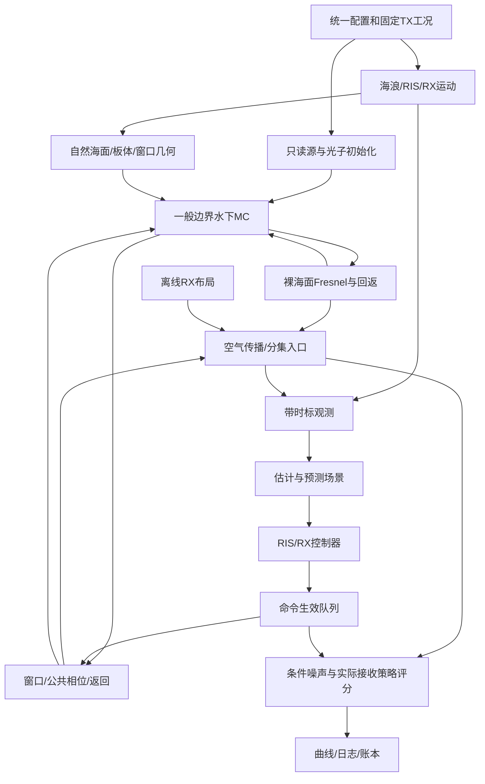

# 硕士毕设详细实施方案：固定 TX 的海面透射 RIS

日期：2026-10-28。修订依据为固定 TX、全反射对比及分阶段执行要求；阶段记录见[本轮报告索引](/C:/Users/Spidey/Desktop/code/研究执行/固定TX修订_20261028/阶段报告索引.md)。本文件为当前完整工程设计，算法推导和伪代码配套见 [硕士毕设算法详解](/C:/Users/Spidey/Desktop/code/硕士毕设算法详解.md)。

## 1. 最终系统与研究主线

系统采用“固定 TX → 水下吸收散射 → 海面透射 RIS → 空气传播 → 分集 RX”。每组测试初始化时指定光轴方向和发散角；RIS 调整公共相位，RX 选择接收分支或合并信号。

两项关联研究为：

1. **跨全反射透射补偿与有限孔径低维相位整形：** 用相位梯度恢复裸水气界面受限的目标出射通道，再优化有限接收孔径中的有效功率。
2. **相关分集与不确定性下的 RIS–RX 联合设计：** 面向共同海浪、姿态和定位误差，设计等资源接收结构、后验风险相位与更新策略。

原方向 A 改为固定光束的有效捕获、入射位置–方向关联及测试参数敏感性；方向 B/C/D 分别承担相位、估计控制和分集。原方案四的机会传输路线排除。

本轮交付包括具体配置、完整传播流程、六个算法、MATLAB 模块接口、缓存边界、曲线生成任务和两章安排。当前已执行四组解析/弹道曲线，正式全散射和带噪闭环按下文流程实施。

已有工程提供海浪、近似六自由度浮板、水下 HG/吸收 MC 和光斑统计；新增工作从完整透射边界、逐包方向与分集接收开始。原文献核验及参数摘录见 [已有研究与器件报告](/C:/Users/Spidey/Desktop/code/研究执行/阶段02_文献与器件核验.md)。联合指向/发散角、相位优化、空间–角度分集均已有研究基础；本方案围绕固定源的超临界透射、公共受限相位和相关接收低尾建立统一可验证问题。

## 2. 固定 TX 的硬约束与测试配置

### 2.1 固定含义

定义每组测试 q 的只读源配置 ξT,q，包括世界系单位光轴 d0,q、发散半角 δ0,q（rad）、发射“1”电平 P0,q（W）和固定位置或预定外生位置轨迹 pT,q(t)（m）。主测试为固定位置。时隙 k 内：

\[
d_T(k)=d_{0,q},\qquad\delta_T(k)=\delta_{0,q},\qquad
\operatorname{hash}(\xi_{T,q};k)=\operatorname{hash}(\xi_{T,q};0). \tag{P1}
\]

哈希比较的是配置及整条预定位置轨迹；外生轨迹的当前坐标可按时间读取。不同测试组可以给定不同方向、发散角；单组时间轨迹不调角、不调发散、不随 RIS 中心重瞄。高斯束内不同包的方向服从同一个固定发散分布，名义光轴保持 P1。

固定世界系光轴为本方案的主定义。原工程的机体固定光轴会随 yaw 在世界系转动，应由新增固定源模块取代该方向输出。原 TX 运动模型可供独立平移工况提取位置，方向仍由只读配置提供。

通信数据采用相同 OOK 电平约定，不引入功率分配优化。控制输出类型只包含 `PhaseCommand` 与 `RxAction`。每步检查源配置哈希、光轴和发散角，发现改变即报错。

### 2.2 建议直接落盘的工况

| 参数组 | 主工况 | 扫描或对照 |
|---|---|---|
| 源方向 | 平界面初始入射 60°、方位 90°，d0=(0,0.8660254,0.5) | 30/45/48/48.5/48.6066/49/50/55/60/65/70°；每角一组固定源 |
| 发散半角 | 0.010 rad | 0.005/0.010/0.020 rad，每组保持不变 |
| 功率、波长 | P0=1 W，λ0=532 nm | 功率保持；波长变化属于新场景 |
| 水体 | a=0.114、b=0.037、c=a+b=0.151 m⁻¹，HG g=0.924 | 用 `Table_abc` 读取其他水质；不以额外 Beer 因子重复衰减 MC |
| 几何 | 水下名义斜程 10 m，初始主光轴经过窗口下表面中心 | 同一比较组使用同一源/接收位置 |
| RX 名义位置 | 从名义参考光线的真实上表面出射点沿世界 `(0,10,10)` m 设置平台中心 | 目标名义空气倾角 45°；竖直 RX 为更大梯度需求对照 |
| 机械板 | 原 1×1 m、12 kg、厚 0.03 m、水密度 1025 kg/m³ | 机械参数变化重新计算运动 |
| 光学窗 | 方形边长 0.20 m；透明传播厚度 ds=0.03 m、ns=1.5 | 原型参考口径 14.4 mm 方形、20 mm 圆形；0.05/0.10/0.20/0.50 m 系统尺度 |
| 相位能力 | 总归一梯度上限 0.50；有限曲率码本开关 | 0.133/0.495/0.866 作为不同器件参照能力量级；水中斜入射适用性另验证 |
| 效率 | 系统模型初值 ηtarget=0.8 | 0.3/0.5/0.8/0.9、角相关包络与文献器件模式分别运行 |
| 分集 | M=2，偏置 ±0.075 m；各半径 0.07071 m，总面积 π×0.10² m² | M=4；单半径 0.10 m 孔径为资源参照 |
| RX 朝向/FOV | 朝名义来光，半角 12° | 3/6/12°；空间、角度和混合分集 |
| 运动 | 先静止，再原 3/5 m/s 运动工况 | 9/12 m/s 作为模型有效域标记下的敏感性 |
| RX 扰动 | 先固定，再给定位置/小姿态随机轨迹 | 位置标准差 0.01/0.05/0.10 m；姿态 0.5/2/5° |
| 控制 | 观测/更新周期 20 ms，最低相位驻留 40 ms | 10/20/50/100 ms；预测开关；延迟 1/5/10/50/100 ms |
| MC 精度 | 功能检查 10³–10⁴ 包 | 验证 10⁵/10⁶ 包，独立重复与尾部误差决定继续加密 |

光学窗、相位能力和大口径属于明确系统假设，机械板参数不自动证明相位器件可制造。器件仅支持平移转向时固定曲率为零；可调曲率需额外光学层或已实现码本。采用受保护透明窗口，水侧保持水接触、空气侧有干燥通道，板外海面采用自然波面。

数值起步配置取梯度速率 vb=1 s⁻¹、曲率速率 vC=0.5 m⁻¹s⁻¹；它们属于执行器假设，按 0.1/1/10 倍扫描。等效可调曲率配置先用 {0,0.5Cref,Cref,1.5Cref}，每个码字均检查整个有效面的梯度、参考出射、速率及效率。转向器件配置仅保留 C=0。测试正式计时前完成初始相位的可达过渡，记录稳定时间；计时后的所有动作受相同速率限制。

### 2.3 源模型与随机流

固定 δ0、真空波长 λ0 和水折射率 nw 后，高斯束腰半径 w0（m）取 λ0/(πnwδ0)。近轴源横向坐标服从方差 w0²/4 的二维高斯，角度服从方差 δ0²/4 的独立二维高斯，再变换到固定光轴坐标系并归一方向。

保留 `legacyRay` 模式复现原采样，主整形研究采用 `gaussianWaist` 并核对自由传播二阶矩和最小发射度。源模型选择进入场景哈希，所有方法使用同一模式。

海浪、RX 运动、MC、传感噪声和公共 EGG 分别设种子。同一场景策略共享环境与可用的配对随机数。不同传播路径的随机数通过初始包 ID、事件号和支路号定位，避免条件分支改变全局抽样次序后误称使用了同一光场。

### 2.4 本地器件参照如何进入配置

| 已核读器件原文 | 可直接借鉴的控制能力 | 本方案的配置处理 |
|---|---|---|
| [Kim 等，AO 2020](/C:/Users/Spidey/Desktop/code/对比文献/RIS器件/ao-59-24-7462.pdf)，DOI 10.1364/AO.398863 | 532 nm、14.4 mm 方形有效区、一维电控，约 ±7.643°，大角处效率降低 | 单维转向/效率包络；二维级联另计损耗；空气正入射归一动量量级约 sin7.643°≈0.133 |
| [Ma 等，OE 2026](/C:/Users/Spidey/Desktop/code/对比文献/RIS器件/oe-34-9-16119.pdf)，DOI 10.1364/OE.600252 | 20 mm 固定双 PB 透镜，532 nm 约 ±29.7°、级联目标级约 90%；平移主要提供线性梯度 | C=0 的二维转向模式；空气参照量级约 0.495；举例平台 25 mm/s，按位移计执行时间 |
| [Wang 等，OE 2020](/C:/Users/Spidey/Desktop/code/对比文献/RIS器件/oe-28-19-28672.pdf)，DOI 10.1364/OE.402691 | 横移双层几何超表面的数值分束设计，532 nm 算例至 ±60° | 偏振/分束份额模式，量级约 0.866；仿真角域、实际样机和响应时间分别标注 |

上述正弦量级用于设置敏感性档位。水侧超临界入射、基底阻抗/偏振、保护封装和大口径的效率由本系统显式模型承担。固定偏置与动态相位的合计梯度都接受上限检查。器件原文细节及对比工作簿读取证据保存在上引报告。

## 3. 全反射、Fresnel 与相位补偿

### 3.1 裸界面

定义局部水侧单位传播方向 dw、从水指向空气的单位法向 n；ci=dwᵀn=cosθi。入射/出射角 θi、θt 以 rad 表示，水/空气折射率为 nw、na。普通 Snell 与临界角为：

\[
n_a\sin\theta_t=n_w\sin\theta_i,\qquad
\theta_c=\arcsin(n_a/n_w). \tag{P2}
\]

当 (nw/na)²(1−ci²)≥1 时普通透射不可传播，T=0、R=1；反射方向 dr=dw−2ci n。可传播时定义 ct=cosθt，振幅反射系数 rs、rp 为：

\[
r_s=\frac{n_wc_i-n_ac_t}{n_wc_i+n_ac_t},\quad
r_p=\frac{n_ac_i-n_wc_t}{n_ac_i+n_wc_t},\quad
R=\tfrac12(r_s^2+r_p^2),\quad T=1-R. \tag{P3}
\]

P3 为无吸收界面的非偏振功率系数；已包含功率通量关系，不再额外乘同一折射余弦比。平面波临界角在 nw=1.333 时约 48.6066°。有限发散、海面斜率与散射要求逐包判断，不按主光轴将整帧置零。

### 3.2 透射 RIS 的有效目标级

定义真空波数 k0（rad/m）、相位面位置 ρ（2×1，m）、公共线性系数 b（无量纲）与对称曲率 C（m⁻¹）。基底侧局部方向为 us，空气侧切向方向为 qt，则：

\[
\Phi(\rho)=k_0[b^T\rho+\tfrac12\rho^TC\rho],\qquad
q_t=(n_su_{s,t}+b+C\rho)/n_a. \tag{P4}
\]

先计算 P4，再判断 ‖qt‖<1 与正向出射；同一位置共享同一梯度。没有相位的平行窗口，其总切向关系仍为 naqt=nwdw,t，因此窗口本身不能自动消除超临界限制。

以水侧 60°、空气目标 45° 的等效共面边界为例，b≈−0.447305。任意正向空气通道的最小补偿幅值约 0.154412；竖直目标需要约 1.154412。相位能力与接收目标一起决定恢复范围。

该机制依据 [Yu 等的原始广义折射论文](https://capasso.seas.harvard.edu/sites/g/files/omnuum6306/files/capasso/files/2011_yu_et_al._science.pdf)。本项目的系统贡献通过固定 TX、真实运动边界、有限口径和分集接收上的曲线验证。

### 3.3 效率与能量处理

器件模型输出目标级份额 ηtarget、反射/返回份额 ηreturn、已知其他级次份额及不可用损失，均无量纲且非负、总和不大于 1。ηtarget 来自器件数据、标量/电磁校验或标明假设的效率包络；P4 只给方向，不给转换效率。

不能把补偿后的出射包再乘裸水气面超临界 T=0，否则会错误抹掉 RIS 打开的通道。下表面普通 Fresnel、基底吸收和图案界面效率按组件口径相乘；使用整机测量效率时整体替换对应组件乘积。

## 4. 几何、自然海面与窗口

### 4.1 坐标与透明窗

定义 RIS 质心 pG（m）、主动旋转 R=Rz(yaw)Ry(pitch)Rx(roll)、机械厚度 hm（m）、法向 nR=Re3。上下中心 c−、c+（m）为：

\[
c_-=p_G-\tfrac12h_mn_R,\qquad c_+=p_G+\tfrac12h_mn_R. \tag{P5}
\]

主窗口设计取 ds=hm；下表面水→基底折射后传播到真实上表面。定义局部水方向 dw,t、基底方向 us、上下横向交点 ρ−/ρ+，有：

\[
u_{s,t}=n_wd_{w,t}/n_s,\quad u_{s,z}=\sqrt{1-\|u_{s,t}\|^2},\quad
\rho_+=\rho_-+d_su_{s,t}/u_{s,z}. \tag{P6}
\]

上下交点都接受实际有效窗 mask，边缘丢失单列。若光学基底厚度和机械外形不一致，则显式补齐其他介质段；不混用板质心、下表面和相位面原点。

A1 的目标方向从参考光线真实上表面点计算。A2 的二次相位截距调整为 bref−Cρref，使曲率初始化保留该点的正确出射方向。

### 4.2 真实裸海面求交

海面来自同一原始风浪样本 `RIS_wave_components` / `RIS_wave_field`。定义海面高度 ζ(X,Y,t)（m），一段自由程内的射线 p(s)=p+s d，s（m）为距离。求首次从水到空气的根：

\[
f(s)=p_z+s d_z-\zeta(p_x+s d_x,p_y+s d_y,t)=0. \tag{P7}
\]

法向 n∝(−∂Xζ,−∂Yζ,1)。不能只检查自由程末端的符号后假定段内没有两次交点。

实现采用按射程排序的自适应区间搜索。已知波面由复系数 Aj（m）、波向量 kj（m⁻¹）叠加，可预计算 Hbound=∑j|Aj|kjkjᵀ（m⁻¹），给出沿光线的二阶导数上界 B=dxyᵀHbounddxy（m⁻¹）。区间长度 h（m）内线性插值误差不超过 Bh²/8。

若区间两端 f 的最大值加该上界仍小于零，则该区间没有出水根；否则按左半区优先细分，直到得到首次穿越根。到达 10⁻⁶ m 求交容差仍无法区分的切触样本记为数值不确定并加密，不静默丢弃。平界面使用解析求交。

### 4.3 安装后的完整场景

自然海面、有限机械板/封装外壳、窗口下表面和内部光学面均返回候选物理事件，选择前向射程最小者。封装占据的区域按结构域定义取代相应自然水气面；板外继续使用自然海面。

路径标签至少分为 `viaRIS`、`naturalBypass`、`opaqueBody`、`reflectedReturn`。没有命中有限板面不等于光子消失：板外光仍可能通过自然海面到达 RX。主系统功率包括已建模旁路，并另报 RIS 路径功率。若实际硬件采用挡板抑制旁路，在几何中建模并注明。

真实裸海面采用自然 ζ 与法向；同一运动平面上的裸边界仅作机理诊断。两类数据不能混成同一个裸海面标签。

空气包先检查到接收入口/天空记录面之前是否再次与自然海面或结构相交。低仰角重入海面时，交换两侧介质按空气→水 Fresnel 分配，透入水中的剩余份额回到输运队列；强制忽略该路径仅用于另行标记的无遮挡空气段简化模式。累计跨界通量与最终留在空气/到达 RX 的能量分别报告，避免往返穿越被重复当成最终出射。

## 5. 完整水下 MC 与反射回返

### 5.1 输运流程

复用既有水下物理方法：自由程为 −lnU/(a+b)，碰撞后剩余权重乘 b/(a+b)，HG 更新方向，轮盘记录有符号权重变化。边界先于碰撞时，先处理边界，不再扣虚构的碰撞吸收。

新内核支持自然界面和窗口事件；原 `wris_mc` 的首次平面外终止行为用于回归对照，不能直接充当完整裸海面/旁路输运。

```text
launch packets using immutable SourceCase
activeWaterPackets = launch
while active packets remain:
    sample collision distance and find first physical boundary
    compare collision, physical boundary, domain exit and path-length limit
    if domain exit or numerical limit is first:
        advance; log escape or truncation; terminate this residual weight
    elif collision is first:
        advance; implicit absorption; HG scatter; roulette / truncation
    else:
        advance exactly to boundary
        if natural water-air interface:
            compute local Fresnel T/R or TIR
            send weight*T to air propagation
            continue weight*R with reflected direction in water
        if optical port:
            trace window, phase and known internal return paths
            send target/known output orders to air
            enqueue returned water weights; log component losses
        if opaque housing:
            log blocked power
trace each air output to first RX / scene boundary / escape event
return air-to-water transmitted branches to the water queue
score actual RX ingress and FOV without counting intermediate crossings twice
close energy ledger per initial packet and scene
```

### 5.2 回返与截断

裸界面全反射时权重保留，方向反射回水中；若后来散射并再次到达界面，重新按局部角度处理。每次透射空气支消耗原包的一部分，水中只保留反射剩余份额。

窗口普通界面也可有内部反射。首版目标级模型若将非目标能量计入不可用损失，须明确返回系数；增加相位相关返回后，追踪它对后续水下出射的影响。

建议最大传播路径 200 m、最大散射 1000 次、最大边界事件 16 次起步，分别加倍复核。水下计算域向源下方和侧方留足余量，初值可取源下 20 m、横向 50 m；逃逸能量独立记录并扩域检查。边界后以 10⁻⁸–10⁻⁶ m 的受控偏置避免同一点自交，偏置变化应收敛。

完整裸链路功率从实际出射样本计算，不能预置为零。零散射弹道基线和单次界面透射率则按其物理条件自然出现零值。

### 5.3 数据结构

设 N 为当前有效包数，Nt 为时刻数，M 为分支数，S 为联合场景数。

| 类型 | 主要字段与维度 | 单位/用途 |
|---|---|---|
| `SourceCase` | `directionWorld[3,1]`、`divergenceRad[1]`、`positionWorldM[3,1]`、`powerOnW`、`caseHash` | 单位向量、rad、m、W；只读 |
| `PacketCloud` | `id[N,1]`、`branchId[N,1]`、`positionM[N,3]`、`direction[N,3]`、`weight[N,1]`、`medium`、`pathTag` | m/无量纲；保留原发射总数 N0 |
| `BoundaryEvent` | `distanceM[N,1]`、`pointM[N,3]`、`normal[N,3]`、`type`、`portId` | 最近物理事件 |
| `PhaseCommand` | `b[2,1]`、`C[2,2]`、`issuedTimeS`、`activationTimeS`、`codewordId` | 无量纲、m⁻¹、s；已量化执行值 |
| `RxDesign` | `offsetM[M,3]`、`axisBody[M,3]`、`radiusM[M,1]`、`fovHalfRad[M,1]`、`splitFractions` | m、单位向量、m、rad、份额 |
| `RxAction` | `selectedBranch` 或 `combineWeights[M,1]`、时标、切换状态 | 实际执行的信号处理 |
| `Observation` | `measurementTimeS`、`arrivalTimeS`、`value[nz,1]`、`cov[nz,nz]`、`valid` | 传感器单位显式标注 |
| `Posterior` | `mean[4,1]`、`cov[4,4]`、`timeS`、RIS 姿态后验 | m、m/s 及相应混合协方差 |
| `FrameResult` | 逐路径/分支功率 W、两比特噪声 A²、实际 Γ/BER、损失与命令日志 | 真值评分，不直接输入控制器 |

MC 包位置/方向用 N×3 行向量；位姿和控制向量用列向量。世界转局部为 `(p−center)*R`，接口处统一处理。

### 5.4 能量账本

H=1 时，初始权重加轮盘有符号增量，应等于最终已出射、介质吸收、封装阻挡、非目标级/不可用损失、域逃逸与数值截断之和。窗口中间功率、反射中间权重不能再次加到终态总和。

功率统一乘 P0/N0，不按命中数归一。每次界面 `transmitted+returned+loss=incoming`；每份空气输出对所有实体入口的归属/分光和不大于 1。

## 6. 分集 RX、电噪声与状态信息

### 6.1 入口几何与耦合

RX 随平台位姿生成各真实孔径平面和观察轴，执行前向求交、圆孔径与 FOV 接受。接收器朝外观察轴与负传播方向比较，避免正负法向错误。

独立孔径采用最先入口与外壳遮挡，FOV 重叠不直接重复收光。共享光瞳先积分一次，再按分光比例分配；偏振分束分别记录偏振份额。光学串扰用非负功率矩阵且列和≤1，电串扰使用电域混合/协方差，分别建模。

各分支使用同一海浪、源、公共 H 与出射光场。统计支路增益相关、所有分支共同低功率和条件尾部依赖；未提供空间相关依据时不独立抽取每支路 EGG。

### 6.2 背景与电评分

定义背景谱辐亮度 Lλ（W·m⁻²·sr⁻¹·nm⁻¹）、滤光带宽 Δλ（nm）、孔径面积 Am（m²）、背景透射 Tb,m 与 FOV 半角 Ψm，均匀背景的功率为：

\[
P_{bg,m}=L_\lambda\Delta\lambda A_m\pi\sin^2\Psi_m\,T_{b,m}. \tag{P8}
\]

定义响应度 Rm（A/W）、电子电荷 qe（C）、电带宽 Be（Hz）、暗电流 Id,m（A）、玻尔兹曼常数 kB（J/K）、温度 T（K）、负载 RL（Ω）、放大器噪声谱密度 ia（A/√Hz）。输入电流方差为：

\[
\sigma_m^2=2q_eB_e[R_m(P_m+P_{bg,m})+I_{d,m}]
+4k_BT B_e/R_L+i_a^2B_e. \tag{P9}
\]

两比特分别取其信号功率。合成基准初值为 Rm=0.4 A/W、Be=10 MHz、T=300 K、RL=1 kΩ、Id=1 nA、Δλ=1 nm、ia=2 pA/√Hz；Lλ=10⁻³ W·m⁻²·sr⁻¹·nm⁻¹，并按 0.1/1/10 倍扫描。以上为可复现合成参数，器件实测模式用对应数据表整体替换。

主方案用 SC，并按观测估计电评分选择。扩展的线性合并用估计权重，真值评分沿用实际权重。误码与归一 Γ 定义详见算法文件 B4–B6。

### 6.3 可观测与时序

控制器读取带时标 RIS IMU、平台定位/姿态与导频质心或分支功率。成像误差转为米需要已知距离/标定；缺失观测保留缺失状态。

源固定后，RIS 控制信息在表面控制器与空中 RX 间交互，主控制链无需向 TX 下发调角/发散命令。仿真真值与估计结构分离：`w2a_observe` 是真值到观测的唯一边界，求解器只使用观测后验与预测模型。

事件顺序为：执行已生效命令 → 更新真实位姿 → 物理传播/传感 → 排队观测 → 处理已到达历史观测 → 求解并排入未来命令 → 记录实际评分。零延迟模式明确先测后控的子时刻。

### 6.4 RX 运动、观测和滤波的可复现初值

固定平台工况首先用于解析回归。随机运动工况用平稳零均值 OU 偏移叠加名义位置/小姿态，OU 为对照扰动模型。对一个标量分量 x，标准差 σx、相关时间 τx（s）、步长 Δt（s）、独立标准正态样本 εk，精确离散更新为 `x[k+1]=a*x[k]+σx*sqrt(1−a²)*εk`，其中 `a=exp(−Δt/τx)`，初值 `x[0]~N(0,σx²)`。位置三轴主值 σx=0.05 m、τx=1 s；roll/pitch/yaw 主值 2°、τx=0.5 s，度先转 rad。扫描沿第 2.2 节；各方法读取同一预生成轨迹，控制器不改变轨迹。若需要轴间相关，将 εk 替换为已给相关矩阵的 Cholesky 变换样本，并保持各分量方差。

功能验证的测量位置标准差先取 0.01 m、RIS 姿态标准差 0.2°，20 ms 采样，观测到达延迟 5 ms；独立缺失概率主值 0，扫描 0/0.05/0.20，连续缺失另设固定持续时间。算法 A4 的过程参数 qa=0.01 m²/s³，初始速度标准差 0.1 m/s，位置协方差由首测误差设置。使用 OU 真值和常速度估计的模型差异由覆盖率及残差验证，并与不预测反馈比较。成像导频试验需先给焦距/标定矩阵和光子噪声；仅有功率时使用明确功率观测模型与预算内探测。

## 7. 六算法的调用与工程落点

六个算法完整推导见独立算法文件。所有接口都以固定 `SourceCase` 为输入，不返回可修改源的动作。

| 算法 | 输入及来源 | 输出及单位 | 调用位置与核心过程 | 验证 |
|---|---|---|---|---|
| A1 补偿 | 固定方向、估计位姿、s0[2,1]、当前命令、器件约束 | b[2,1] 无量纲、C=0、可达标志 | 每次初始化/线性基线；三圆盘投影，有限孔径候选评分 | 临界角、目标梯度、速率可达与空集 |
| A2 整形 | 相位面包 N×3、固定 RxDesign、有限曲率码本 | b、C[2,2] m⁻¹、器件码字和 Γ | A1 后，先优化线性再遍历曲率/轮询 | 同位置共同相位、硬孔径、量化、衍射 |
| A3 稳健 | 后验与 S 个联合场景、预测银行、α | 稳健相位、v[S,1] 与低尾 | A2 的风险评分内层；场景积分/排序收敛 | 协方差归零、场景加倍、独立尾部 |
| A4 更新 | Observation、Posterior、已执行历史、队列 | 后验、PhaseCommand、RxAction | 每控制周期；滤波、可选预测、保持/更新风险比较 | 时标因果、实际选择评分、缺失恢复、超时 |
| A5 分集 | 共同出射银行、面积 m²、跨度 m、FOV rad、噪声 | M、偏置/朝向/半径/FOV 与接收策略 | 离线有限布局筛选与局部精化 | 等资源、归属、共同低尾、切换代价 |
| A6 联合 | 候选布局、相位、后验场景和共同目标 | 固定结构与 RIS/RX 策略 | 离线交替 A3/A5，在线冻结结构执行 A4 | 接受目标单调、小例穷举、分块消融 |

默认求解：梯度步长 0.005 减半至 10⁻⁴；εJ≥10⁻³ 且超过数值误差；A1 投影≤100 次；A2≤200 次评分；A3≤80 次；A6≤3 个外循环。达到预算保留已验证最好动作，记录停止原因。

控制周期 20 ms 的剖析目标为求解 15 ms 内完成。分为离线算法设计、显式假设计算时延的因果仿真与实测截止期重放三种模式，分别报告。在线超时使用保持策略，不把离线计算能力当成已达实时性能。

## 8. MATLAB 逐文件实施方案

### 8.1 实际已有文件

| 绝对路径 | 可复用内容与用途 |
|---|---|
| `C:/Users/Spidey/Desktop/code/W_RIS/wris_config.m` | 现有 1 W/532 nm/水质/MC 基础参数与有限板面工况 |
| `C:/Users/Spidey/Desktop/code/W_RIS/wris_reference.m` | 初始下表面、光束坐标与 10 m/入射角几何 |
| `C:/Users/Spidey/Desktop/code/W_RIS/wris_geometry.m` | 姿态和评分面坐标约定 |
| `C:/Users/Spidey/Desktop/code/W_RIS/wris_intersect.m` | 倾斜矩形平面求交方法 |
| `C:/Users/Spidey/Desktop/code/W_RIS/wris_mc.m` | 已核查自由程、隐式吸收、HG 与账本；作为回归参考 |
| `C:/Users/Spidey/Desktop/code/W_RIS/wris_tx_motion.m` | 独立测试中可提取预定平移；世界系方向由新模块固定 |
| `C:/Users/Spidey/Desktop/code/W_RIS/wris_egg.m` | 公共均值归一 EGG；主动态机理 H=1，边际扫描复用 |
| `C:/Users/Spidey/Desktop/code/W_RIS/wris_metrics.m` | 光斑加权质心和二阶矩 |
| `C:/Users/Spidey/Desktop/code/sea_wave/RIS_float.m` | 既有近似六自由度运动 |
| `C:/Users/Spidey/Desktop/code/sea_wave/RIS_rotation.m` | 主动旋转/四元数约定 |
| `C:/Users/Spidey/Desktop/code/sea_wave/RIS_wave_components.m` | 公共风浪分量 |
| `C:/Users/Spidey/Desktop/code/sea_wave/RIS_wave_field.m` | 真实裸海面高度/梯度 |
| `C:/Users/Spidey/Desktop/code/fig3-7/Table_abc.m` | 水质 a/b/c |
| `C:/Users/Spidey/Desktop/code/fig3-7/Hen_Green.m` | g=0.924 的 HG 采样 |

当前 `wris_run` 引用的历史测试源码缺失事项保留，新工程建立独立物理验证入口。本轮不修改这些既有 `.m` 文件。

### 8.2 新工程目录与模块接口

以下文件均拟新增于绝对目录 `C:/Users/Spidey/Desktop/code/W2A_RIS/`；本轮交付的是这些文件的实现设计。

| 文件/函数 | 输入 | 输出 | 关键实现 |
|---|---|---|---|
| `w2a_config.m` | profile、固定测试 ID | cfg 与只读源配置 | 集中配置、源哈希、器件/边界模式 |
| `w2a_run.m` | 固定 case 清单、种子 | 结果目录/清单 | 测试先行、逐场景、汇总报告 |
| `w2a_fixed_tx.m` | SourceCase、时间轴 Nt | pT[3,Nt] m、固定 d0、δ0 与 hash | 每时刻不变量；源与控制动作分离 |
| `w2a_source.m` | λ0/nw、固定 δ0、N0/seed、源位姿 | 初始 PacketCloud | legacy/高斯相空间；不按 RIS 重瞄 |
| `w2a_motion.m` | 原机械配置、独立种子、时间轴 | RIS/RX 真值位姿 | 调 RIS_float，RX 轨迹按场景给定 |
| `w2a_geometry.m` | 位姿、窗口/结构配置 | 上下表面、光学域、RX 平面 | 统一原点与结构域 |
| `w2a_scene_intersect.m` | p/d、最大自由程、冻结场景 | 最近 BoundaryEvent | 海面/有限板体/窗口/旁路最先事件 |
| `w2a_surface_root.m` | 射线、海浪分量、t、容差 | 首次出水根与法向 | P7 自适应首根及数值不确定标志 |
| `w2a_fresnel.m` | 局部方向、n1/n2 | T/R、折/反方向、tir 标志 | P2/P3，法向反转与介质方向正确 |
| `w2a_water_mc.m` | 源包、场景、边界模式、相位/seed | 空气输出、窗口入射、返回/损失 | 新一般边界调度；复用旧输运物理方法 |
| `w2a_window_phase.m` | 端口入射、基底/相位/效率 | 目标空气包、水中返回、各级损失 | 真实上下交点、内部事件、P4/P6 |
| `w2a_air_rx.m` | 空气包、RX 位姿/设计 | Pm[M,1] W、归属和损失 | 空气传播、入口/FOV/遮挡、串扰/分光 |
| `w2a_noise.m` | Pm、背景与硬件 | 两比特 Cn[M,M] A² | P8/P9 与可选电相关 |
| `w2a_receive.m` | 到达的导频估计、实际 RxAction、信号/噪声 | 选择/权重、Γ/BER、切换损失 | 估计决定动作，真值只评分 |
| `w2a_solve_compensation.m` | A1 接口 | 线性 PhaseCommand | 可行圆盘与候选目标 |
| `w2a_solve_phase.m` | A2 接口 | b/C、码字与日志 | 公共低维码本/轮询 |
| `w2a_solve_robust_phase.m` | A3 接口 | 稳健命令、低尾 | 多场景聚合，复用相位搜索 |
| `w2a_solve_layout.m` | A5 接口 | 固定 RxDesign | 面积/跨度/通道/FOV 受限 |
| `w2a_solve_joint.m` | A6 接口 | RIS/RX 设计与策略 | 分块共同目标接受 |
| `w2a_observe.m` | 真值与传感配置 | Observation 到达队列 | 噪声/量化/缺失/时标 |
| `w2a_estimate.m` | 已到达观测与历史相位 | Posterior | 滤波、固定滞后、可选简单预测 |
| `w2a_controller.m` | Posterior、预测银行、保持动作 | PhaseCommand/RxAction | A4、截止期和最低驻留 |
| `w2a_command_queue.m` | 命令、设备速率、当前时刻 | 实际已执行命令/状态 | 生效时间和动作相关执行过程 |
| `w2a_predict_bank.m` | 固定源、后验场景、校准模型 | 预测包/代理 | 不读未观测当前真实包 |
| `w2a_cache.m` | 全部依赖与版本、种子 | 分层缓存与 hash | 源/几何/回返相关性失效规则 |
| `w2a_simulate_frame.m` | 真值、已执行命令、源与场景 | FrameResult | 完整 frozen-time 光学评分 |
| `w2a_validate.m` | 模块/物理输出 | 验证表与失败定位 | 守恒、临界角、固定源、因果与精度 |
| `w2a_wavecheck.m` | 已知源复场/正高斯相空间、光学区/相位 | 传播场与孔径积分 | 小尺寸 Fresnel/角谱对照 |
| `w2a_export.m` | 帧结果、cfg、求解日志 | MAT/CSV/PNG/清单 | 真实零值、模型标签、独立种子与版本 |

单接口字段、物理单位和调用契约按第 5 节与算法文档执行；不以匿名黑箱函数替代传播评分。

### 8.3 调用关系



固定源只有配置输入边，没有来自控制器的写入边。

## 9. 缓存、必须重算与计算规模

| 改变量 | 可以复用 | 必须更新 |
|---|---|---|
| 同组相位 b/C | 水下首次遇到受控端口前的路径前缀 | 目标级方向/效率、空气与接收；相位相关返回时重新追踪返回支路 |
| 仅 RX 位姿/布局/FOV | 适用的完整出射场 | 入口归属、遮挡、分光、背景及电评分 |
| RIS 位置/姿态、自然海面 | 固定源参数、随机流与不受影响前缀 | 当前边界求交和受影响输运；不能刚体搬移旧命中分布 |
| 光学窗/基底参数 | 同一下表面入射集合 | 内部折射、截断、相位与返回 |
| 板尺寸/质量 | 同一风浪分量 | 水动力、结构几何和传播 |
| 公共 H | H=1 的几何输运 | 信号缩放和信号相关噪声；共同样本所有支路共享 |
| 背景/电噪声 | 出射/接收光功率 | 相应背景积分、噪声、实际接收评分 |
| 下一测试组的方向/发散角 | 一致的随机流设计 | 新源包与水下输运；属于独立场景，不是在线控制 |
| α/成本权重 | 同一有效场景银行 | 风险聚合及最优动作；新场景超出模型域时更新银行 |

相位相关的回返水中场不能默认缓存为不变通道。首版可使用显式固定返回系数模型验证控制算法，再增加返回系数依赖相位的器件模式作敏感性。

100 万包的七个 double 位置/方向/权重字段约 56 MB，另有 ID/路径/状态开销；128 个完整银行会达到数 GB。采用按场景和包块流式求和，RX 分支仅 M=2/4，避免保存全 N×M×S 张量。

取消 TX 动作搜索后，主要开销是 Kφ×S×N×M 的相位/接收评分与回返输运。先检查可达性，用少量包/码字筛选，再对入围动作独立高精度复核。预测模型银行/代理需验证能量、低尾、门限误判与动作排序，不只验证拟合均方误差。

## 10. 全反射曲线与正式实验矩阵

### 10.1 本轮已生成的模型曲线

数据、参数与图注见 [曲线说明](/C:/Users/Spidey/Desktop/code/研究执行/固定TX修订_20261028/curves/曲线说明.md)。


图 C1：裸平面普通透射与相位边界目标级。效率 0.8 为假设；蓝线零值表示 45° 目标超出配置梯度可行域。裸界面曲线为自然折射方向总透射，接收端比较使用下一图的相同 RX。


图 C3：每组固定发散角 0.01 rad、16384 个弹道包，指数权重使用消光系数。60° 时裸界面弹道功率为零；线性与二次相位的目标跨界功率均约 0.114905 W，双孔径总功率分别约 0.032276 W 和 0.114905 W。

单工况加密检查中，60° 线性相位的接收功率由 16384 包的 0.03228 W 变为 65536 包的 0.03354 W，相差约 3.9%；按逐初始包贡献估算的正态近似 95% 半宽分别为 0.00105 W、0.00053 W。当前图用于机制与量级比较，正式 F8 逐曲线独立重复和加密，再报告算法间的小差值。

C2 给出不同出射目标的梯度要求；C4 在固定世界光轴下重放既有运动。当前四图使用等效相位平面和显式效率，未包含完整散射、有限基底内部回返或带噪控制。正式曲线按下一表生成。

C4 的公共二次相位在部分时刻出现接收低谷：该相位按参考目标的局部曲率构造，有限双孔径之间存在空隙；局部近似的落点变化可能失去捕获。正式 A2 以真实孔径评分优化，并始终保留已优化线性候选；A3 再评价不确定性下的低尾。当前图中的几何构造参照与正式优化算法分别命名。

### 10.2 正式输出 F1–F8

| 曲线组 | 输入、横轴与扫描 | 对照与输出 | 证明内容 |
|---|---|---|---|
| F1 平界面临界曲线 | 入射角 0–80°，临界附近加密；平面波与三个固定发散角分开 | 裸水气、无图案平行窗、相位补偿；目标级跨界功率/有效透射率 | 恢复超临界目标通道及其梯度/效率条件 |
| F2 同一 RX 的接收曲线 | 固定 RX 位置/资源，每组固定角度和发散 | 真实裸海面、无图案窗、冻结 RIS、A1/A2；Psky、PRX、Γ/BER | 跨界恢复与接收对准/整形分层 |
| F3 相位能力图 | θi×gmax、目标角、相位量化/效率 | 不可达比例、有效透射角域、损失分解 | 系统恢复范围、所需梯度和器件代价 |
| F4 运动功率与中断 | 固定 TX，公共独立海浪/RX 轨迹；风速/风向扫描 | 裸自然海面、无图案窗口、冻结/动态线性、A2/A3；时间曲线、低分位/OP | 动态全反射、捕获和共同失锁 |
| F5 相关分集 | 等总面积 1/2/4 路、朝向/FOV、共享/部分相关扰动 | 单孔径、空间、角度、混合；相关与联合低尾、背景噪声和资源表 | 分集互补与共同扰动限制 |
| F6 风险与更新 | 观测噪声、缺失、总信息年龄和周期 | 当前反馈/常速度预测、周期/事件更新、理想状态参照；RMSE、覆盖率、更新次数、OP | 方向 C 的可测作用与开销 |
| F7 统一目标 | 相同固定源、同器件、同信息/计算预算 | 单点、仅功率、分别设计、A6；均值/低尾、动作变化和复杂度 | RIS–RX 协调必要性 |
| F8 精度和外测 | 包数、截断/域范围、码本/初值、未见整轨迹 | 账本、误差、排序、置信区间、耗时/内存 | 可复现性、尾部可靠性和适用域 |

F1/F2 是本项目跨全反射使能的核心对比，不能省略裸自然海面与无图案窗口。A2–A6 的额外算法收益同时与同器件的冻结/优化线性方法比较。

### 10.3 归一化、零值与统计

跨界有效透射率分母使用到达对应界面的入射功率；端到端功率使用初始 P0，两者分别报告。板外旁路和 viaRIS 路径分开累计。

裸基线低于可分辨水平时，报告绝对接收功率、有效角域和中断差值，不通过给零值加任意 ε 制造 dB 增益。零命中记录初始包数、样本能量和加密结果；完整 MC 保留散射/回返出射。

每个方法在同一环境轨迹上配对；训练/验证/测试按整条轨迹分开。先 5–10 条轨迹估计成本与方差，正式从约 30 条起步，按低功率事件与置信区间继续增加。帧不当作独立重复。

MC 误差与环境误差分别记录；轨迹级配对 bootstrap 评价策略差值。时间统计使用均匀采样，已有选定快照只解释机理。

## 11. 分步实现与验收

| 开发步 | 具体工作 | 必须通过的检查 |
|---|---|---|
| D0 固定源 | 建立 SourceCase、场景哈希和 fixed_tx；保留原代码 | 同组 d0/δ0 不变；不同参数只在测试组切换 |
| D1 解析边界 | Fresnel、相位通道、反射方向、平面求交 | 正入射 R、临界角、b=0、60°→45°、功率份额闭合 |
| D2 完整水下事件 | 自然海面首根、有限结构、回返和旁路 | 多根首交、TIR 返回、散射后二次出射、窗口边界与截断收敛 |
| D3 接收评分 | 实际孔径/FOV、噪声与 SC | 每包归属、遮挡/分光、均匀照明热噪声解析例 |
| D4 A1/A2 | 可行补偿与公共低维整形 | 不可达标志、优化线性强基线、公共相位、场/MC 对照 |
| D5 A5 | 有限离线分集结构 | 总面积/跨度/FOV/通道表，相关与共同失锁 |
| D6 A3/A4 | 后验场景、估计、队列和更新 | 无未来信息、真实已执行动作评分、缺失/迟到/超时处理 |
| D7 A6 | 离线 RIS–RX 分块与在线冻结结构 | 固定场景接受目标不降、小例穷举、相同预算消融 |
| D8 正式 F1–F8 | 独立重复、加密与外测 | 数值/统计误差、曲线标签、参数/源码/种子清单 |

每一步形成短报告：本步输入版本、修改/新增文件、执行命令、实际数值、未通过项与下一步依赖。建议测试文件为 `W2A_RIS/tests/W2AFixedTxTest.m`、`W2ABoundaryTest.m`、`W2AEnergyTest.m`、`W2AControlTest.m`，围绕物理不变量和因果性设计。

推荐先完成 D0–D3 的可回归物理链路，再完成 A1/A2 与使能曲线，随后加入分集、后验风险和联合框架。学习预测、完整飞控和微纳器件设计在核心结果稳定后扩展。

## 12. 论文两个核心章节

### 第一核心章：固定 TX 下的全反射补偿与有限孔径相位整形

1. 固定源、运动端口与真实裸海面对照模型。
2. 裸界面全反射及公共相位的目标通道可行域。
3. 有限窗口捕获、散射联合位置–方向和能量分解。
4. A1 可行线性补偿与 A2 低维公共相位求解。
5. F1–F4、F8 的能力曲线、强基线与物理验证。
6. 输出给第二章的传播银行、相位接口和器件约束。

### 第二核心章：相关分集与不确定性下的 RIS–RX 联合控制

1. 独立/共享入口、FOV、噪声与相关共同失锁模型。
2. A5 等资源空间–角度接收设计。
3. 可观测后验、延迟尺度和简单预测必要性。
4. A3/A4 低尾相位与事件触发执行。
5. A6 固定源下的 RIS–RX 联合目标与分块求解。
6. F5–F8 的同预算消融、轨迹外测和复杂度。

与参考毕设三至五章对应，本课题保留“模型→求解→动态性能”的连续结构；已有海浪/HG/EGG 基础明确复用，新工作集中在跨全反射端口、受限相位、相关分集和可实现控制。每章安排约 7–10 组回答不同问题的图表，合并重复指标展示。

## 13. 当前交付、状态和证据

当前 `.md` 方案及算法设计已按固定 TX 重构，四组模型曲线与数据已生成。原 MATLAB 源码由本轮哈希基线保护，新增 W2A_RIS 函数表为后续开发任务。

本轮阶段报告和曲线保存在 [固定 TX 修订目录索引](/C:/Users/Spidey/Desktop/code/研究执行/固定TX修订_20261028/阶段报告索引.md)。修改前用户版本保存在该目录的 `evidence/修订前_硕士毕设详细实施方案.md`。

物理参照包括本地三份器件论文与上一轮已核读材料。近场器件效率、可调曲率、透明窗口封装和毫秒级执行响应在配置中分别标注证据/假设。当前全反射曲线直接展示条件成立时恢复目标通道的模型结果，后续全散射/器件约束结果按同一口径扩展。
